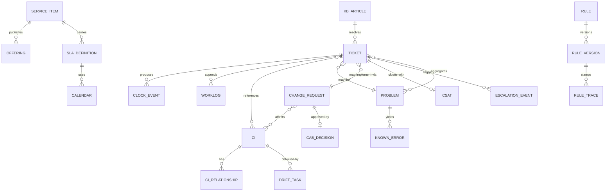

# 05 · Logical Data Model

> ⚠️ ASSUMPTION — entities/keys/cardinalities are pack design; borrowed
> vocabulary (RFC 5322 Message-ID, SSO subject ids) is normative and cited
> in [`../SOURCES.md`](../SOURCES.md).

Technology-neutral; history tables are append-only per ADR-0002.

## ER view (logical)

## Entity groups

### Portal & catalog

| Entity | Key | Notable attributes |
|---|---|---|
| service_item | item_id | category, entitlement scope, fulfillment type, sla_definition ref |
| offering | (item_id, version) | effective-dated published form |
| kb_article | article_id | visibility scope, linked items, revision history |
| announcement | id | audience scope, validity window |
| sla_definition | (service, version) | response/resolution targets, calendar ref, thresholds `(A)` |
| calendar | (id, effective range) | service hours, holidays (BR-05) — **immutable once used** |

### Ticketing (history append-only per ADR-0002)

| Entity | Key | Notable attributes |
|---|---|---|
| ticket | ticket_id | type, category, impact/urgency, priority, state (SM-S1), requester, entitlement scope, channel, provenance, links {cis, problem, change, known_error} |
| clock_event | event_id | clock kind (start/pause/resume/stop/warn/breach), ts, reason, calendar ref — **the clock's state is the fold** (NFR-002) |
| worklog | event_id | visibility (internal/requester), author, body — append-only |
| escalation_event | event_id | functional/hierarchical, threshold, notify roles |
| rule_trace | event_id | rule id, version, actions, stamp on ticket (BR-14) |
| csat | (ticket_id, round) | score, comment, sent_at |

### Problem & change

| Entity | Key | Notable attributes |
|---|---|---|
| problem | problem_id | status (SM-S2), root cause, links to tickets (≥ BR-08 threshold) |
| known_error | ke_id | cause, workaround, affected CIs, publication scope |
| change_request | rfc_id | risk class (standard/normal/emergency), CIs, backout plan, window, outcome, post-review ref (BR-09) |
| cab_decision | (rfc_id, round) | approvers, decision, ts — append-only |

### Configuration

| Entity | Key | Notable attributes |
|---|---|---|
| ci | ci_id | type, state (planned/building/active/retired), attributes; **retire not delete** (BR-10) |
| ci_relationship | (from, to, type) | effective range; typed |
| ci_state_history | event_id | effective-dated view source |
| drift_task | task_id | observed vs. recorded, source feed, reconcile outcome |

### Automation & channels

| Entity | Key | Notable attributes |
|---|---|---|
| rule / rule_version | rule_id / (rule_id, version) | conditions, actions, dry-run support (FR-017) |
| channel_message | channel + native id (e.g. RFC 5322 Message-ID) | raw payload ref, auth verdict, quarantine state (BR-13) |
