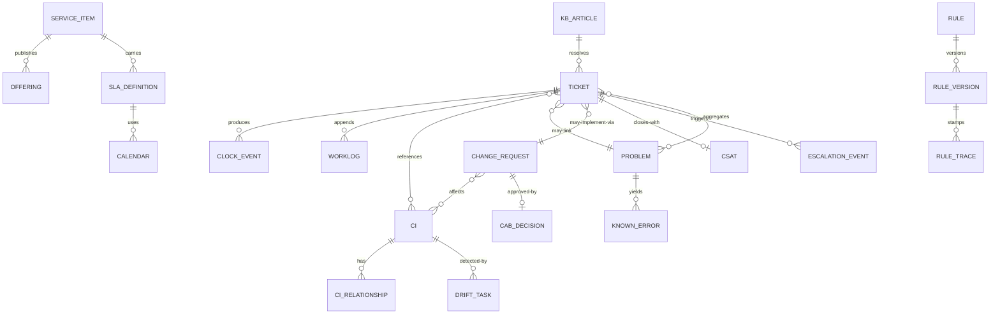

# 05 · Logical Data Model

> ⚠️ ASSUMPTION — entities/keys/cardinalities are pack design; borrowed
> vocabulary (RFC 5322 Message-ID, SSO subject ids) is normative and cited
> in [`../SOURCES.md`](../SOURCES.md).

Technology-neutral; history tables are append-only per ADR-0002.

## ER view (logical)

## Entity groups

### Portal & catalog

| Entity | Key | Notable attributes |
|---|---|---|
| service_item | item_id | category, entitlement scope, fulfillment type, sla_definition ref |
| offering | (item_id, version) | effective-dated published form |
| kb_article | article_id | visibility scope, linked items, revision history |
| announcement | id | audience scope, validity window |
| sla_definition | (service, version) | response/resolution targets, calendar ref, thresholds `(A)` |
| calendar | (id, effective range) | service hours, holidays (BR-05) — **immutable once used** |

### Ticketing (history append-only per ADR-0002)

| Entity | Key | Notable attributes |
|---|---|---|
| ticket | ticket_id | type, category, impact/urgency, priority, state (SM-S1), requester, entitlement scope, channel, provenance, links {cis, problem, change, known_error} |
| clock_event | event_id | clock kind (start/pause/resume/stop/warn/breach), ts, reason, calendar ref — **the clock's state is the fold** (NFR-002) |
| worklog | event_id | visibility (internal/requester), author, body — append-only |
| escalation_event | event_id | functional/hierarchical, threshold, notify roles |
| rule_trace | event_id | rule id, version, actions, stamp on ticket (BR-14) |
| csat | (ticket_id, round) | score, comment, sent_at |

### Problem & change

| Entity | Key | Notable attributes |
|---|---|---|
| problem | problem_id | status (SM-S2), root cause, links to tickets (≥ BR-08 threshold) |
| known_error | ke_id | cause, workaround, affected CIs, publication scope |
| change_request | rfc_id | risk class (standard/normal/emergency), CIs, backout plan, window, outcome, post-review ref (BR-09) |
| cab_decision | (rfc_id, round) | approvers, decision, ts — append-only |

### Configuration

| Entity | Key | Notable attributes |
|---|---|---|
| ci | ci_id | type, state (planned/building/active/retired), attributes; **retire not delete** (BR-10) |
| ci_relationship | (from, to, type) | effective range; typed |
| ci_state_history | event_id | effective-dated view source |
| drift_task | task_id | observed vs. recorded, source feed, reconcile outcome |

### Automation & channels

| Entity | Key | Notable attributes |
|---|---|---|
| rule / rule_version | rule_id / (rule_id, version) | conditions, actions, dry-run support (FR-017) |
| channel_message | channel + native id (e.g. RFC 5322 Message-ID) | raw payload ref, auth verdict, quarantine state (BR-13) |

## 4. Integrity constraints (normative)

Constraints the model must enforce. They are numbered and stable, and each
names the `BR-`/`FR-` identifiers it enforces.

The closing sentence records which of them are enforced **in the store** rather
than in application code. That is a claim the pack makes about itself, not a
verified property — application discipline is exactly what a later change
bypasses, which is why the distinction is drawn rather than left implied.

| # | Constraint | Enforces |
|---|---|---|
| 1 | `TICKET_EVENT` is append-only: comments, classifications, assignments, state changes and clock events are events, and a correction is a new event **referencing** the original | BR-07, ADR-0002 |
| 2 | A ticket has exactly one type (incident \| service_request); a problem or a change is a separate lifecycle **referenced**, never a re-typed ticket | BR-02 |
| 3 | Duplicate intake (same alert signature or same RFC 5322 thread) is linked or merged with provenance kept; nothing lives outside the backbone | BR-01, ADR-0001 |
| 4 | Every `CLOCK_EVENT` of kind `pause` carries a reason; breach is computed from events and is never edited | BR-04 |
| 5 | A business calendar is effective-dated, and a calendar change never rewrites a closed ticket's clock history | BR-05 |
| 6 | Priority is derived from the matrix at creation; an agent may override **downward** only, and only with a recorded reason | BR-03, BR-03a |
| 7 | A ticket without an owner after the routing window escalates automatically, and the escalation appends events notifying the matrix by role | BR-06 |
| 8 | A ticket or RFC referencing a CI holds a registry id; a CI that is still referenced cannot be hard-deleted — retire instead | BR-10, ADR-0004 |
| 9 | A security-classified ticket is visible only to explicit membership; an entitlement query never falls back to a broader set | BR-11 |
| 10 | A service request must resolve a published catalog item; bespoke work is rejected to the request-offering backlog, not fulfilled ad hoc | BR-12 |
| 11 | An unknown sender becomes an "unregistered requester" ticket that cannot expose CMDB content or restricted knowledge | BR-13 |
| 12 | A rule application records `rule_id`, `rule_version` and the dry-run flag; a rule about to fire with no version recorded is illegal | BR-14, ADR-0003 |
| 13 | Closure requires a resolution code and requester confirmation; auto-closure is the only exception and is configurable per catalog item | BR-15 |
| 14 | An emergency change is the only path that bypasses CAB approval, and it must carry a post-implementation review with a due date | BR-09 |
| 15 | A `channel_message` in quarantine is never delivered downstream; the auth verdict precedes any parse of its payload | BR-13 |

> Constraints 1, 3, 8, 10, 11, 12 and 15 are **enforced in the store**, not in
> application code. An editable ticket history, an unrecorded rule application,
> a hard-deleted CI that something still references, a fulfilled request with
> no catalog item, a spoofable intake, or a quarantined message that reaches a
> mailbox is a defect regardless of what application discipline promises — and
> in this domain the defect is invisible until someone audits the clock.
