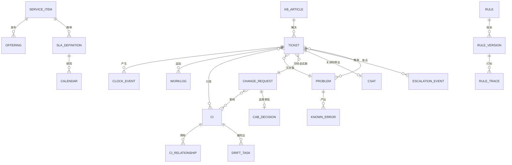

# 05 · 逻辑数据模型

> ⚠️ ASSUMPTION — 实体/键/基数属于方案包设计；借用的术语（RFC 5322
> Message-ID、SSO 主体 id）具有规范效力，并在
> [`../SOURCES.md`](../SOURCES.md) 中引用。

技术中立；历史表按 ADR-0002 仅可追加。

## ER 视图（逻辑）

## 实体分组

### 门户与目录

| 实体 | 键 | 值得注意的属性 |
|---|---|---|
| service_item | item_id | 类别、权限范围、履行类型、sla_definition 引用 |
| offering | (item_id, version) | 带生效日期的发布形态 |
| kb_article | article_id | 可见范围、关联条目、修订历史 |
| announcement | id | 受众范围、有效期窗口 |
| sla_definition | (service, version) | 响应/解决目标、日历引用、阈值 `(A)` |
| calendar | (id, 生效区间) | 服务时间、节假日（BR-05）— **一经使用即不可变** |

### 工单（历史按 ADR-0002 仅可追加）

| 实体 | 键 | 值得注意的属性 |
|---|---|---|
| ticket | ticket_id | 类型、类别、影响/紧急度、优先级、状态（SM-S1）、请求人、权限范围、渠道、来源、关联 {cis, problem, change, known_error} |
| clock_event | event_id | 时钟种类（start/pause/resume/stop/warn/breach）、时间戳、理由、日历引用 — **时钟的状态就是折叠结果**（NFR-002） |
| worklog | event_id | 可见性（内部/请求人）、作者、正文 — 仅追加 |
| escalation_event | event_id | 职能/层级、阈值、通知角色 |
| rule_trace | event_id | 规则 id、版本、动作、在工单上的留痕（BR-14） |
| csat | (ticket_id, round) | 评分、评语、发送时间 |

### 问题与变更

| 实体 | 键 | 值得注意的属性 |
|---|---|---|
| problem | problem_id | 状态（SM-S2）、根因、到工单的关联（≥ BR-08 阈值） |
| known_error | ke_id | 原因、规避手段、受影响 CI、发布范围 |
| change_request | rfc_id | 风险分级（standard/normal/emergency）、CI、回退方案、时间窗、结果、复核引用（BR-09） |
| cab_decision | (rfc_id, round) | 审批人、决议、时间戳 — 仅追加 |

### 配置

| 实体 | 键 | 值得注意的属性 |
|---|---|---|
| ci | ci_id | 类型、状态（planned/building/active/retired）、属性；**退役而非删除**（BR-10） |
| ci_relationship | (from, to, type) | 生效区间；带类型 |
| ci_state_history | event_id | 带生效日期视图的数据来源 |
| drift_task | task_id | 观测值与记录值、来源馈送、对账结果 |

### 自动化与渠道

| 实体 | 键 | 值得注意的属性 |
|---|---|---|
| rule / rule_version | rule_id / (rule_id, version) | 条件、动作、支持试运行（FR-017） |
| channel_message | 渠道 + 原生 id（如 RFC 5322 Message-ID） | 原始载荷引用、认证结论、隔离状态（BR-13） |

## 4. 完整性约束（具有规范效力）

模型必须强制执行的约束。它们有编号且稳定，每一条都指明它所强制执行的
`BR-`/`FR-` 标识。

收尾那句记录了其中哪些是**在存储层**强制执行的，而不是在应用代码里。这是
本方案包对自己的声明，不是经过验证的属性——应用纪律恰恰是日后某次改动会
绕过的东西，所以这个区别被明确画出，而不是留作暗示。

| # | 约束 | 强制执行 |
|---|---|---|
| 1 | `TICKET_EVENT` 仅可追加：备注、分级、指派、状态变更与时钟事件都是事件，更正是**引用**原事件的新事件 | BR-07、ADR-0002 |
| 2 | 一张工单恰好有一种类型（incident \| service_request）；问题或变更是独立生命周期，只能被**引用**，绝不是被改类型的工单 | BR-02 |
| 3 | 重复接入（相同告警特征或相同 RFC 5322 线程）会关联或合并并保留来源；任何内容都不得存在于主干之外 | BR-01、ADR-0001 |
| 4 | 每一条种类为 `pause` 的 `CLOCK_EVENT` 都带有理由；违约由事件计算得出，绝不手工修改 | BR-04 |
| 5 | 业务日历带生效日期，日历变更绝不改写已关闭工单的时钟历史 | BR-05 |
| 6 | 优先级在创建时由矩阵推导；智能体只能**向下**覆盖，且必须记录理由 | BR-03、BR-03a |
| 7 | 工单在路由窗口结束后仍无责任人时自动升级，升级会追加事件并按角色通知升级矩阵 | BR-06 |
| 8 | 引用 CI 的工单或 RFC 持有注册表 id；仍被引用的 CI 不可硬删除——只能退役 | BR-10、ADR-0004 |
| 9 | 涉密工单只对明确成员可见；权限查询绝不回退到更大的集合 | BR-11 |
| 10 | 服务请求必须解析到一个已发布的目录项；定制工作被退回请求受理积压，而不是临时私下履行 | BR-12 |
| 11 | 未知发件人成为「未注册请求人」工单，这类工单不能暴露 CMDB 内容或受限知识 | BR-13 |
| 12 | 规则应用记录 `rule_id`、`rule_version` 与试运行标志；一条将要触发却没有记录版本的规则是非法的 | BR-14、ADR-0003 |
| 13 | 关闭需要解决代码与请求人确认；自动关闭是唯一例外，且按目录项可配置 | BR-15 |
| 14 | 紧急变更是唯一绕过 CAB 审批的路径，且必须带有带截止日期的实施后复核 | BR-09 |
| 15 | 处于隔离状态的 `channel_message` 绝不向下游投递；认证结论先于对其载荷的任何解析 | BR-13 |

> 约束 1、3、8、10、11、12 和 15 是**在存储层强制执行**的，而不是在应用
> 代码中。可编辑的工单历史、未留痕的规则应用、被硬删除却仍被引用的 CI、
> 没有目录项就被履行的请求、可被伪造的接入，或是抵达邮箱的隔离消息——这些
> 无论应用纪律作出何种承诺都是缺陷——而在这一领域里，缺陷在有人审计时钟
> 之前都是不可见的。
