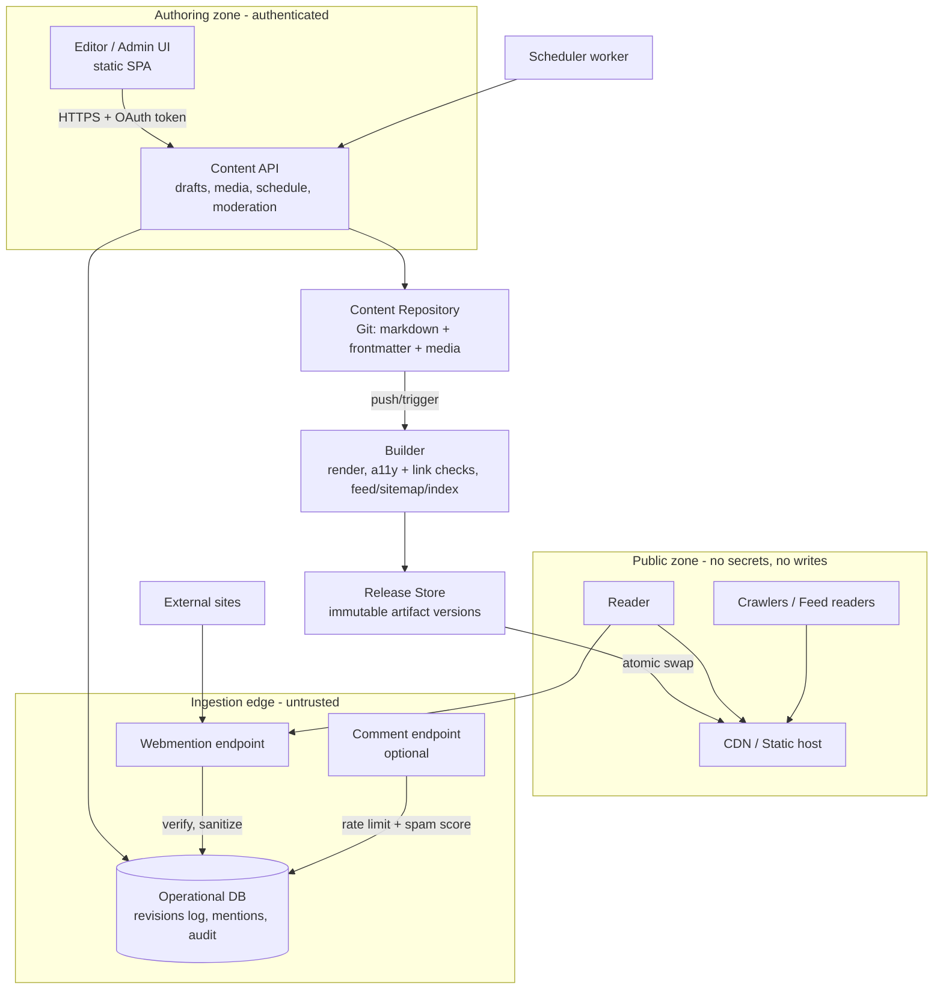

# 04 · Architecture Overview

## Architectural style

**Static-public / thin-dynamic-edge**: the public site is a set of
pre-built static artifacts served entirely from CDN/object storage; the only
server-side runtime is a tiny, isolated *authoring & ingestion service*
(content API + Webmention endpoint + scheduler), backed by a content
repository that remains readable without it.

Decisions behind this shape are recorded in:
[ADR-0001](./adr/0001-static-first.md) ·
[ADR-0002](./adr/0002-git-as-source-of-truth.md) ·
[ADR-0003](./adr/0003-webmention.md) ·
[ADR-0004](./adr/0004-client-side-search.md).

## Component view



## Deployment view

```
Region A (single region is acceptable for this scale)
├── CDN edge: global cache of the current Release (public pages, feeds, media)
├── Origin: object storage bucket holding Release versions (private prefix)
│    + current-release pointer; atomic promotion = pointer update
├── Authoring service: 1 small container/function, autoscale 0..2
│    + managed relational/KV store (mentions, sessions)
│    + scheduler: cron/function invocation every minute
└── Backup: content repo remote mirror + daily encrypted DB snapshot (off-region bucket)
```

Fail static: if the authoring service is down, the public site keeps serving
the last Release unchanged (NFR-004). The author can also push content by Git
directly — the repository stays a valid manual input.

## Key flows mapped to components

| Flow | Path |
|---|---|
| Write & publish (BP-01) | Editor → Content API → Repo + revision row → Builder → Release → CDN |
| Scheduled publish (FR-009) | Scheduler → Content API publish at T+0/60s; failures alert after 3 tries |
| Read (BP-04) | Reader → CDN cache only; origin hit only on cold cache |
| Respond (BP-02) | External site → Webmention endpoint → verification → DB PENDING → Admin UI moderation → Builder rebuild of affected page |
| Exit (BP-05) | Content API export → repo archive + mentions dump → ExportBundle |

## Multi-tenancy

None. Single author (with optional second trusted editor as a future,
non-MVP identity). This removes an entire class of isolation concerns and is
an explicit scope decision (see pack README out-of-scope).
