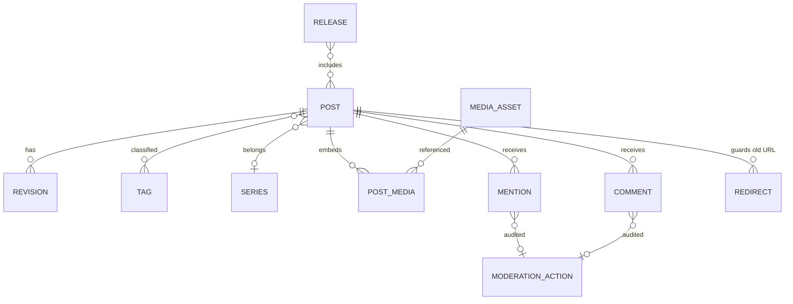

# 05 · Logical Data Model

Two stores by design (ADR-0002): the **content repository** (Git tree,
system of record for publishing) and the **operational store** (derived and
ephemeral). Logical entities, physical-neutral.

## ER view (logical)



## Table-level entities (operational store)

| Entity | Key | Notable attributes | Notes |
|---|---|---|---|
| post_metadata | post_id (uuid) | slug (unique), status, published_at, canonical_url, license_id, repo_path | projection of repo frontmatter; rebuilt on sync |
| revision | (post_id, rev_no) | commit_sha, created_at, note | mirrors Git history; append-only |
| tag | tag_id | name_norm, display_name | normalization per BR-05 |
| post_tag | (post_id, tag_id) | — | ≤ 8 per post enforced |
| series / series_entry | series_id / (series_id, position, post_id) | title | ordered |
| media_asset | media_id | sha256, content_type, bytes, alt_text, decorative, storage_key | dedup by sha256 |
| post_media | (post_id, media_id, position) | — | embed order |
| mention | mention_id | source_url (UK with target), target_post_id, type, status, content_safe, received_at, verified_at | idempotency key (source,target) |
| comment | comment_id | post_id, name, url, body_md, body_safe, spam_score, status | optional feature |
| moderation_action | id | target_type, target_id, action, actor, at, reason | audit append-log |
| redirect | from_path (PK) | to_url, kind (301/410), created_at, reason | no chains/loops |
| release | release_id | commit_sha, artifact_prefix, status, created_at, deployed_at | atomic promotion record |
| schedule | post_id, run_at | last_attempt, attempts, alert_sent | scheduler state |
| audit_log | id | actor, action, entity, at, detail_json | append-only (CTL-010) |
| analytics_hourly | hour, path | views, unique_coarse, referrer_class | **aggregated only**; no raw rows, no IPs |

## Content repository layout (system of record)

```
content/
├── posts/YYYY/MM/<slug>/
│   ├── post.md            # frontmatter + Markdown body
│   └── media/…            # or shared media pool with hash names
├── series/<slug>.yaml
├── tags.yaml              # display names / renames map
├── redirects.yaml
├── licenses/
└── site.config.yaml
```

## Classification & retention

| Data | Class | Retention |
|---|---|---|
| Posts/revisions/media | owned content | indefinite, exported |
| Approved mentions/comments | third-party contributed, public | until target post unpublished or deletion request (CTL-003); included in export |
| Pending/rejected mentions | interaction metadata | 90 days then purge |
| Reader IP / raw logs | personal data | ≤ 24 h, scrubbed at edge (NFR-008) |
| Analytics | derived aggregate | 24 months hourly, then monthly rollups |
| Audit log | operational | ≥ 2 years |
