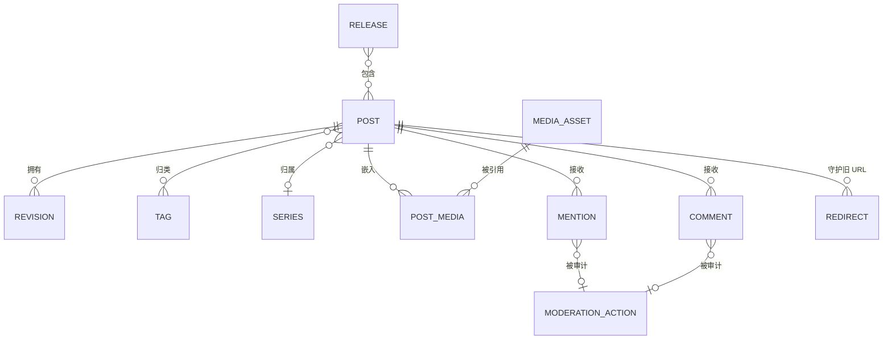

# 05 · 逻辑数据模型

按设计有两个存储（ADR-0002）：**内容仓库**（Git 树，发布的事实来源）与
**运行库存储**（派生且瞬时）。以下是逻辑实体，与物理实现无关。

## ER 视图（逻辑）



## 表级实体（运行库存储）

| 实体 | 键 | 值得注意的属性 | 说明 |
|---|---|---|---|
| post_metadata | post_id (uuid) | slug（唯一）、status、published_at、canonical_url、license_id、repo_path | 仓库 frontmatter 的投影；同步时重建 |
| revision | (post_id, rev_no) | commit_sha、created_at、note | 镜像 Git 历史；仅追加 |
| tag | tag_id | name_norm、display_name | 按 BR-05 规范化 |
| post_tag | (post_id, tag_id) | — | 强制每篇 ≤ 8 个 |
| series / series_entry | series_id / (series_id, position, post_id) | title | 有序 |
| media_asset | media_id | sha256、content_type、bytes、alt_text、decorative、storage_key | 按 sha256 去重 |
| post_media | (post_id, media_id, position) | — | 嵌入顺序 |
| mention | mention_id | source_url（与 target 组成 UK）、target_post_id、type、status、content_safe、received_at、verified_at | 幂等键 (source,target) |
| comment | comment_id | post_id、name、url、body_md、body_safe、spam_score、status | 可选特性 |
| moderation_action | id | target_type、target_id、action、actor、at、reason | 审计追加日志 |
| redirect | from_path (PK) | to_url、kind (301/410)、created_at、reason | 不成链/不成环 |
| release | release_id | commit_sha、artifact_prefix、status、created_at、deployed_at | 原子晋升记录 |
| schedule | post_id、run_at | last_attempt、attempts、alert_sent | 定时器状态 |
| audit_log | id | actor、action、entity、at、detail_json | 仅追加（CTL-010） |
| analytics_hourly | hour、path | views、unique_coarse、referrer_class | **仅聚合**；无原始行、无 IP |

## 内容仓库布局（事实来源）

```
content/
├── posts/YYYY/MM/<slug>/
│   ├── post.md            # frontmatter + Markdown 正文
│   └── media/…            # 或使用以哈希命名的共享媒体池
├── series/<slug>.yaml
├── tags.yaml              # 显示名 / 改名映射
├── redirects.yaml
├── licenses/
└── site.config.yaml
```

## 分类与留存

| 数据 | 类别 | 留存 |
|---|---|---|
| 文章/修订/媒体 | 自有内容 | 无限期，可导出 |
| 已通过的提及/评论 | 第三方贡献，公开 | 直到目标文章取消发布或收到删除请求（CTL-003）；包含在导出中 |
| 待处理/被拒的提及 | 互动元数据 | 90 天后清除 |
| 读者 IP / 原始日志 | 个人数据 | ≤ 24 小时，在边缘清洗（NFR-008） |
| 分析 | 派生聚合 | 按小时 24 个月，之后按月汇总 |
| 审计日志 | 运行数据 | ≥ 2 年 |

## 完整性约束（具有规范效力）

模型必须强制执行的约束。它们有编号且稳定，每一条都指明它所强制执行的
`BR-`/`FR-` 标识。收尾那句记录了其中哪些是**在存储层**强制执行的，而不是
在应用代码中——这是本方案包对自己的声明，不是经过验证的属性，因为应用纪律
恰恰是日后某次改动会绕过的东西。

| # | 约束 | 强制执行 |
|---|---|---|
| 1 | 一篇文章恰好有一条 `canonical_url` 记录；第二条是非法的 | BR-01、ADR-0001 |
| 2 | `title`、`slug`、`author`、`created_at`、`license` 在首次发布时为 NOT NULL | BR-02 |
| 3 | `slug` 匹配小写 ASCII kebab-case，长度 ≤ 80，且在**包括已退役在内的**每篇文章中唯一 | BR-03 |
| 4 | 文章发布后 `slug` 不可变；发布后的编辑被拒绝 | BR-04 |
| 5 | 标签以规范化形式存储（去空白、按语言折叠大小写），且一篇文章携带的标签数不超过配置值 | BR-05 |
| 6 | 取消发布写入一条 `410` 规则；改名或合并写入 `301`。任何公开 URL 都不会被静默丢弃 | BR-06 |
| 7 | 一篇文章公开可见当且仅当 `status = PUBLISHED AND published_at <= now`；任何渲染、检索或订阅源路径都不得绕过这一判定 | BR-07 |
| 8 | 订阅源条目的 GUID 是正本 URL 且永不改变；编辑更新条目，但不改其 GUID | BR-08 |
| 9 | 一条 webmention 在 `(source_url, target_url)` 上唯一；重复时更新状态而非插入 | BR-09、ADR-0003 |
| 10 | 已发布内容中的图片带非空 `alt`；装饰性图片带装饰性标记 | BR-10 |
| 11 | 没有匿名写入路径能到达公开内容：发布要求已认证的作者身份 | BR-11 |
| 12 | 第三方请求（字体、分析、嵌入）必须被声明并记录，否则构建失败 | BR-12 |
| 13 | 导出包含收到的 webmention，且**绝不**包含读者 IP 地址或原始日志 | BR-13 |
| 14 | 草稿以判定式（而非过滤器）被排除在站点地图、订阅源、检索索引与公开构建之外 | BR-14、ADR-0004 |
| 15 | `REDIRECT` 记录仅可追加，且绝不指向草稿 | BR-06 |

> 约束 1、3、7、9 和 11 是**在存储层强制执行**的，而不是在应用代码中。第二个
> 正本 URL、冲突的 slug、绕过可见性判定的渲染路径、重复的 webmention，或
> 抵达公开树的匿名写入，无论应用纪律作出何种承诺都是缺陷——在静态站点上，
> 这个失败表现为一个页面一直错到下一次构建为止，而且没有人看见它发生。
