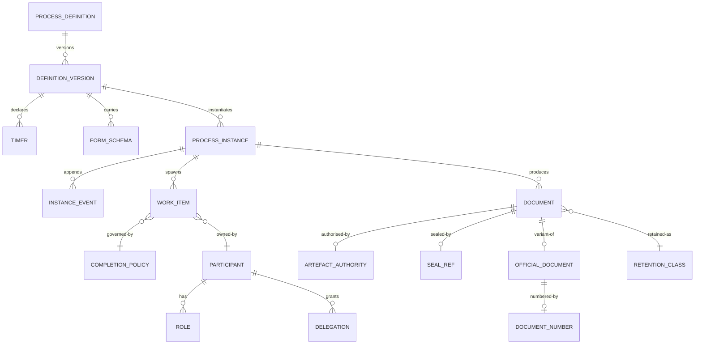

# 03 · Domain Model

> ⚠️ ASSUMPTION — bounded contexts, aggregates and invariants are pack design.
> BPMN 2.0 supplies the modelling vocabulary, not this decomposition.

## Bounded contexts

| Context | Responsibility | Owns |
|---|---|---|
| **Definition** | Modelled, versioned, published procedures | ProcessDefinition, DefinitionVersion, Gateway, Timer |
| **Runtime** | Instances pinned to a definition version | ProcessInstance, Token, InstanceEvent |
| **Work items** | The human-task vocabulary | WorkItem, Pattern, CompletionPolicy |
| **Participants** | Role-and-scope resolution | Participant, Role, Scope, Delegation |
| **Forms & rules** | Schema-driven capture and its validation | FormSchema, ValidationExpression, RuleRef |
| **Documents & records** | Artefacts, seals, retention | Document, ArtefactAuthority, RetentionClass |
| **Variant (CN)** | 公文, 文号, 电子签章 | OfficialDocument, DocumentNumber, SealRef |
| **Directory & events** | Org source and the event log | OrgUnit, Position, EventLog |

Definition is the spine: a running instance pins to a definition **version**, and
an instance without a resolvable version cannot be interpreted (NFR-003).

## Core aggregates & invariants

### ProcessDefinition / DefinitionVersion (definition)
```
ProcessDefinition: id, name, status
DefinitionVersion: id, definitionRef, version, bpmnRef, publishedBy,
  publishedTs, effectiveFrom, supersededBy?
Timer: id, versionRef, trigger, durationOrSchedule, calendarRef, action,
  authorityRef
└── invariants
    • modelled in BPMN 2.0 vocabulary; any extension is a labelled addition
      (BR-01, BR-12, constraint 1)
    • a version is immutable once published; a change is a new version (BR-02)
    • publication records the in-flight treatment (BR-03, FR-004, constraint 2)
    • gateways and timers are declared, never inferred by the engine (BR-06)
```

### ProcessInstance (runtime)
```
ProcessInstance: id, definitionVersionRef NOT NULL, state, createdTs,
  terminalTs?
InstanceEvent: id, instanceRef, kind, actor, ts, reason?, definitionVersionRef
└── invariants
    • definitionVersionRef is NOT NULL and resolvable at all times (BR-03,
      constraint 3)
    • every transition appends an InstanceEvent; nothing is rewritten (BR-07)
    • current state = fold(events) — replayable bit-for-bit (BR-07, NFR-002)
    • a definition publication never mutates a running instance (BR-03)
```

### WorkItem / CompletionPolicy (work items)
```
WorkItem: id, instanceRef, activityRef, pattern, ownerRef?, poolRef?,
  state, expiresTs?, completedTs?
CompletionPolicy: id, pattern, variant (unanimous|all-responded | cancel|never-
  surfaced | rework|reject), declaredTs
└── invariants
    • pattern ∈ the defined vocabulary — assign, claim, transfer, delegate,
      会签, 或签, 加签, 退回, 撤回, add-comment (BR-05, constraint 4)
    • an action outside the defined set is illegal (NFR-007)
    • a multi-participant pattern REQUIRES a declared CompletionPolicy
      (BR-05, FR-013, FR-014, constraint 5)
    • transfer is permanent: after it, the original owner cannot act (FR-011)
    • add-comment never changes control flow (glossary)
```

### Participant / Delegation (participants)
```
Participant: id, kind (user|group|role)
Role: id, scopeRef
Delegation: id, fromRef, toRef, scope, validFrom, validTo?, revokedTs?
└── invariants
    • resolution is by role and business scope; a user name in a definition is
      illegal (BR-04, constraint 6)
    • a delegation carries a scope and an expiry, and revocation stops further
      acts (FR-008, constraint 7)
    • org changes affect future resolution, never running instances (FR-007)
```

### FormSchema / ValidationExpression (forms & rules)
```
FormSchema: id, version, fields[], validations[]
ValidationExpression: id, expression, ruleRef?, declaredTs
└── invariants
    • an expression without a ruleRef is an untraceable validation — counted by
      NFR-011, and not illegal (BR-05's neighbour)
    • schema changes are versioned with the definition
```

### Document / ArtefactAuthority (documents & records)
```
Document: id, instanceRef, kind, authorityRef, basis, signedTs?, sealRef?
ArtefactAuthority: id, issuerRef, basis, ts
RetentionClass: id, dataClass, declaredWindow
└── invariants
    • an artefact carries its authority — issuer, basis, timestamp (BR-08,
      FR-022)
    • sealRef resolves to a seal that was valid at signing time (CTL-04)
    • retention per class; no global row (BR-09, constraint 8)
```

### OfficialDocument / DocumentNumber / SealRef (CN variant)
```
OfficialDocument: id, instanceRef, templateRef
DocumentNumber: id, documentRef, value, allocatedBy, allocatedTs
SealRef: id, documentRef, sealId, appliedTs, validAtTs
└── invariants
    • these entities exist only inside the labelled variant (BR-11, FR-027)
    • the core operates with them absent (FR-028, constraint 9)
    • DocumentNumber allocation is gapless and auditable (glossary)
```

## Relationships (logical)



## The four aggregates that carry the pack's weight

| Aggregate | The invariant that matters most | What it prevents |
|---|---|---|
| **DefinitionVersion** | immutable once published, with an in-flight treatment recorded | a running instance whose meaning moves underneath it |
| **ProcessInstance** | current state = fold(events) | an approval trail that is a log rather than evidence |
| **WorkItem / CompletionPolicy** | multi-participant patterns require a declared policy | the vocabulary being labels — two products meaning different things by 会签, with nothing recording which |
| **Participant / Delegation** | role-and-scope, never a name | approval breaking silently when someone changes jobs |

> The third is the pack's reason for existing. BPMN 2.0 supplies the notation and
> none of these terms, so the definitions are this pack's contribution — and an
> implementation that uses the words without the semantics has invented them,
> which is the failure the pack exists to prevent.