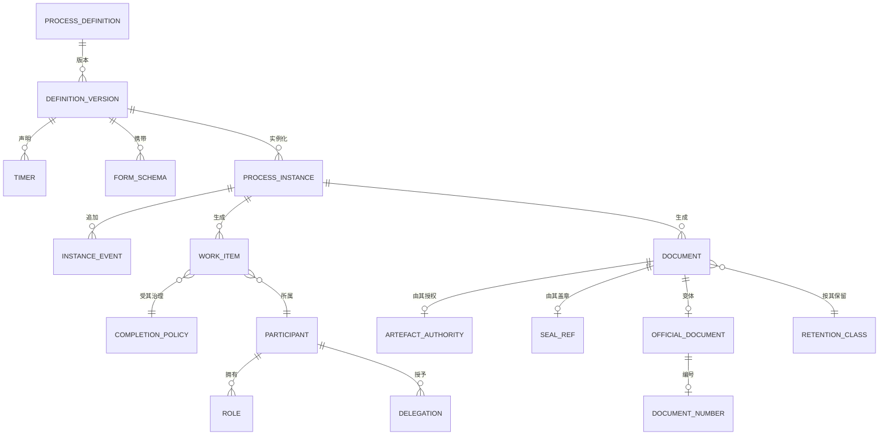

# 03 · 领域模型

> ⚠️ ASSUMPTION — 限界上下文、聚合和不变量属于方案包设计。
> BPMN 2.0 提供的是建模词汇，而非这一分解方式。

## 限界上下文

| 上下文 | 职责 | 所拥有 |
|---|---|---|
| **定义** | 经建模、版本化并发布的规程 | ProcessDefinition, DefinitionVersion, Gateway, Timer |
| **运行时** | 固定至定义版本的实例 | ProcessInstance, Token, InstanceEvent |
| **工作项** | 人工任务词汇 | WorkItem, Pattern, CompletionPolicy |
| **参与者** | 基于角色和范围的解析 | Participant, Role, Scope, Delegation |
| **表单与规则** | 由模式驱动的信息采集及其校验 | FormSchema, ValidationExpression, RuleRef |
| **文档与记录** | 制品、印章、保留期 | Document, ArtefactAuthority, RetentionClass |
| **变体（CN）** | 公文、文号、电子签章 | OfficialDocument, DocumentNumber, SealRef |
| **目录与事件** | 组织来源与事件日志 | OrgUnit, Position, EventLog |

定义是主干：运行中的实例会固定到一个定义**版本**，无法解析版本的实例便无法解释（NFR-003）。

## 核心聚合与不变量

### ProcessDefinition / DefinitionVersion（定义）
```
ProcessDefinition: id, name, status
DefinitionVersion: id, definitionRef, version, bpmnRef, publishedBy,
  publishedTs, effectiveFrom, supersededBy?
Timer: id, versionRef, trigger, durationOrSchedule, calendarRef, action,
  authorityRef
└── invariants
    • 采用 BPMN 2.0 词汇建模；任何扩展均为带标签的扩展
      (BR-01, BR-12, constraint 1)
    • 版本一经发布即不可变；任何变更均构成新版本 (BR-02)
    • 发布记录在途实例的处理方式 (BR-03, FR-004, constraint 2)
    • 网关和计时器必须声明，绝不得由引擎推断 (BR-06)
```

### ProcessInstance（运行时）
```
ProcessInstance: id, definitionVersionRef NOT NULL, state, createdTs,
  terminalTs?
InstanceEvent: id, instanceRef, kind, actor, ts, reason?, definitionVersionRef
└── invariants
    • definitionVersionRef 始终为 NOT NULL 且可解析 (BR-03,
      constraint 3)
    • 每次转换都会追加一个 InstanceEvent；绝不重写任何内容 (BR-07)
    • 当前状态 = fold(events)——可逐位重放 (BR-07, NFR-002)
    • 定义发布绝不改变运行中的实例 (BR-03)
```

### WorkItem / CompletionPolicy（工作项）
```
WorkItem: id, instanceRef, activityRef, pattern, ownerRef?, poolRef?,
  state, expiresTs?, completedTs?
CompletionPolicy: id, pattern, variant (unanimous|all-responded | cancel|never-
  surfaced | rework|reject), declaredTs
└── invariants
    • pattern 属于既定词汇——指派/分发、签收/认领、转办、代办/委托、
      会签、或签、加签、退回、撤回、加签意见/批注 (BR-05, constraint 4)
    • 既定集合之外的操作均属非法 (NFR-007)
    • 多参与者 pattern 必须预先声明 CompletionPolicy
      (BR-05, FR-013, FR-014, constraint 5)
    • 转办是永久性的：转办后，原所有者不得再执行操作 (FR-011)
    • 加签意见/批注绝不改变控制流（术语表）
```

### Participant / Delegation（参与者）
```
Participant: id, kind (user|group|role)
Role: id, scopeRef
Delegation: id, fromRef, toRef, scope, validFrom, validTo?, revokedTs?
└── invariants
    • 按角色和业务范围解析；定义中出现用户姓名均属非法
      (BR-04, constraint 6)
    • 每项委托均包含范围和有效期，撤销会阻止后续操作
      (FR-008, constraint 7)
    • 组织变更只影响未来的解析，绝不影响运行中的实例 (FR-007)
```

### FormSchema / ValidationExpression（表单与规则）
```
FormSchema: id, version, fields[], validations[]
ValidationExpression: id, expression, ruleRef?, declaredTs
└── invariants
    • 没有 ruleRef 的表达式属于不可追溯的校验——计入
      NFR-011，且不属非法（BR-05 的相邻约束）
    • 模式变更与定义一并进行版本管理
```

### Document / ArtefactAuthority（文档与记录）
```
Document: id, instanceRef, kind, authorityRef, basis, signedTs?, sealRef?
ArtefactAuthority: id, issuerRef, basis, ts
RetentionClass: id, dataClass, declaredWindow
└── invariants
    • 每项制品均携带其授权信息——签发者、依据、时间戳 (BR-08,
      FR-022)
    • sealRef 必须解析到签署时有效的印章 (CTL-04)
    • 保留期按类别设定；不存在全局行 (BR-09, constraint 8)
```

### OfficialDocument / DocumentNumber / SealRef（CN 变体）
```
OfficialDocument: id, instanceRef, templateRef
DocumentNumber: id, documentRef, value, allocatedBy, allocatedTs
SealRef: id, documentRef, sealId, appliedTs, validAtTs
└── invariants
    • 这些实体仅存在于带标签的变体中 (BR-11, FR-027)
    • 核心在缺少这些实体时仍可运行 (FR-028, constraint 9)
    • DocumentNumber 的分配必须无缺口且可审计（术语表）
```

## 关系（逻辑）



## 承载本方案包核心重量的四个聚合

| 聚合 | 最重要的不变量 | 所防止的情况 |
|---|---|---|
| **DefinitionVersion** | 发布后不可变，并记录在途实例的处理方式 | 运行中的实例所依据的含义悄然改变 |
| **ProcessInstance** | 当前状态 = fold(events) | 仅仅是一份日志而非证据的审批轨迹 |
| **WorkItem / CompletionPolicy** | 多参与者模式要求预先声明策略 | 这套词汇仅仅充当标签——两个产品对“会签”含义不同，却没有任何内容记录具体含义 |
| **Participant / Delegation** | 依据角色和范围，而非姓名 | 有人调岗时审批悄然失效 |

> 第三项是本方案包存在的理由。BPMN 2.0 提供了表示法，却未定义其中任何一个术语，
> 因此这些定义是本方案包的贡献——而任何只使用这些词语却不采用这些语义的实现，
> 都是自行创造了这些术语，而这正是本方案包旨在防止的失败。