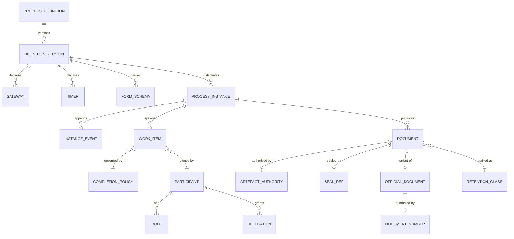

# 05 · Logical Data Model

> Logical model for the core entities. Physical modelling is a deployment
> concern; this file fixes the shape and the invariants.
>
> ⚠️ ASSUMPTION — the model is pack design. BPMN 2.0 supplies modelling
> vocabulary, not this decomposition.

## Entities

```
PROCESS_DEFINITION (definition)              -- BR-01, BR-12
  definition_id      PK, name, status
  -- modelling vocabulary is BPMN 2.0; extensions are labelled (constraint 1)

DEFINITION_VERSION (definition)              -- BR-02, ADR-0002
  definition_version_id PK
  definition_id      FK → PROCESS_DEFINITION NOT NULL
  version            NOT NULL
  bpmn_ref                     -- the interchange artefact
  published_by       NOT NULL
  published_ts       NOT NULL
  effective_from     NOT NULL
  superseded_by?
  in_flight_treatment NOT NULL -- finish_on_old | migrate | terminate (constraint 2)
  impact_statement_ref NOT NULL -- which running instances are affected (constraint 2)

GATEWAY / TIMER (definition)                 -- BR-01, BR-06
  gateway_id         PK, definition_version_id FK, kind, expression
  timer_id           PK, definition_version_id FK
  trigger, duration_or_schedule, calendar_ref
  action             NOT NULL      -- remind | reassign | route_to_superior
  authority_ref      NOT NULL      -- who may authorise THIS action (constraint 3)

PROCESS_INSTANCE (runtime)                   -- BR-03, ADR-0005
  instance_id        PK
  definition_version_id FK → DEFINITION_VERSION NOT NULL (constraint 4)
  state, created_ts, terminal_ts?
  -- current state = fold over INSTANCE_EVENT (see below)

INSTANCE_EVENT (runtime)                     -- BR-07, ADR-0005
  instance_event_id  PK
  instance_id        FK → PROCESS_INSTANCE NOT NULL
  kind, actor, ts, reason?, rule_id?, definition_version_id
  -- APPEND-ONLY: no UPDATE or DELETE grant (constraint 5)

WORK_ITEM (work items)                       -- BR-05, ADR-0004
  work_item_id       PK
  instance_id        FK → PROCESS_INSTANCE
  activity_ref, pattern
  owner_ref?, pool_ref?, state, expires_ts?, completed_ts?
  -- pattern ∈ the defined vocabulary (constraint 6)

COMPLETION_POLICY (work items)               -- BR-05, FR-013, FR-014
  completion_policy_id PK
  work_item_pattern  countersign | or-sign
  variant            unanimous | all-responded | cancel_others | never_surface
  declared_ts
  -- REQUIRED for a multi-participant pattern (constraint 7)

PARTICIPANT / ROLE / DELEGATION (participants) -- BR-04, ADR-0003
  participant_id     PK, kind (user|group|role)
  role_id            PK, scope_ref
  delegation_id      PK, from_ref, to_ref
  scope              NOT NULL       -- structured, not free text (constraint 8)
  valid_from         NOT NULL
  valid_to?
  revoked_ts?
  -- resolution is by role + scope; no user name in a DEFINITION (constraint 8)

FORM_SCHEMA / VALIDATION_EXPRESSION (forms)  -- BR-05's neighbour
  form_schema_id     PK, version, fields[], validations[]
  validation_expression_id PK, expression, rule_ref?, declared_ts
  -- rule_ref may be null; NFR-011 measures the share

DOCUMENT / ARTEFACT_AUTHORITY (documents)    -- BR-08, CTL-04
  document_id        PK, instance_ref, kind
  authority_ref      FK → ARTEFACT_AUTHORITY NOT NULL (constraint 9)
  signed_ts?, seal_ref?
ARTEFACT_AUTHORITY
  artefact_authority_id PK, issuer_ref, basis, ts

RETENTION_CLASS (documents)                  -- BR-09
  retention_class_id PK, data_class, declared_window NOT NULL
  -- no global row (constraint 10)
DOCUMENT }o--|| RETENTION_CLASS : retained_as

CN VARIANT entities (variant only)           -- BR-11, ADR-0006
OFFICIAL_DOCUMENT
  official_document_id PK, document_ref FK → DOCUMENT, template_ref
DOCUMENT_NUMBER
  document_number_id PK, official_document_ref FK → OFFICIAL_DOCUMENT
  value, allocated_by, allocated_ts
  -- allocation gapless and auditable
SEAL_REF
  seal_ref_id        PK, document_ref FK → DOCUMENT
  seal_id, applied_ts, valid_at_ts     -- validity AT SIGNING (CTL-04)
  -- these tables exist ONLY inside the variant (constraint 11)
```

## Keys and cardinalities



## Integrity constraints the model must enforce

| # | Constraint | Enforces |
|---|---|---|
| 1 | A notation extension must be declared as a labelled addition, not presented as BPMN | BR-01, FR-002 |
| 2 | `DEFINITION_VERSION.in_flight_treatment` and `impact_statement_ref` are NOT NULL at publication | BR-03, FR-004, NFR-004, NFR-010 |
| 3 | `TIMER.authority_ref` is NOT NULL and differs from the action's target | BR-06, FR-019 |
| 4 | `PROCESS_INSTANCE.definition_version_id` is NOT NULL and must resolve | BR-03, FR-005, NFR-003 |
| 5 | `INSTANCE_EVENT` has no UPDATE or DELETE grant; a correction is a new compensating event | BR-07, BR-10, FR-020, FR-025, NFR-001 |
| 6 | `WORK_ITEM.pattern` is constrained to the defined vocabulary set | BR-05, FR-016, NFR-007 |
| 7 | A `WorkItem` with a multi-participant pattern REQUIRES a `CompletionPolicy` row | BR-05, FR-013, FR-014, NFR-007 |
| 8 | No `DEFINITION` row may contain a user reference; participants resolve from `PARTICIPANT`/`ROLE`. `DELEGATION.scope` is structured, and a delegation without a bound is illegal | BR-04, FR-006, FR-008 |
| 9 | `DOCUMENT.authority_ref` is NOT NULL; a document with no issuable authority is illegal | BR-08, FR-022 |
| 10 | `RETENTION_CLASS.declared_window` is NOT NULL per class; there is no global row | BR-09, FR-024 |
| 11 | `OFFICIAL_DOCUMENT` / `DOCUMENT_NUMBER` / `SEAL_REF` may only be written by the variant; a core-only deployment operates with them absent | BR-11, FR-027, FR-028 |

> Constraints 5, 6, 7, 8, 10 and 11 are **enforced in the store**, not in
> application code. A rewritten event trail, an undefined vocabulary action, a
> multi-participant pattern without a policy, a user name in a definition, a global
> retention row, or a CN entity written by the core is a defect regardless of what
> application discipline promises — and each is a sev-1 signal in
> `04-architecture/observability.md`.