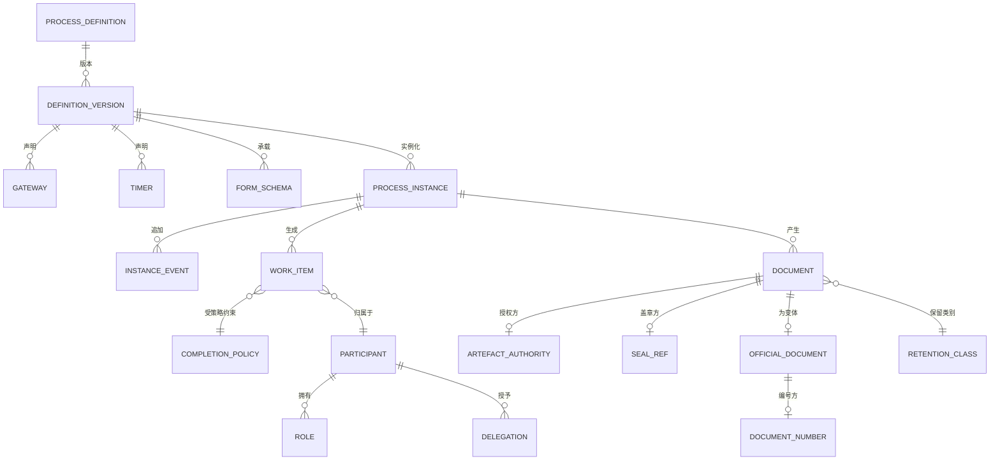

# 05 · 逻辑数据模型

> 核心实体的逻辑模型。物理建模属于部署层面的关注事项；本文件确定模型形态和不变量。
>
> ⚠️ ASSUMPTION — 该模型属于方案包设计。BPMN 2.0 提供的是建模词汇，而非这种分解方式。

## 实体

```
PROCESS_DEFINITION (定义)                    -- BR-01, BR-12
  definition_id      PK, name, status
  -- 建模词汇采用 BPMN 2.0；扩展项须带标签（约束 1）

DEFINITION_VERSION (定义)                    -- BR-02, ADR-0002
  definition_version_id PK
  definition_id      FK → PROCESS_DEFINITION NOT NULL
  version            NOT NULL
  bpmn_ref                     -- 交换制品
  published_by       NOT NULL
  published_ts       NOT NULL
  effective_from     NOT NULL
  superseded_by?
  in_flight_treatment NOT NULL -- finish_on_old | migrate | terminate（约束 2）
  impact_statement_ref NOT NULL -- 受影响的运行中实例（约束 2）

GATEWAY / TIMER (定义)                       -- BR-01, BR-06
  gateway_id         PK, definition_version_id FK, kind, expression
  timer_id           PK, definition_version_id FK
  trigger, duration_or_schedule, calendar_ref
  action             NOT NULL      -- remind | reassign | route_to_superior
  authority_ref      NOT NULL      -- 谁可授权执行此操作（约束 3）

PROCESS_INSTANCE (运行时)                     -- BR-03, ADR-0005
  instance_id        PK
  definition_version_id FK → DEFINITION_VERSION NOT NULL（约束 4）
  state, created_ts, terminal_ts?
  -- 当前状态 = 对 INSTANCE_EVENT 折叠计算（见下文）

INSTANCE_EVENT (运行时)                       -- BR-07, ADR-0005
  instance_event_id  PK
  instance_id        FK → PROCESS_INSTANCE NOT NULL
  kind, actor, ts, reason?, rule_id?, definition_version_id
  -- APPEND-ONLY：不授予 UPDATE 或 DELETE 权限（约束 5）

WORK_ITEM (工作项)                            -- BR-05, ADR-0004
  work_item_id       PK
  instance_id        FK → PROCESS_INSTANCE
  activity_ref, pattern
  owner_ref?, pool_ref?, state, expires_ts?, completed_ts?
  -- pattern ∈ 已定义的词汇（约束 6）

COMPLETION_POLICY (工作项)                    -- BR-05, FR-013, FR-014
  completion_policy_id PK
  work_item_pattern  countersign | or-sign
  variant            unanimous | all-responded | cancel_others | never_surface
  declared_ts
  -- 多参与者模式必须具备此记录（约束 7）

PARTICIPANT / ROLE / DELEGATION (参与者)      -- BR-04, ADR-0003
  participant_id     PK, kind (user|group|role)
  role_id            PK, scope_ref
  delegation_id      PK, from_ref, to_ref
  scope              NOT NULL       -- 结构化，而非自由文本（约束 8）
  valid_from         NOT NULL
  valid_to?
  revoked_ts?
  -- 按角色和范围解析；DEFINITION 中不得包含用户名（约束 8）

FORM_SCHEMA / VALIDATION_EXPRESSION (表单)    -- BR-05 的相邻项
  form_schema_id     PK, version, fields[], validations[]
  validation_expression_id PK, expression, rule_ref?, declared_ts
  -- rule_ref 可以为 null；NFR-011 衡量其占比

DOCUMENT / ARTEFACT_AUTHORITY (文档)          -- BR-08, CTL-04
  document_id        PK, instance_ref, kind
  authority_ref      FK → ARTEFACT_AUTHORITY NOT NULL（约束 9）
  signed_ts?, seal_ref?
ARTEFACT_AUTHORITY
  artefact_authority_id PK, issuer_ref, basis, ts

RETENTION_CLASS (文档)                        -- BR-09
  retention_class_id PK, data_class, declared_window NOT NULL
  -- 不存在全局行（约束 10）
DOCUMENT }o--|| RETENTION_CLASS : retained_as

CN 变体实体（仅限变体）                       -- BR-11, ADR-0006
OFFICIAL_DOCUMENT
  official_document_id PK, document_ref FK → DOCUMENT, template_ref
DOCUMENT_NUMBER
  document_number_id PK, official_document_ref FK → OFFICIAL_DOCUMENT
  value, allocated_by, allocated_ts
  -- 编号分配不得有缺口且可审计
SEAL_REF
  seal_ref_id        PK, document_ref FK → DOCUMENT
  seal_id, applied_ts, valid_at_ts     -- 签署时点的有效性（CTL-04）
  -- 这些表仅存在于变体内部（约束 11）
```

## 键与基数



## 模型必须强制执行的完整性约束

| # | 约束 | 所约束内容 |
|---|---|---|
| 1 | 表示法扩展必须声明为带标签的添加项，而不得作为 BPMN 呈现 | BR-01, FR-002 |
| 2 | `DEFINITION_VERSION.in_flight_treatment` 和 `impact_statement_ref` 在发布时均为 NOT NULL | BR-03, FR-004, NFR-004, NFR-010 |
| 3 | `TIMER.authority_ref` 为 NOT NULL，且不同于操作的目标对象 | BR-06, FR-019 |
| 4 | `PROCESS_INSTANCE.definition_version_id` 为 NOT NULL，且必须能够解析 | BR-03, FR-005, NFR-003 |
| 5 | `INSTANCE_EVENT` 不授予 UPDATE 或 DELETE 权限；更正应记录为新的补偿事件 | BR-07, BR-10, FR-020, FR-025, NFR-001 |
| 6 | `WORK_ITEM.pattern` 必须限定在已定义的词汇集合内 | BR-05, FR-016, NFR-007 |
| 7 | 采用多参与者模式的 `WorkItem` 必须具有 `CompletionPolicy` 行 | BR-05, FR-013, FR-014, NFR-007 |
| 8 | 任何 `DEFINITION` 行都不得包含用户引用；参与者通过 `PARTICIPANT`/`ROLE` 解析。`DELEGATION.scope` 必须采用结构化形式，没有边界约束的委托属于非法记录 | BR-04, FR-006, FR-008 |
| 9 | `DOCUMENT.authority_ref` 为 NOT NULL；没有签发权限的文档属于非法记录 | BR-08, FR-022 |
| 10 | 每个类别的 `RETENTION_CLASS.declared_window` 均为 NOT NULL；不存在全局行 | BR-09, FR-024 |
| 11 | 只有变体可以写入 `OFFICIAL_DOCUMENT` / `DOCUMENT_NUMBER` / `SEAL_REF`；仅部署核心时，这些实体不存在 | BR-11, FR-027, FR-028 |

> 约束 5、6、7、8、10 和 11 由**存储层**强制执行，而非应用程序代码。被重写的事件轨迹、未纳入已定义词汇的操作、没有策略的多参与者模式、定义中包含的用户名、全局保留行，或由核心写入的 CN 实体，无论应用程序规范作出何种承诺，均属于缺陷——而且每一项都是 `04-architecture/observability.md` 中的 sev-1 信号。