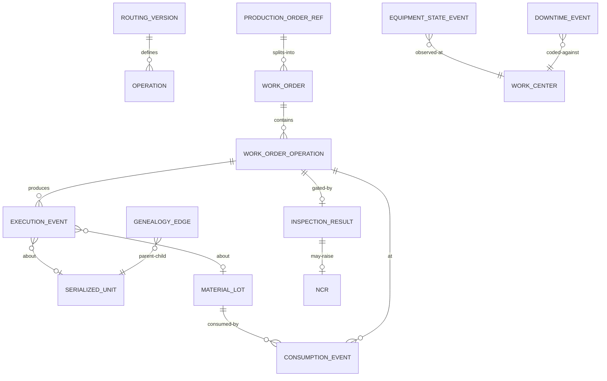

# 03 · Domain Model

> ⚠️ ASSUMPTION — the bounded-context decomposition and its invariants are
> pack design. IEC 62264-3 defines MOM activity models (production /
> maintenance / quality / inventory) but explicitly does **not** specify
> genealogy or event-sourced execution; those are extensions this pack adds
> (see [`../SOURCES.md` §4](../SOURCES.md)).

## Bounded contexts

| Context | Responsibility | Owns |
|---|---|---|
| **Manufacturing Model** | Effective-dated master data | Plant, Line, WorkCenter, Equipment, Material, BomVersion, RoutingVersion, Personnel, ShiftCalendar |
| **Planning Handoff** | ERP order intake, work-order derivation, dispatch, release gating | ProductionOrderRef, WorkOrder, DispatchQueue |
| **Execution** | Station operations & immutable event capture, andon | ExecutionEvent, AndonEvent |
| **Material & Genealogy** | Lots, serialized units, consumption, genealogy graph | MaterialLot, SerializedUnit, ConsumptionEvent, GenealogyEdge, WipState (projection) |
| **Quality Execution** | Inspection plans/results, SPC, NCR, holds | InspectionPlan, InspectionResult, Ncr, Hold |
| **Equipment** | States, downtime, OEE inputs | EquipmentStateEvent, DowntimeEvent, Tooling |
| **Reporting** | Read-only projections & exports | OeeAggregate, YieldReport, TraceabilityDossier |

Reporting and Material/Genealogy projections are **read models derived from
the Execution event store** (ADR-0002); they never mutate source events.

## Core aggregates & invariants

### WorkOrder (aggregate root)
```
WorkOrder
├── identity: id, erpOrderRef, materialVersionRef, routingVersionRef
├── quantity: authorized (ERP), planned, completed, scrapped
├── lifecycle: state (SM-01), releasedWith: {bomVersion, routingVersion, inspectionPlans}
├── operations: [WorkOrderOperation] ordered per routing (BR-02)
└── invariants
    • planned ≤ authorized (BR-01)
    • release only when gate passes (FR-004); release snapshot frozen (BR-13)
    • operations start only when predecessor complete (BR-02)
```

### ExecutionEvent (immutable fact)
```
ExecutionEvent: id, type, source (station|equipment|system),
sourceTs, ingestionTs, workOrderRef?, operationRef?, unitRef?, lotRef?,
equipmentRef?, operatorRef?, payload(json), sequence
└── invariants
    • append-only; corrections = compensating event referencing original (BR-07)
    • monotonic per (source, sequence) (BR-10)
```

### MaterialLot / SerializedUnit
```
MaterialLot: lotId, materialRef, qty (≥ 0, BR-04), status (OK|QUARANTINED|BLOCKED), expiry?
SerializedUnit: unitId, currentWorkOrderRef (exactly one active, BR-03),
state (SM-02b), genealogy links
```

### Ncr / Hold
```
Ncr: id, affected [units|lots], raisedFrom (inspection|andon|audit),
disposition (REWORK|SCRAP|USE_AS_IS), approvals[]
Hold: scope (unit|lot|workOrder), blocks release & shipment until released
```

## Relationships (logical)



Genealogy is stored as `GenealogyEdge(parentUnitOrLot, childUnitOrLot, via
operationRef, consumptionRef)` — a directed acyclic graph built from
consumption/production events, queryable in both directions (FR-011).
