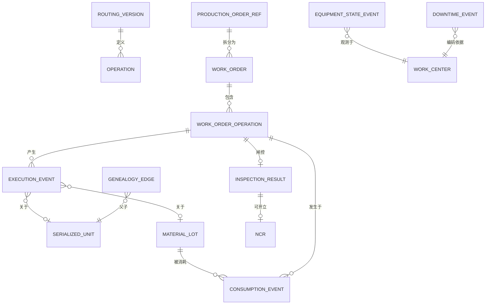

# 03 · 领域模型

> ⚠️ ASSUMPTION — 限界上下文的分解及其不变量属于方案包设计。IEC 62264-3
> 定义了 MOM 活动模型（生产/维护/质量/库存），但**没有**规定谱系或事件溯源
> 的执行；那些是本方案包添加的扩展（见 [`../SOURCES.md` §4](../SOURCES.md)）。

## 限界上下文

| 上下文 | 职责 | 拥有的类型 |
|---|---|---|
| **制造模型** | 带生效日的主数据 | Plant、Line、WorkCenter、Equipment、Material、BomVersion、RoutingVersion、Personnel、ShiftCalendar |
| **计划承接** | ERP 订单接入、工单派生、派工、下达闸门 | ProductionOrderRef、WorkOrder、DispatchQueue |
| **执行** | 工位操作与不可变事件采集、andon | ExecutionEvent、AndonEvent |
| **物料与谱系** | 批次、序列化单件、消耗、谱系图 | MaterialLot、SerializedUnit、ConsumptionEvent、GenealogyEdge、WipState（投影） |
| **质量执行** | 检验计划/结果、SPC、不合格品、冻结 | InspectionPlan、InspectionResult、Ncr、Hold |
| **设备** | 状态、停机、OEE 输入 | EquipmentStateEvent、DowntimeEvent、Tooling |
| **报告** | 只读投影与导出 | OeeAggregate、YieldReport、TraceabilityDossier |

报告与物料/谱系投影是**从执行事件存储派生的读模型**（ADR-0002）；它们绝不
改写源事件。

## 核心聚合与不变量

### WorkOrder（聚合根）
```
WorkOrder
├── identity: id, erpOrderRef, materialVersionRef, routingVersionRef
├── quantity: authorized (ERP), planned, completed, scrapped
├── lifecycle: state (SM-01), releasedWith: {bomVersion, routingVersion, inspectionPlans}
├── operations: [WorkOrderOperation] ordered per routing (BR-02)
└── invariants
    • 计划量 ≤ 授权量（BR-01）
    • 仅在闸门通过时下达（FR-004）；下达快照被冻结（BR-13）
    • 仅当前道工序完成时后续工序才能开始（BR-02）
```

### ExecutionEvent（不可变事实）
```
ExecutionEvent: id, type, source (station|equipment|system),
sourceTs, ingestionTs, workOrderRef?, operationRef?, unitRef?, lotRef?,
equipmentRef?, operatorRef?, payload(json), sequence
└── invariants
    • 仅追加；更正 = 引用原事件的补偿事件（BR-07）
    • 按 (source, sequence) 单调（BR-10）
```

### MaterialLot / SerializedUnit
```
MaterialLot: lotId, materialRef, qty (≥ 0, BR-04), status (OK|QUARANTINED|BLOCKED), expiry?
SerializedUnit: unitId, currentWorkOrderRef (exactly one active, BR-03),
state (SM-02b), genealogy links
```

### Ncr / Hold
```
Ncr: id, affected [units|lots], raisedFrom (inspection|andon|audit),
disposition (REWORK|SCRAP|USE_AS_IS), approvals[]
Hold: scope (unit|lot|workOrder), blocks release & shipment until released
```

## 关系（逻辑）



谱系以 `GenealogyEdge(parentUnitOrLot, childUnitOrLot, via operationRef,
consumptionRef)` 存储——一张由消耗/产出事件构成的有向无环图，可双向查询
（FR-011）。
