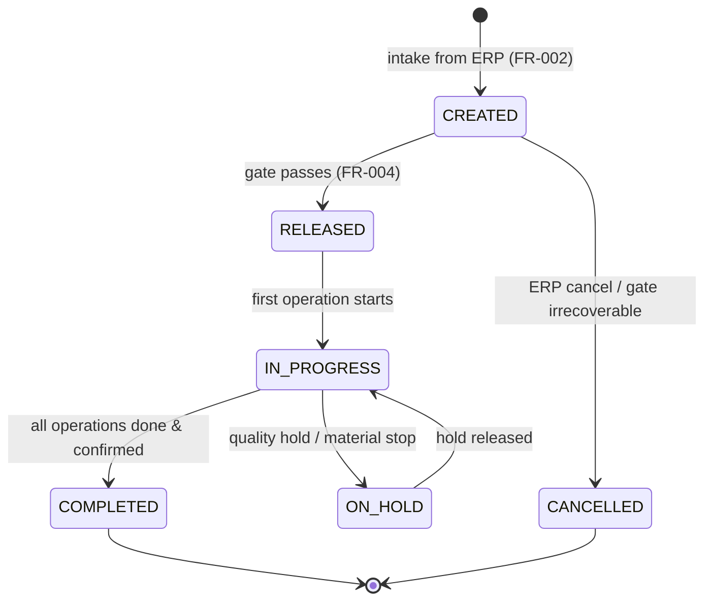
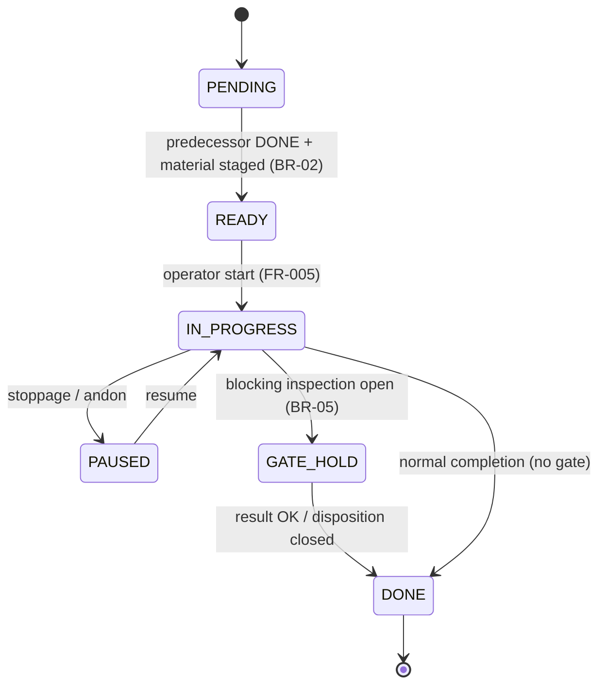
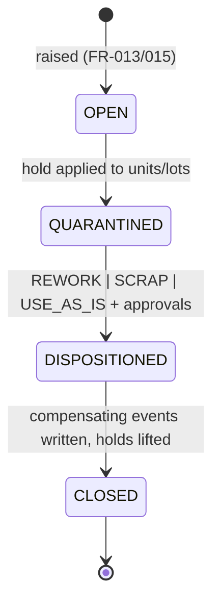

# 03 · State Machines

> ⚠️ ASSUMPTION — the SM-01..SM-05 states, transitions and guards are pack
> design; they are not derivable from ISA-95/IEC 62264 or the other cited
> standards (see [`../SOURCES.md` §4](../SOURCES.md)).

## SM-01 WorkOrder lifecycle

Guards: `RELEASED` freezes routing/BOM/inspection versions (BR-13);
`COMPLETED` requires quantity reconciliation vs. ERP (BR-01); ERP changes
affect only CREATED orders (FR-002).

## SM-02 Operation (work-order operation)

## SM-02b SerializedUnit / lot-split state

`CREATED → IN_WIP (one active work order, BR-03) → COMPLETED | SCRAPPED`;
`QUARANTINED` overlays from NCR (FR-015) and blocks transitions.

## SM-03 Andon event

`OPEN → ACKNOWLEDGED → RESOLVED`, with timed `ESCALATED` re-notifications
per role matrix (FR-007); every transition is an event (BR-07).

## SM-04 NCR lifecycle

## SM-05 Equipment state (classification, not control)

`RUNNING | IDLE | SETUP | DOWN | PM` — transitions recorded as
EquipmentStateEvents; `DOWN` requires a reason code (BR-08). These states
feed OEE exactly as defined in BR-09.
