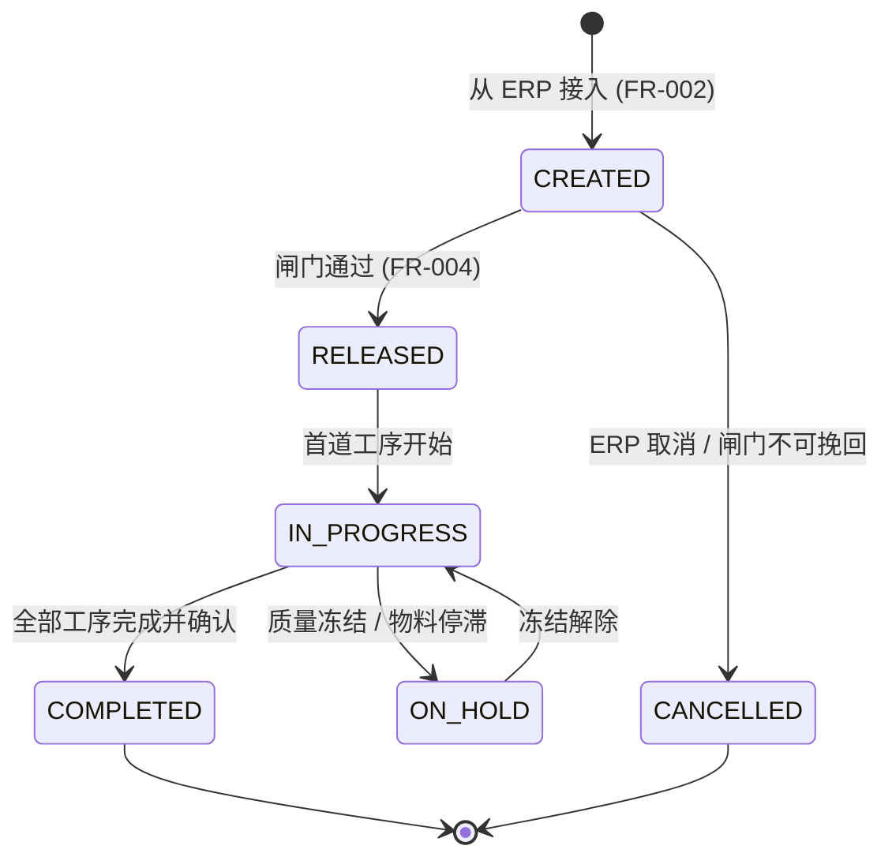
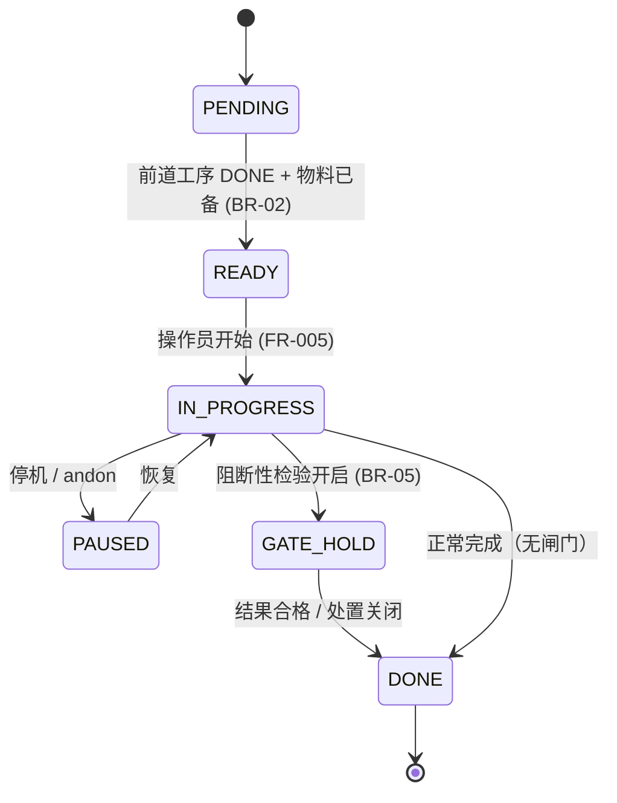
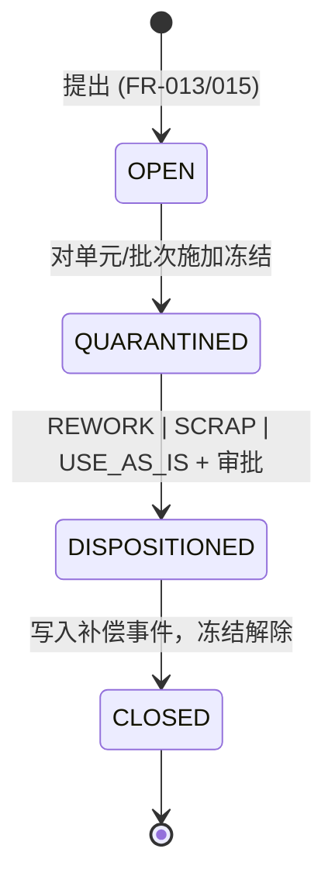

# 03 · 状态机

> ⚠️ ASSUMPTION — SM-01..SM-05 的状态、迁移与守卫属于方案包设计；它们不是
> 从 ISA-95/IEC 62264 或其他被引用标准推导出来的（见
> [`../SOURCES.md` §4](../SOURCES.md)）。

## SM-01 工单生命周期

守卫：`RELEASED` 冻结工艺路线/BOM/检验版本（BR-13）；`COMPLETED` 要求与
ERP 的数量对账（BR-01）；ERP 的变更只影响 CREATED 状态的订单（FR-002）。

## SM-02 工序（工单工序）

## SM-02b 序列化单件 / 批次拆分状态

`CREATED → IN_WIP（一个活动工单，BR-03）→ COMPLETED | SCRAPPED`；
`QUARANTINED` 自不合格品叠加而来（FR-015）并阻断迁移。

## SM-03 Andon 事件

`OPEN → ACKNOWLEDGED → RESOLVED`，并按角色矩阵做定时的 `ESCALATED` 重新
通知（FR-007）；每一次迁移都是一个事件（BR-07）。

## SM-04 不合格品生命周期

## SM-05 设备状态（一种分类，不是控制）

`RUNNING | IDLE | SETUP | DOWN | PM` —— 迁移记录为 EquipmentStateEvents；
`DOWN` 必须带原因码（BR-08）。这些状态严格按 BR-09 的定义馈入 OEE。
