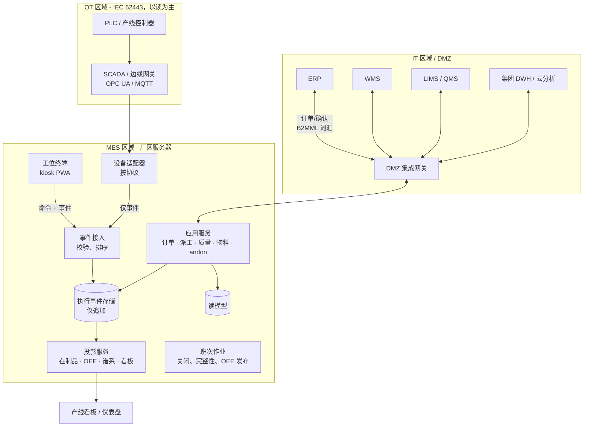

# 04 · 架构概览

## 架构风格

**事件溯源的执行内核 + 厂区边缘韧性。** 车间事实在边缘被采集为不可变事件，
仅追加存储（ADR-0002），并投影为读模型（在制品、OEE、谱系、看板）。服务是
无状态的；厂区服务器运行完整的执行平面，使生产能在 WAN/云中断期间继续
（NFR-002）。

## 组件视图



## 部署视图

```
厂区现场（权威执行平面）
├── OT 网络分段：PLC/SCADA；适配器只运行在 OT/DMZ 边界上
├── MES 网络分段：2× 应用节点（主/备）+ 事件存储
│   （本地复制）+ 终端服务；kiosk 终端接在车间 Wi-Fi/免 WAN 的 VLAN 上
└── DMZ：通往 ERP/WMS/LIMS/云的集成网关；出站发起的管道

集团层级（可选）
└── 集中分析接收复制的事件/聚合——绝不是执行的依赖（NFR-002）
```

关键属性：执行不依赖 WAN；围绕班次日历的滚动升级（NFR-007）；MES 停机期间
工位终端继续提供已下达的指令并缓冲事件（NFR-002）。

## 失败行为

| 故障 | 行为 |
|---|---|
| ERP 不可达 | 派工/执行从本地状态继续；确认消息排队（幂等重放） |
| SCADA/网关宕机 | 人工工位录入仍可用；设备事件缺口被标记并对账 |
| MES 节点宕机 | 备机接管；终端在本地缓冲（NFR-002）；无事件丢失（BR-07） |
| 读模型损坏 | 通过重放事件存储重建（ADR-0002） |

## 变体位置

行业差异（离散 vs. 流程；受监管 eDHR；工装深度）作为变体挂载——内核保持
上文定义的事件主干、派工、谱系与质量闸门。
