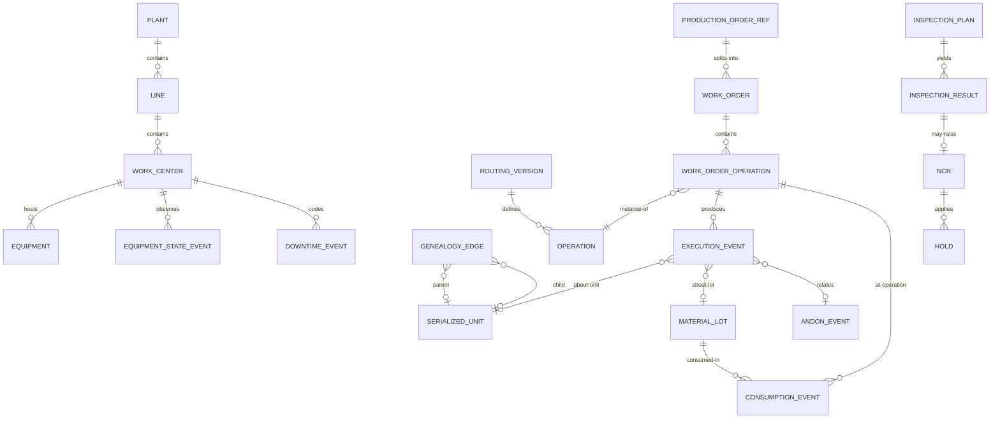

# 05 · Logical Data Model

> ⚠️ ASSUMPTION — the logical entities, keys and cardinalities are pack
> design; only the ISA-95/IEC 62264 object vocabulary they borrow is
> normative (see [`../SOURCES.md` §4](../SOURCES.md)).

Technology-neutral; physical choices (relational core + event stream, or
log-native store) are implementation freedom, bounded by ADR-0002: shop-floor
facts live append-only.

## ER view (logical)

## Entity groups

### Manufacturing Model (effective-dated, BR-13)

| Entity | Key | Notable attributes |
|---|---|---|
| plant / line / work_center | id (hierarchy) | timezone, calendar ref |
| equipment | equipment_id | work_center ref, protocol profile ref, criticality |
| material | material_id | type, unit of measure, tracking level (lot/serial) |
| bom_version | (material, version, effective_from) | components[] {material, qty, tracking} |
| routing_version | (material, version, effective_from) | operations[] {seq, work_center, ideal_cycle_time, params schema} |
| personnel / skill | operator_id / (operator, skill) | shift calendar ref |
| inspection_plan | (routing_version, op_seq, version) | checks[] {type, blocking (BR-05), spc char?} |

### Planning & Execution

| Entity | Key | Notable attributes |
|---|---|---|
| production_order_ref | erp_order_id | authorized qty, material, status mirror |
| work_order | wo_id | state (SM-01), planned/completed/scrap qty, releasedWith{bom, routing, plans} |
| work_order_operation | (wo_id, op_seq) | state (SM-02), work_center, good/scrap/rework rollup |
| execution_event | event_id | type, source, source_ts, ingestion_ts, refs {wo, op, unit, lot, equipment, operator}, payload(json), sequence — **append-only** |
| andon_event | event_id | state (SM-03), escalation steps[], ack/resolution refs |

### Material & Genealogy

| Entity | Key | Notable attributes |
|---|---|---|
| material_lot | lot_id | material ref, qty ≥ 0 (BR-04), status (OK/QUARANTINED/BLOCKED), expiry? |
| serialized_unit | unit_id | current_work_order (one active, BR-03), state (SM-02b), quarantine overlay |
| consumption_event | event_id | lot, operation, qty, mode (actual/backflush) — event subtype |
| genealogy_edge | edge_id | parent (unit|lot), child (unit|lot), via operation, consumption ref — DAG |
| wip_state (projection) | (wo_id, op_seq, unit/lot) | rebuilt from events; rebuildable (ADR-0002) |

### Quality / Equipment / Reporting

| Entity | Key | Notable attributes |
|---|---|---|
| inspection_result | result_id | plan ref, values, verdict, operator, signature? (variant) |
| ncr | ncr_id | affected refs, disposition, approvals[] (SM-04) |
| hold | hold_id | scope (unit/lot/wo), reason, released_at? |
| equipment_state_event | event_id | state (SM-05), source (auto/manual) |
| downtime_event | event_id | reason code, start/end, uncoded default (BR-08) |
| oee_aggregate (projection) | (work_center, shift/day) | per BR-09 formulas |
| traceability_dossier | dossier_id | query ref, integrity manifest (FR-021) |

## Integrity constraints (normative)

Constraints the model must enforce. They are numbered and stable, and each
names the `BR-`/`FR-` identifier it enforces. The closing sentence records
which are enforced **in the store** rather than in application code — a claim
the pack makes about itself, not a verified property, since application
discipline is exactly what a later change bypasses.

| # | Constraint | Enforces |
|---|---|---|
| 1 | `EXECUTION_EVENT` is append-only; a correction is a **compensating** event referencing the original | BR-07, ADR-0002 |
| 2 | An operation cannot start unless its routing predecessor is complete and its material is available | BR-02 |
| 3 | A WIP unit (serialized unit or lot split) belongs to exactly one active work order at a time | BR-03 |
| 4 | Shop-floor `MATERIAL_LOT` balance never goes negative; consumption beyond on-hand is rejected | BR-04 |
| 5 | A blocking inspection gate is enforced by the workflow engine; no event records completion past a failed gate | BR-05 |
| 6 | A finished unit's genealogy dossier resolves to lots of **all** key components; an incomplete dossier is not completable | BR-06 |
| 7 | `DOWNTIME_EVENT.reason_code` is NOT NULL before shift close; uncoded downtime is auto-coded **and flagged** | BR-08 |
| 8 | OEE is computed only from validated state events, using the pack's stated formulas; a hand-entered OEE value is illegal | BR-09 |
| 9 | Events carry a source timestamp; a clock skew beyond the configured bound is rejected or flagged, never silently re-stamped | BR-10 |
| 10 | A work order references the routing and BOM **version** in force at release; master-data changes are effective-dated and never mutate a released order | BR-13 |
| 11 | Equipment writes are limited to non-control peripherals (label printers, scanners, HMI read paths) | BR-12, ADR-0003 |
| 12 | Regulated variants only: a record step requiring e-signature cannot be backdated or re-signed | BR-11 |
| 13 | A work-order quantity change reconciles against the ERP production order; MES never grants itself more quantity | BR-01, ADR-0001 |

> Constraints 1, 3, 4, 6, 8 and 10 are **enforced in the store**, not in
> application code. An editable execution history, a WIP unit in two orders, a
> negative material balance, an incomplete genealogy dossier, a hand-entered
> OEE figure, or a released order silently re-pointed at new master data is a
> defect regardless of what application discipline promises — and in this
> domain the defect is a recall that cannot be executed.
