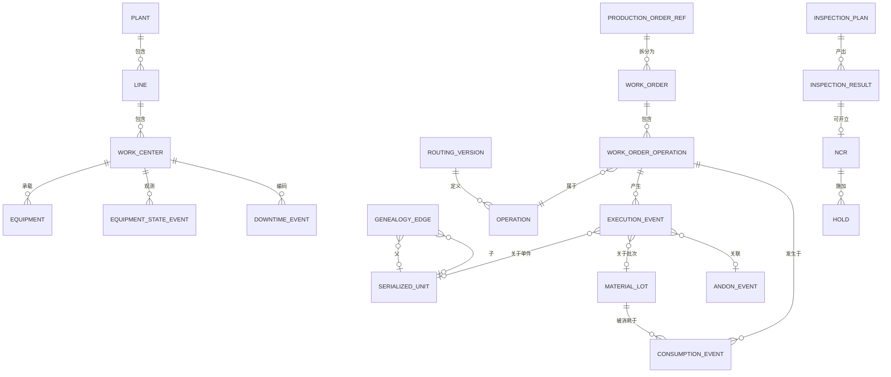

# 05 · 逻辑数据模型

> ⚠️ ASSUMPTION — 逻辑实体、键与基数属于方案包设计；只有它们借用的
> ISA-95/IEC 62264 对象词汇具有规范效力（见
> [`../SOURCES.md` §4](../SOURCES.md)）。

技术中立；物理选择（关系型内核 + 事件流，或日志原生存储）是实现自由度，但受
ADR-0002 约束：车间事实仅可追加地活着。

## ER 视图（逻辑）

## 实体分组

### 制造模型（带生效日，BR-13）

| 实体 | 键 | 值得注意的属性 |
|---|---|---|
| plant / line / work_center | id（层级） | 时区、日历引用 |
| equipment | equipment_id | 工作中心引用、协议画像引用、关键度 |
| material | material_id | 类型、计量单位、跟踪级别（批次/序列号） |
| bom_version | (material, version, effective_from) | components[] {material, qty, tracking} |
| routing_version | (material, version, effective_from) | operations[] {seq, work_center, ideal_cycle_time, params schema} |
| personnel / skill | operator_id / (operator, skill) | 班次日历引用 |
| inspection_plan | (routing_version, op_seq, version) | checks[] {type, blocking (BR-05), spc char?} |

### 规划与执行

| 实体 | 键 | 值得注意的属性 |
|---|---|---|
| production_order_ref | erp_order_id | 授权数量、物料、状态镜像 |
| work_order | wo_id | state (SM-01)、计划/完成/报废数量、releasedWith{bom, routing, plans} |
| work_order_operation | (wo_id, op_seq) | state (SM-02)、工作中心、良品/报废/返工汇总 |
| execution_event | event_id | type、source、source_ts、ingestion_ts、refs {wo, op, unit, lot, equipment, operator}、payload(json)、sequence — **仅追加** |
| andon_event | event_id | state (SM-03)、升级步骤[]、确认/解决引用 |

### 物料与谱系

| 实体 | 键 | 值得注意的属性 |
|---|---|---|
| material_lot | lot_id | 物料引用、数量 ≥ 0（BR-04）、状态 (OK/QUARANTINED/BLOCKED)、有效期? |
| serialized_unit | unit_id | current_work_order（一个活动工单，BR-03）、state (SM-02b)、隔离叠加 |
| consumption_event | event_id | 批次、工序、数量、模式 (actual/backflush) —— 事件子类型 |
| genealogy_edge | edge_id | 父 (unit\|lot)、子 (unit\|lot)、经由工序、消耗引用 —— DAG |
| wip_state（投影） | (wo_id, op_seq, unit/lot) | 由事件重建；可重建（ADR-0002） |

### 质量 / 设备 / 报告

| 实体 | 键 | 值得注意的属性 |
|---|---|---|
| inspection_result | result_id | 计划引用、取值、判定、操作员、签名?（变体） |
| ncr | ncr_id | 受影响引用、处置、审批[]（SM-04） |
| hold | hold_id | 范围 (unit/lot/wo)、理由、released_at? |
| equipment_state_event | event_id | 状态 (SM-05)、来源 (auto/manual) |
| downtime_event | event_id | 原因码、起止、未编码默认值（BR-08） |
| oee_aggregate（投影） | (work_center, shift/day) | 按 BR-09 公式 |
| traceability_dossier | dossier_id | 查询引用、完整性清单（FR-021） |

## 完整性约束（具有规范效力）

模型必须强制执行的约束。它们有编号且稳定，每一条都指明它所强制执行的
`BR-`/`FR-` 标识。收尾那句记录了其中哪些是**在存储层**强制执行的，而不是
在应用代码中——这是本方案包对自己的声明，不是经过验证的属性，因为应用纪律
恰恰是日后某次改动会绕过的东西。

| # | 约束 | 强制执行 |
|---|---|---|
| 1 | `EXECUTION_EVENT` 仅可追加；一次更正是一个引用原事件的**补偿**事件 | BR-07、ADR-0002 |
| 2 | 一道工序在其工艺路线前道未完成、物料不可用时不能开始 | BR-02 |
| 3 | 一个在制品单元（序列化单元或批次拆分）在同一时刻恰好属于一个活动工单 | BR-03 |
| 4 | 车间 `MATERIAL_LOT` 余额永不为负；超出在手量的消耗被拒绝 | BR-04 |
| 5 | 阻断性检验闸门由工作流引擎强制；没有事件能记录越过失败闸门的完成 | BR-05 |
| 6 | 一个完工单元的谱系档案解析到**所有**关键部件的批次；不完整的档案不可被补全 | BR-06 |
| 7 | 班次关闭前 `DOWNTIME_EVENT.reason_code` 为 NOT NULL；未编码停机被自动编码**并标记** | BR-08 |
| 8 | OEE 只从已校验的状态事件按本方案包所述公式计算；手工录入的 OEE 数值是非法的 | BR-09 |
| 9 | 事件携带来源时间戳；超出配置界限的时钟偏差被拒绝或标记，绝不被静默重新盖戳 | BR-10 |
| 10 | 工单引用下达时生效的工艺路线与 BOM **版本**；主数据变更带生效日，绝不改写已下达的订单 | BR-13 |
| 11 | 设备写入限于非控制类外设（标签打印机、扫描枪、HMI 读路径） | BR-12、ADR-0003 |
| 12 | 仅受监管变体：需要电子签名的记录步骤不得回填日期或重签 | BR-11 |
| 13 | 工单数量变更与 ERP 生产订单对账；MES 绝不自行给自己更多数量 | BR-01、ADR-0001 |

> 约束 1、3、4、6、8 和 10 是**在存储层强制执行**的，而不是在应用代码中。
> 一份可编辑的执行历史、一个同时挂在两张订单上的在制品单元、一个负的物料
> 余额、一份不完整的谱系档案、一个手工录入的 OEE 数字，或一张被悄悄指向
> 新主数据的已下达订单，无论应用纪律作出何种承诺都是缺陷——而在这一领域，
> 这个缺陷就是一次无法执行的召回。
