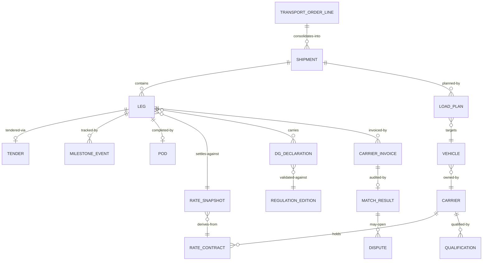

# 03 · Domain Model

> ⚠️ ASSUMPTION — the bounded-context decomposition and its invariants are
> pack design. EPCIS/CBV 2.0 defines event *vocabulary*, and EDIFACT/X12
> define message *formats*, but no cited standard mandates this decomposition.
> See [`../SOURCES.md` §4](../SOURCES.md).

## Bounded contexts

| Context | Responsibility | Owns |
|---|---|---|
| **Order Management** | Demand intake, consolidation, multi-leg structure | TransportOrderLine, Shipment, Leg |
| **Carrier & Rate** | Carrier master, qualifications, effective-dated rate contracts | Carrier, Qualification, RateContract, RateSnapshot |
| **Planning** | Load building, routing, dispatch plans (solver pluggable) | LoadPlan, Route, Stop, DispatchPlan |
| **Execution & Visibility** | Tender lifecycle, milestone event stream, ETA, exceptions, POD | Tender, MilestoneEvent, Exception, Pod |
| **Settlement** | Cost computation, invoice audit, disputes, settlement batches | FreightCost, CarrierInvoice, MatchResult, Dispute, SettlementBatch |
| **DG Compliance** | Regulation data editions, consignment DG metadata, validations | RegulationEdition, DgDeclaration, ValidationResult |
| **Publication** | Read-model & EPCIS/EDI outbound | EpcisEventOutbox, EdiMessageLog |

## Core aggregates & invariants

### Shipment / Leg (aggregate roots)
```
Shipment: id, orderLineRefs[], consolidation info, planned {loadPlan, route}
├── legs: [Leg] ordered
│   Leg: id, seq, carrierRef, mode, planned {window, vehicle, driver?},
│        tender (SM-T2), actual milestones[], pod?, rateSnapshotRef
└── invariants
    • order-line qty derived from demand, never exceeds it (BR-01, FR-001)
    • leg dispatch requires tender acceptance (BR-03)
    • DELIVERED only with POD (BR-06)
    • plan fields mutate only via new plan revision; actuals append (BR-02)
```

### RateSnapshot (immutable fact)
```
RateSnapshot: id, rateContractRef, version, components {linehaul, fuel basis,
  accessorials[]}, frozenAt (tender acceptance, BR-04)
└── invariants
    • created once at acceptance; never edited (BR-04, BR-11)
    • settlement computes only from snapshots (FR-014)
```

### MilestoneEvent (immutable fact)
```
MilestoneEvent: id, legRef, epcisBusinessStep?, disposition?, position?,
source (telematics|edi|manual|system), sourceTs, ingestionTs, payload
└── invariants
    • append-only; corrections are compensating events (BR-11, FR-011)
    • partner-published subset maps to EPCIS/CBV 2.0 vocabulary (FR-021)
```

### DgDeclaration
```
DgDeclaration: id, consignmentLineRef, unNumber, psn, classDivision,
  packingGroup?, qty, regulationEditionRef
└── invariants
    • every field validated against the loaded edition table (BR-07, FR-017)
    • dispatch blocked when edition not in force for transport date (NFR-010)
```

### CarrierInvoice / MatchResult
```
CarrierInvoice: id, carrierRef, lines[], total, documentRef
MatchResult: invoiceRef, three-way {orderTender, execution, invoice},
  status (AUTO_APPROVED|DISPUTED), tolerance verdict (BR-05)
└── invariants
    • no payment path without an AUTO_APPROVED MatchResult (FR-015)
    • MatchResult & Dispute are append-only (BR-11)
```

## Relationships (logical)


