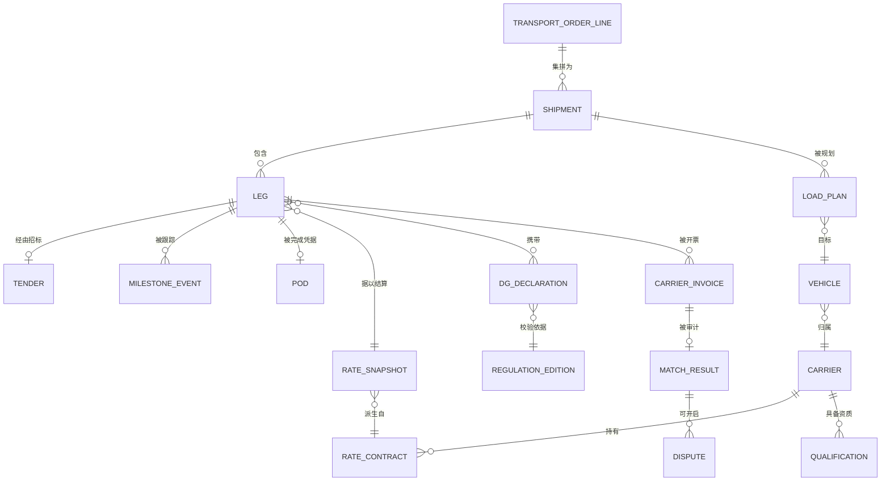

# 03 · 领域模型

> ⚠️ ASSUMPTION — 限界上下文的分解及其不变量属于方案包设计。EPCIS/CBV 2.0
> 定义的是事件*词汇*，EDIFACT/X12 定义的是报文*格式*，但没有任何被引用的标准
> 强制要求这一分解。见 [`../SOURCES.md` §4](../SOURCES.md)。

## 限界上下文

| 上下文 | 职责 | 拥有的类型 |
|---|---|---|
| **订单管理** | 需求接入、集拼、多段结构 | TransportOrderLine、Shipment、Leg |
| **承运商与费率** | 承运商主数据、资质、带生效日期的费率合同 | Carrier、Qualification、RateContract、RateSnapshot |
| **规划** | 装载构建、路径、派车计划（求解器可插拔） | LoadPlan、Route、Stop、DispatchPlan |
| **执行与可视化** | 招标生命周期、里程碑事件流、ETA、异常、POD | Tender、MilestoneEvent、Exception、Pod |
| **结算** | 成本计算、发票审计、争议、结算批次 | FreightCost、CarrierInvoice、MatchResult、Dispute、SettlementBatch |
| **危险品合规** | 法规数据版本、托运危险品元数据、校验 | RegulationEdition、DgDeclaration、ValidationResult |
| **发布** | 读模型与 EPCIS/EDI 出站 | EpcisEventOutbox、EdiMessageLog |

## 核心聚合与不变量

### Shipment / Leg（聚合根）
```
Shipment: id, orderLineRefs[], consolidation info, planned {loadPlan, route}
├── legs: [Leg] ordered
│   Leg: id, seq, carrierRef, mode, planned {window, vehicle, driver?},
│        tender (SM-T2), actual milestones[], pod?, rateSnapshotRef
└── invariants
    • 订单行数量由需求推导，绝不超出（BR-01、FR-001）
    • 运输段派车要求先有招标接单（BR-03）
    • DELIVERED 必须有 POD（BR-06）
    • 计划字段只能通过新的计划修订变更；实际值只追加（BR-02）
```

### RateSnapshot（不可变事实）
```
RateSnapshot: id, rateContractRef, version, components {linehaul, fuel basis,
  accessorials[]}, frozenAt (tender acceptance, BR-04)
└── invariants
    • 接单时创建一次；绝不被编辑（BR-04、BR-11）
    • 结算只依据快照计算（FR-014）
```

### MilestoneEvent（不可变事实）
```
MilestoneEvent: id, legRef, epcisBusinessStep?, disposition?, position?,
source (telematics|edi|manual|system), sourceTs, ingestionTs, payload
└── invariants
    • 仅追加；更正以补偿事件表达（BR-11、FR-011）
    • 面向伙伴发布的子集映射到 EPCIS/CBV 2.0 词汇（FR-021）
```

### DgDeclaration
```
DgDeclaration: id, consignmentLineRef, unNumber, psn, classDivision,
  packingGroup?, qty, regulationEditionRef
└── invariants
    • 每个字段都针对已加载的版本表校验（BR-07、FR-017）
    • 当运输日期在生效版本之外时阻断派车（NFR-010）
```

### CarrierInvoice / MatchResult
```
CarrierInvoice: id, carrierRef, lines[], total, documentRef
MatchResult: invoiceRef, three-way {orderTender, execution, invoice},
  status (AUTO_APPROVED|DISPUTED), tolerance verdict (BR-05)
└── invariants
    • 没有 AUTO_APPROVED 的 MatchResult 就没有任何付款路径（FR-015）
    • MatchResult 与 Dispute 仅可追加（BR-11）
```

## 关系（逻辑）


