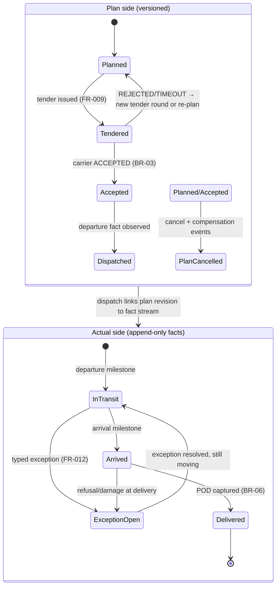
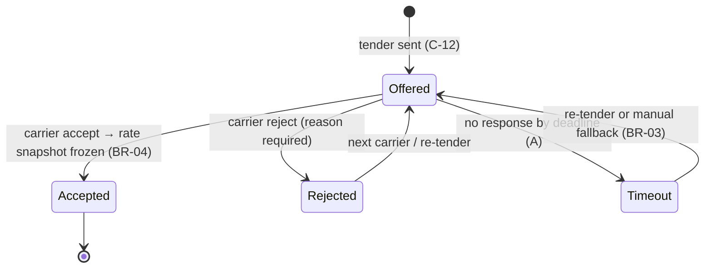
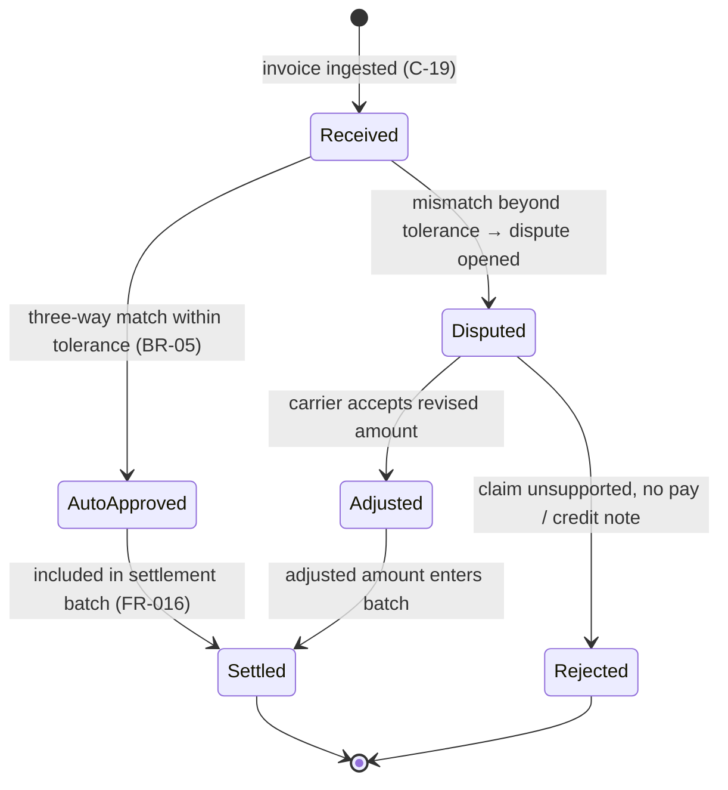
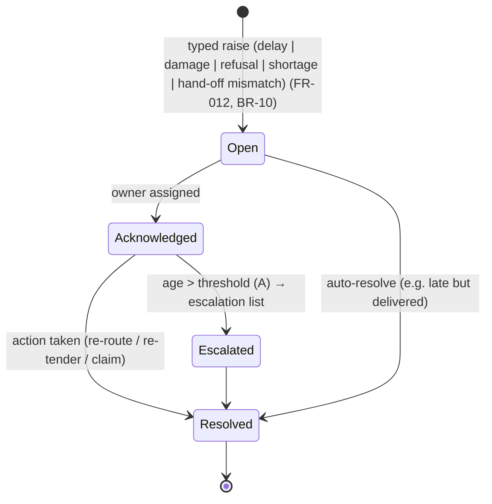
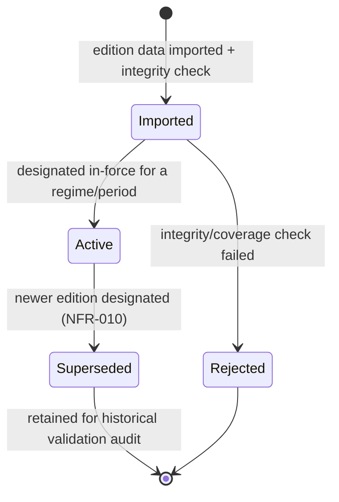

# 03-domain / State Machines

> ⚠️ ASSUMPTION — SM-T1..SM-T4 states and transitions are pack design, not
> derived from a standard (EPCIS supplies event *vocabulary*, not lifecycle
> states — see [`../SOURCES.md` §4](../SOURCES.md)).

The dual-state stance (ADR-0005) is visible in SM-T1: the **plan side** and
the **actual side** are separate machines that never mutate each other.

## SM-T1 Leg (plan side × actual side)

Key: replanning (window/carrier change) creates a **new plan revision**;
KPIs compare actuals against the *original accepted* revision (ADR-0005,
FR-012). `Delivered` is unreachable without a POD (BR-06).

## SM-T2 Tender (per leg, per round)

Every round is recorded (`leg, round` key); history of rounds is never
rewritten (BR-11).

## SM-T3 Carrier invoice → settlement

No payment path exists without `AutoApproved` or an `Adjusted` outcome;
`MatchResult` and `Dispute` records are append-only (BR-11, FR-015).

## SM-T4 Exception

Opening an exception **never** mutates the plan or the fact stream; it links
to a plan revision when replanning occurs (BR-02).

## SM-T5 Regulation edition

Dispatch validation always resolves the edition in force **for the
transport date**; a missing in-force edition blocks dispatch (ADR-0003,
NFR-010).
