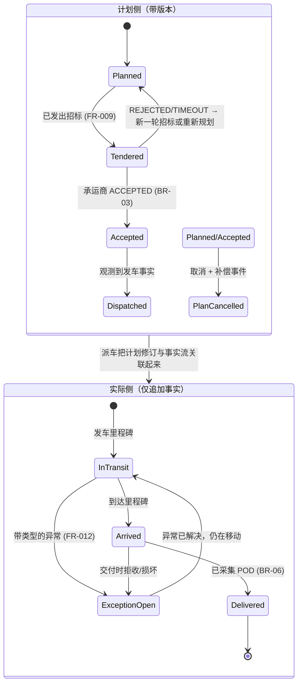
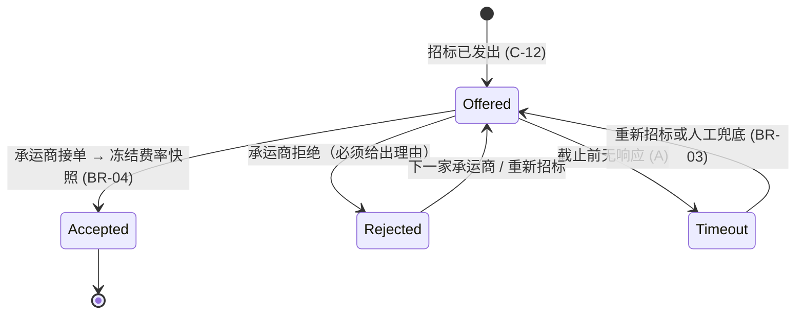
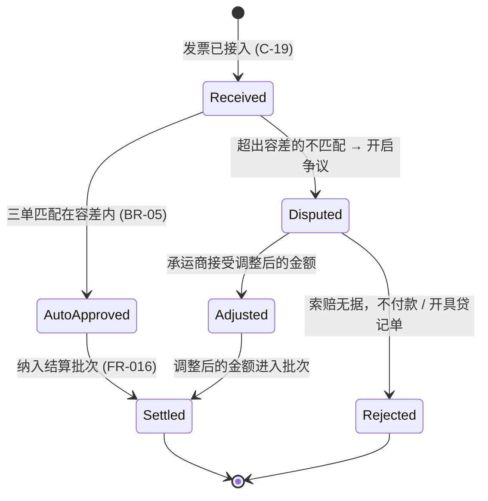
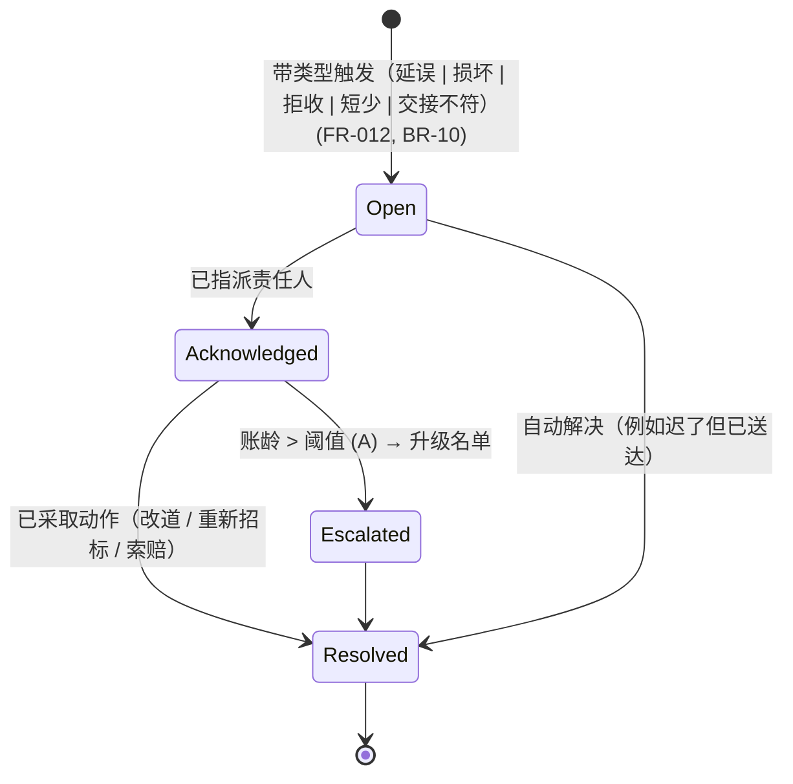
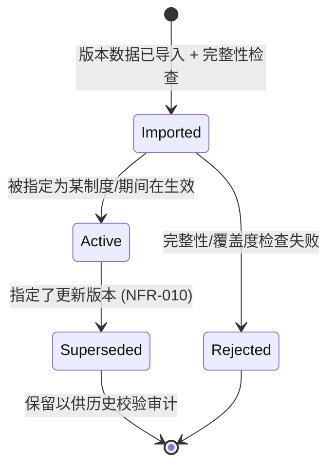

# 03-domain / 状态机

> ⚠️ ASSUMPTION — SM-T1..SM-T4 的状态与迁移属于方案包设计，并非从标准推导
> （EPCIS 提供的是事件*词汇*，不是生命周期状态——见
> [`../SOURCES.md` §4](../SOURCES.md)）。

双状态立场（ADR-0005）在 SM-T1 中清晰可见：**计划侧**与**实际侧**是两台
永不互相改写的独立状态机。

## SM-T1 运输段（计划侧 × 实际侧）

要点：重新规划（时间窗/承运商变更）创建一个**新的计划修订**；KPI 把实际值
与*最初被接单的*修订做比较（ADR-0005、FR-012）。没有 POD 就无法到达
`Delivered`（BR-06）。

## SM-T2 招标（按运输段、按轮次）

每一轮都被记录（键为 `leg, round`）；各轮历史绝不被改写（BR-11）。

## SM-T3 承运商发票 → 结算

没有 `AutoApproved` 或 `Adjusted` 结果就不存在任何付款路径；`MatchResult` 与
`Dispute` 记录仅可追加（BR-11、FR-015）。

## SM-T4 异常

开启异常**绝不**改写计划或事实流；发生重新规划时它会关联到一个计划修订
（BR-02）。

## SM-T5 法规版本

派车校验始终解析**运输日期当时**在生效的版本；缺少在生效版本会阻断派车
（ADR-0003、NFR-010）。
