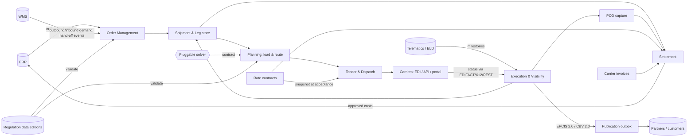

# 04 · Architecture Overview

> ⚠️ ASSUMPTION — component decomposition and deployment topology are pack
> design; the ADRs below are the load-bearing decisions. See
> [`../SOURCES.md` §4](../SOURCES.md).

## Component view

## Key structural rules

- **Event spine**: milestone/POD/dispute facts are append-only
  (ADR-0005, BR-11); projections (shipment view, KPIs, EPCIS outbox) are
  derived, never source of truth.
- **Solver outside the core** (ADR-0002): the contract is the interface;
  rule-based fallback keeps the core runnable without one.
- **Regulation data is data** (ADR-0003): loaded editions guard dispatch
  (NFR-010); the core ships no DG rule text.
- **Money path is snapshot-driven** (ADR-0004): settlement computes only
  from frozen RateSnapshots; invoices never re-price on live contracts.

## Deployment view (reference)

| Element | Notes |
|---|---|
| Core services | Order/planning/dispatch/settlement behind one API gateway; stateless horizontally `(A)` |
| Event store | Append-only log + relational projection store (same stance as sibling packs) |
| EDI/connectivity | Per-carrier adapter instances isolated; message log per adapter |
| Solver | Optional sidecar/service; contract-versioned |
| Outbox publisher | EPCIS capture endpoint + webhook fan-out; partner-scoped credentials |
| Telemetry ingest | Position stream normalizer; PII-minimized before persistence (CTL-06) |

> The topology is illustrative; pack stance is `stack-agnostic`.
