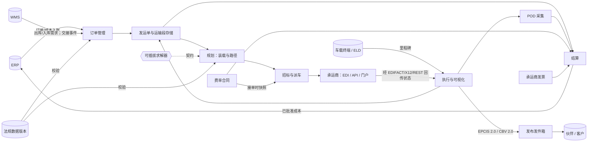

# 04 · 架构概览

> ⚠️ ASSUMPTION — 组件分解与部署拓扑属于方案包设计；下面的 ADR 承载承重的
> 决策。见 [`../SOURCES.md` §4](../SOURCES.md)。

## 组件视图

## 关键结构规则

- **事件主干**：里程碑/POD/争议事实仅可追加（ADR-0005、BR-11）；投影（运输单
  视图、KPI、EPCIS 发件箱）是派生的，绝不是真相来源。
- **求解器在内核之外**（ADR-0002）：契约就是接口；基于规则的兜底让内核在没有
  求解器时依然可运行。
- **法规数据就是数据**（ADR-0003）：已加载的版本为派车把关（NFR-010）；内核
  不携带任何危险品规则文本。
- **资金路径由快照驱动**（ADR-0004）：结算只依据冻结的 RateSnapshot 计算；
  发票绝不按实时合同重新定价。

## 部署视图（参考）

| 要素 | 说明 |
|---|---|
| 核心服务 | 订单/规划/派车/结算置于同一个 API 网关之后；水平无状态 `(A)` |
| 事件存储 | 仅追加日志 + 关系型投影存储（与兄弟方案包同一立场） |
| EDI/连接 | 每个承运商一个隔离的适配器实例；每个适配器一份报文日志 |
| 求解器 | 可选的 sidecar/服务；契约带版本 |
| 发件箱发布器 | EPCIS 捕获端点 + Webhook 扇出；按伙伴范围配发凭据 |
| 遥测接入 | 位置流规范化器；持久化前做 PII 最小化（CTL-06） |

> 拓扑仅作示意；本方案包的立场是 `stack-agnostic`。
