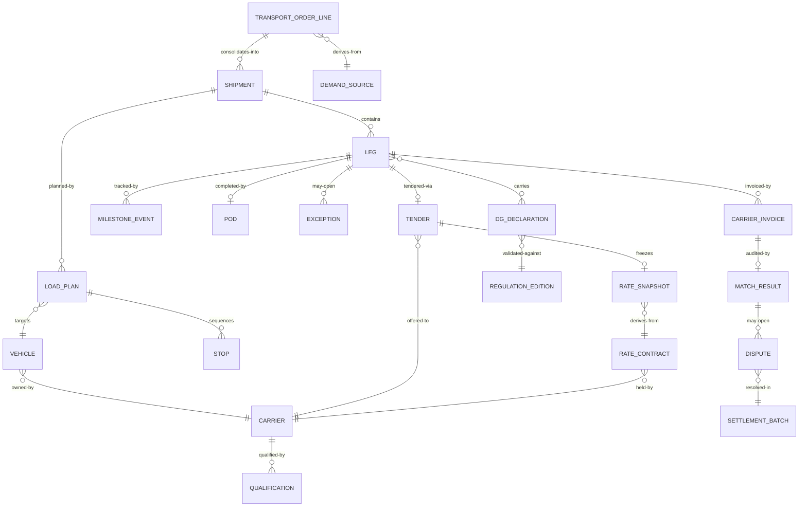

# 05 · Logical Data Model

> ⚠️ ASSUMPTION — the logical entities, keys and cardinalities are pack
> design; the borrowed vocabulary (EPCIS business steps/dispositions,
> UN numbers/PSN, Incoterms® terms) is normative and cited in
> [`../SOURCES.md`](../SOURCES.md).

Technology-neutral; physical choices are implementation freedom, bounded by
ADR-0005: execution facts live append-only.

## ER view (logical)

## Entity groups

### Demand & structure

| Entity | Key | Notable attributes |
|---|---|---|
| demand_source | source_system + source_id | type (erp_order/wms_outbound/…), authorized qty, Incoterms® rule (BR-12) |
| transport_order_line | line_id | demand_source ref, qty (≤ authorized, BR-01), window, DG flag |
| shipment | shipment_id | order_line refs, consolidation provenance, plan revision no. |
| leg | leg_id | shipment ref, seq, carrier ref, mode, planned window, state (see state notes) |

### Carrier & rate

| Entity | Key | Notable attributes |
|---|---|---|
| carrier | carrier_id | type (3pl/own_fleet), contacts, payment identity (security.md) |
| qualification | (carrier, attribute, effective range) | lanes, service levels, insurance, DG authorization |
| rate_contract | (carrier, contract_id, version, effective range) | components: linehaul, fuel basis, accessorials |
| rate_snapshot | snapshot_id | contract ref+version, frozen components, frozen_at (BR-04) — **immutable** |
| vehicle | vehicle_id | capacity (weight, volume), DG authorization, owner carrier |
| driver | driver_id | qualification, personal-data scope (CTL-06) |

### Execution facts (append-only per BR-11, ADR-0005)

| Entity | Key | Notable attributes |
|---|---|---|
| tender | (leg, round) | outcome (ACCEPTED/REJECTED/TIMEOUT), responded_at |
| milestone_event | event_id | leg ref, EPCIS business step/disposition mapping (FR-021), position?, source, source_ts, ingestion_ts, payload |
| pod | leg_id | signature/photo/e-POD ref, captured_at (BR-06) |
| exception | exception_id | leg ref, type (delay/damage/refusal/shortage), opened_at, plan_revision link (BR-02) |

### DG compliance (ADR-0003)

| Entity | Key | Notable attributes |
|---|---|---|
| regulation_edition | edition_id | regime (adr/imdg/iata-dgr/jt617/gb6944), valid-from/to, import audit ref |
| dg_declaration | declaration_id | leg/line ref, UN number, PSN, class/division, packing group, qty, edition ref |
| validation_result | (declaration, check, ts) | verdict, violated constraint citation |

### Settlement (append-only outcomes)

| Entity | Key | Notable attributes |
|---|---|---|
| freight_cost | (leg, calc_run) | computed from snapshot + actuals (FR-014) |
| carrier_invoice | invoice_id | carrier ref, lines, total, document ref |
| match_result | (invoice, run) | three-way verdicts, tolerance outcome (BR-05), status |
| dispute | dispute_id | match ref, claimed vs. agreed delta, outcome event |
| settlement_batch | batch_id | carrier, period, approved invoices |

### Publication

| Entity | Key | Notable attributes |
|---|---|---|
| epcis_outbox | event_id | EPCIS 2.0 document ref, publish status, partner scope |
| edi_message_log | message_id | channel, direction, payload ref, audit trail (FR-022) |
