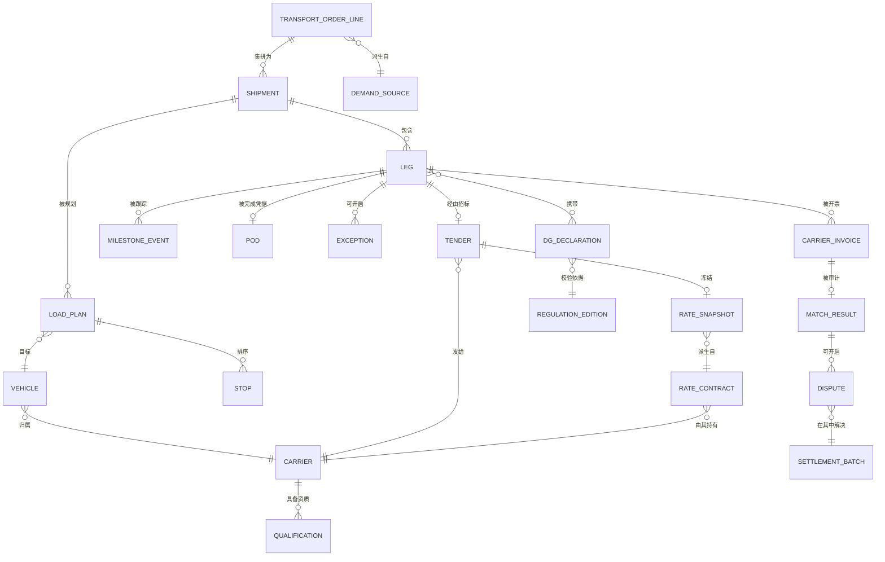

# 05 · 逻辑数据模型

> ⚠️ ASSUMPTION — 逻辑实体、键与基数属于方案包设计；借用的术语（EPCIS 业务
> 步骤/处置、UN 编号/PSN、Incoterms® 术语）具有规范效力，并在
> [`../SOURCES.md`](../SOURCES.md) 中引用。

技术中立；物理选择是实现自由度，但受 ADR-0005 约束：执行事实仅可追加。

## ER 视图（逻辑）

## 实体分组

### 需求与结构

| 实体 | 键 | 值得注意的属性 |
|---|---|---|
| demand_source | source_system + source_id | 类型 (erp_order/wms_outbound/…)、授权数量、Incoterms® 规则 (BR-12) |
| transport_order_line | line_id | demand_source 引用、数量（≤ 授权量，BR-01）、时间窗、危险品标记 |
| shipment | shipment_id | 订单行引用、集拼来源、计划修订号 |
| leg | leg_id | 发运单引用、序号、承运商引用、方式、计划时间窗、状态（见状态说明） |

### 承运商与费率

| 实体 | 键 | 值得注意的属性 |
|---|---|---|
| carrier | carrier_id | 类型 (3pl/own_fleet)、联系人、付款身份（security.md） |
| qualification | (carrier, attribute, effective range) | 航线、服务等级、保险、危险品授权 |
| rate_contract | (carrier, contract_id, version, effective range) | 组成部分：干线运费、燃油基准、附加费 |
| rate_snapshot | snapshot_id | 合同引用+版本、冻结的组成部分、frozen_at (BR-04) — **不可变** |
| vehicle | vehicle_id | 运力（重量、体积）、危险品授权、所属承运商 |
| driver | driver_id | 资质、个人数据范围（CTL-06） |

### 执行事实（按 BR-11、ADR-0005 仅可追加）

| 实体 | 键 | 值得注意的属性 |
|---|---|---|
| tender | (leg, round) | 结果 (ACCEPTED/REJECTED/TIMEOUT)、responded_at |
| milestone_event | event_id | leg 引用、EPCIS 业务步骤/处置映射（FR-021）、位置?、来源、source_ts、ingestion_ts、载荷 |
| pod | leg_id | 签名/照片/e-POD 引用、captured_at (BR-06) |
| exception | exception_id | leg 引用、类型 (delay/damage/refusal/shortage)、opened_at、计划修订关联 (BR-02) |

### 危险品合规（ADR-0003）

| 实体 | 键 | 值得注意的属性 |
|---|---|---|
| regulation_edition | edition_id | 制度 (adr/imdg/iata-dgr/jt617/gb6944)、生效起止、导入审计引用 |
| dg_declaration | declaration_id | leg/行引用、UN 编号、PSN、类别/项别、包装类别、数量、版本引用 |
| validation_result | (declaration, check, ts) | 结论、被违反约束的引用 |

### 结算（仅追加的结果）

| 实体 | 键 | 值得注意的属性 |
|---|---|---|
| freight_cost | (leg, calc_run) | 依据快照 + 实际值计算（FR-014） |
| carrier_invoice | invoice_id | 承运商引用、明细行、合计、单证引用 |
| match_result | (invoice, run) | 三方结论、容差结果 (BR-05)、状态 |
| dispute | dispute_id | 匹配引用、主张与认可金额的差额、结果事件 |
| settlement_batch | batch_id | 承运商、周期、已通过的发票 |

### 发布

| 实体 | 键 | 值得注意的属性 |
|---|---|---|
| epcis_outbox | event_id | EPCIS 2.0 文档引用、发布状态、伙伴范围 |
| edi_message_log | message_id | 通道、方向、载荷引用、审计轨迹 (FR-022) |

## 完整性约束（具有规范效力）

模型必须强制执行的约束。它们有编号且稳定，每一条都指明它所强制执行的
`BR-`/`FR-` 标识。收尾那句记录了其中哪些是**在存储层**强制执行的，而不是
在应用代码中——这是本方案包对自己的声明，不是经过验证的属性，因为应用纪律
恰恰是日后某次改动会绕过的东西。

| # | 约束 | 强制执行 |
|---|---|---|
| 1 | 计划与实际是两个独立状态；`MILESTONE_EVENT` 仅可追加，计划行绝不被实际值改写 | BR-02、ADR-0005 |
| 2 | `TRANSPORT_ORDER_LINE.quantity` 由授权需求推导而来，且永不超出 | BR-01、ADR-0001 |
| 3 | 一个 `LEG` 只有在存在 `TENDER` 接单之后才能达到 DISPATCHED；自动接单被记录为自动接单，而不是人工接单 | BR-03 |
| 4 | 接单冻结 `RATE_SNAPSHOT`；发票绝不按比快照更新的合同版本定价 | BR-04、ADR-0004 |
| 5 | 三方匹配（订单/招标/执行事实/发票）记录其结论；超出容差的差异在没有记录审批人的情况下不能被通过 | BR-05 |
| 6 | 一个 `LEG` 只有在采集到 POD 事实（签名、照片或 e-POD 引用）后才达到 DELIVERED | BR-06 |
| 7 | 危险品托运行针对参考数据集进行校验；未知的 UN 编号被拒绝，而不是仅告警 | BR-07、ADR-0003 |
| 8 | `LOAD_PLAN` 遵守危险品隔离与积载约束；冲突的计划无法保存 | BR-08 |
| 9 | `LOAD_PLAN.weight` ≤ 车辆总重额定值且 `.volume` ≤ 车辆运力，以当时生效的车辆版本为准 | BR-09 |
| 10 | 备货核验结果先于发车；差异在被记录之前阻断发车 | BR-10 |
| 11 | 每个执行事件都带来源与接入时间戳，且仅可追加 | BR-11 |
| 12 | 订单上的 Incoterms 2020 规则决定谁与谁订立并支付运输合同，并被记录在订单行上 | BR-12 |

> 约束 1、3、4、6、7 和 11 是**在存储层强制执行**的，而不是在应用代码中。
> 用实际值覆盖计划、没有已接单招标就被派出的运输段、按已被取代的合同定价的
> 发票、没有 POD 的 DELIVERED 运输段、未校验的 UN 编号，或被重新盖戳的事件——
> 无论应用纪律作出何种承诺都是缺陷——而在货运领域，这个缺陷会在几个月后以
> 争议的形式浮现，那时能了结它的证据早已被覆盖。
