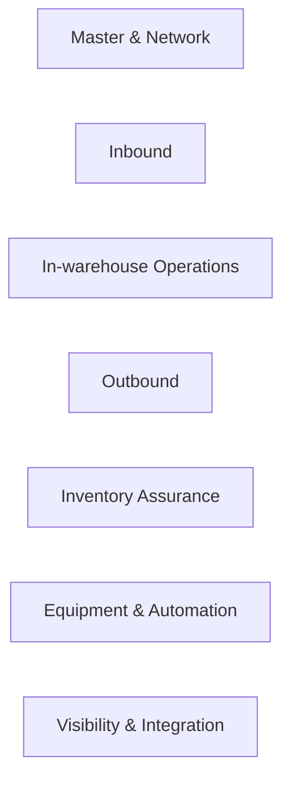

# 01-business / Capability Map

Level-1 capabilities (numbered); level-2 under each. Capabilities are stable
"what" — organization/process independent.

## 1. Master data & warehouse network (01)

- 01.1 Multi-warehouse / facility modeling (仓库)
- 01.2 Zone & location modeling (库区/库位): type, capacity (volume/weight/slots), access, constraints
- 01.3 SKU/product & pack hierarchy (EA/inner/case/pallet), units of measure & conversions
- 01.4 Lot / serial / expiry / batch attributes; status attributes
- 01.5 Owner (货主) modeling & owner-isolation policy (3PL)
- 01.6 Strategy/rule configuration: putaway, allocation, replenishment, count
- 01.7 Labor/shift, resource (forklift/device), work calendars
- 01.8 Barcode/label & GS1 identification config (GTIN/SSCC/AI mapping)
- 01.9 Hazard/compatibility & temperature-zone attributes

## 2. Inbound (02)

- 02.1 ASN / advance shipping notice intake & validation
- 02.2 Dock/appointment scheduling (月台预约) & yard check-in
- 02.3 Receiving & blind/known count, exception (over/short/damage)
- 02.4 Identification & license-plate/SSCC labeling, hierarchy build
- 02.5 QC handoff / pending status & quarantine placement
- 02.6 Putaway strategy & directed putaway task generation
- 02.7 Putaway confirmation; stock becomes available at bin
- 02.8 Goods receipt posting to ERP (event)

## 3. In-warehouse operations (03)

- 03.1 Inventory status control (available/locked/quarantine/frozen/scrapped)
- 03.2 Move/transfer & relocation tasks
- 03.3 Replenishment: min/max, demand/wave-triggered, top-up
- 03.4 Pick-face / slotting management
- 03.5 Kitting / assembly / value-added services (VAS), relabeling/repack
- 03.6 Holds & release; lot freeze/recall quarantine
- 03.7 Owner-to-owner stock transfer / ownership change (3PL, audited)
- 03.8 Physical reorganization & bin maintenance

## 4. Outbound (04)

- 04.1 Order intake (sales/STO/pick request) & validation/availability
- 04.2 Wave planning & release (wave by carrier/cutoff/zone/priority)
- 04.3 Allocation & soft/hard reservation; lot direction (FIFO/FEFO)
- 04.4 Pick methods: single-order, batch, zone, cluster; pick-to-light/voice
- 04.5 Task interleaving (pick + putaway to save travel)
- 04.6 Pick confirmation & short-pick/exception handling; re-allocation
- 04.7 Packing & verification (scan), cartonization, weighing
- 04.8 Carrier/parcel label, documentation, VAS at pack
- 04.9 Staging, loading, seal, manifest
- 04.10 Ship confirmation / goods issue; ASN to customer; post to ERP
- 04.11 Returns / reverse logistics intake & disposition

## 5. Inventory assurance (05)

- 05.1 Cycle counting ABC plans & scheduling
- 05.2 Triggered counts (zero-bin, post-pick, high-value, hot SKU)
- 05.3 Blind/double count & recount workflow
- 05.4 Variance analysis & adjustment request/approval
- 05.5 Reconciliation vs. ERP ledger; adjustment event posting
- 05.6 Inventory accuracy & KPI reporting
- 05.7 Lot/serial trace & recall dossier (forward/backward)

## 6. Equipment & automation (06)

- 06.1 Task-based WCS/WES integration (transport/order tasks, status events)
- 06.2 AS-RS / conveyor / sorter / AGV-AMR orchestration boundary
- 06.3 Device capture: RF gun, fixed scanner/RFID gate, scale, PTL
- 06.4 Label/print services; reprint control
- 06.5 Automation fallback to manual mode

## 7. Visibility, labor & integration (07)

- 07.1 Real-time stock & task visibility (location/lot/owner/status)
- 07.2 Yard/dock & throughput dashboards
- 07.3 Labor management (LMS-lite): work measurement, productivity
- 07.4 Alerts/exception workbench (短缺/超时/滞留)
- 07.5 Integration: ERP/OMS/MES/TMS/carrier (EDI/API/events)
- 07.6 EPCIS-style event capture & trace export
- 07.7 Identity, access, audit & owner data isolation
