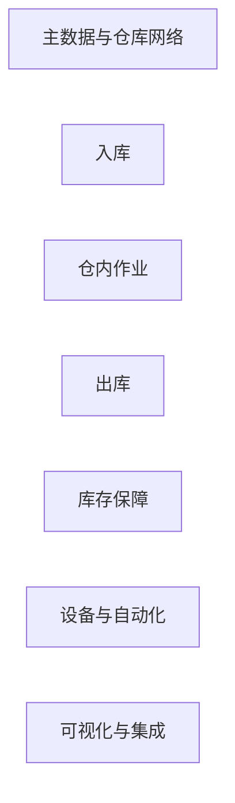

# 01-business / 能力地图

一级能力（带编号）；每项一级能力下设二级能力。能力是稳定的“做什么”——与组织/流程无关。

## 1. 主数据与仓库网络 (01)

- 01.1 多仓库/设施建模（仓库）
- 01.2 库区与库位建模（库区/库位）：类型、容量（体积/重量/货位）、通行条件、约束条件
- 01.3 SKU/产品与包装层级（EA/内包装/箱/托盘）、计量单位及换算
- 01.4 批次/序列号/有效期/批次属性；状态属性
- 01.5 货主建模与货主隔离策略（3PL）
- 01.6 策略/规则配置：上架、分配、补货、盘点
- 01.7 人员/班次、资源（叉车/设备）、工作日历
- 01.8 条码/标签与 GS1 标识配置（GTIN/SSCC/AI 映射）
- 01.9 危险品/相容性及温度区属性

## 2. 入库 (02)

- 02.1 ASN/预先发货通知接收与验证
- 02.2 月台/预约调度（月台预约）与园区签到
- 02.3 收货与盲盘/明盘，异常处理（超收/短收/损坏）
- 02.4 标识与托盘/容器标签/SSCC 标签生成、层级构建
- 02.5 质检交接/待处理状态与待检存放
- 02.6 上架策略与定向上架任务生成
- 02.7 上架确认；库存于货位变为可用
- 02.8 向 ERP 过账收货（事件）

## 3. 仓内作业 (03)

- 03.1 库存状态控制（可用/锁定/待检/隔离/报废）
- 03.2 移动/调拨与移位任务
- 03.3 补货：最小/最大库存、需求/波次触发、补足库存
- 03.4 拣货面/库位规划管理
- 03.5 组套/组装/增值服务（VAS）、重新贴标/重新包装
- 03.6 库存冻结与释放；批次隔离/召回待检
- 03.7 货主间库存调拨/所有权变更（3PL，经审计）
- 03.8 实物整理与货位维护

## 4. 出库 (04)

- 04.1 订单接收（销售/STO/拣货请求）与验证/可用量检查
- 04.2 波次规划与释放（按承运商/截止时间/库区/优先级编制波次）
- 04.3 分配与软/硬预留；批次流向（FIFO/FEFO）
- 04.4 拣货方式：单订单、批次、分区、集群；电子标签拣货/语音拣货
- 04.5 任务交错（拣货 + 上架以减少行走距离）
- 04.6 拣货确认与少拣/异常处理；重新分配
- 04.7 打包与复核（扫描）、装箱计算、称重
- 04.8 承运商/包裹标签、单据、打包环节的增值服务
- 04.9 集货、装载、封签、装车/发运清单
- 04.10 发运确认/发货过账；向客户发送 ASN；过账至 ERP
- 04.11 退货/逆向物流接收与处置

## 5. 库存保障 (05)

- 05.1 循环盘点 ABC 计划与排程
- 05.2 触发式盘点（零货位、拣货后、高价值、高动销 SKU）
- 05.3 盲盘/双重计数与复盘工作流
- 05.4 差异分析与调整申请/审批
- 05.5 与 ERP 账簿对账；调整事件过账
- 05.6 库存准确率与 KPI 报表
- 05.7 批次/序列号追溯与召回档案（正向/反向）

## 6. 设备与自动化 (06)

- 06.1 基于任务的 WCS/WES 集成（搬运/订单任务、状态事件）
- 06.2 自动化立体库/输送机/分拣机/AGV-AMR 编排边界
- 06.3 设备数据采集：RF 枪、固定扫描器/RFID 闸门、秤、PTL
- 06.4 标签/打印服务；重印控制
- 06.5 自动化回退至手动模式

## 7. 可视化、人员与集成 (07)

- 07.1 实时库存与任务可视化（库位/批次/货主/状态）
- 07.2 园区/月台与吞吐量仪表板
- 07.3 人员管理（LMS-lite）：工时测量、生产率
- 07.4 告警/异常工作台（短缺/超时/滞留）
- 07.5 集成：ERP/OMS/MES/TMS/承运商（EDI/API/事件）
- 07.6 EPCIS 风格事件采集与追溯导出
- 07.7 身份、访问、审计与货主数据隔离