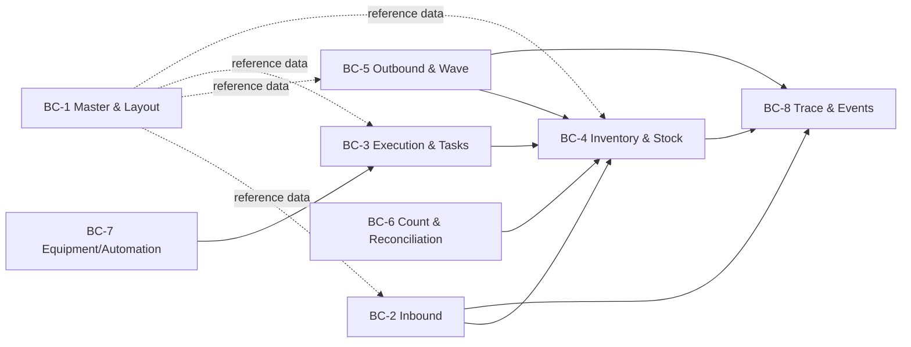

# 03-domain / Domain Model

Bounded contexts (DDD), aggregates, key entities, and the event-sourced core.
IDs `BC-*`; aggregates named in **bold**.

## 1. Bounded contexts



| BC | Responsibility | Upstream/downstream |
|---|---|---|
| **BC-1 Master & Layout** | warehouses, zones, locations, SKU/pack/UOM, owner, strategies, hazard/temp attributes | supplies all |
| **BC-2 Inbound** | ASN, appointments, receiving, HU/SSCC, QC handoff, putaway requests | → Inventory, Trace; ERP |
| **BC-3 Execution & Tasks** | canonical warehouse tasks (putaway/move/pick/replenish/count), assignment/interleaving, executor (human/device) | ↔ Inventory, Equipment |
| **BC-4 Inventory & Stock** | stock (bucketed), status/holds, adjustments, reservation ledger | ← all mutating BCs; → ERP |
| **BC-5 Outbound & Wave** | orders, waves, allocation/reservation, pick lists, pack/ship, returns | → Inventory, Trace; OMS/TMS |
| **BC-6 Count & Reconciliation** | count plans/tasks, variance, adjustment approval | → Inventory; ERP |
| **BC-7 Equipment/Automation** | WCS/WES task gateway, device status, capture devices | → Execution (events only) |
| **BC-8 Trace & Events** | append-only event log, EPCIS-aligned projections, lot/serial graph | subscribes all |

> The stock mutation boundary: **only** BC-4 changes stock, and only by
> applying validated events emitted from task/document completion. BC-7
> never touches stock (ADR-0003, BR-14).

## 2. Core aggregates & entities

- **Warehouse / Zone / Location (bin)** — hierarchy; `Location` carries
  type, capacity (vol/weight/slots), current occupancy, access, hazard/temp
  zone, blocked/being-counted flags.
- **Product (SKU)** — pack hierarchy (Each/Inner/Case/Pallet), UOM
  conversions, control flags (barcode/lot/serial/expiry/QC), allocation mode,
  count ABC class, tolerances.
- **Owner** — isolation scope for all transactional data (3PL).
- **Lot / SerialInstance** — lot attrs (receipt date, expiry, supplier lot,
  status); serial for unit-tracked goods; recalled/hold flags.
- **HandlingUnit (license plate / SSCC)** — recursive parent/child HU tree;
  contains stock lines; GS1 SSCC identity.
- **ASN / ASNLine** — expected delivery; received/over/short/damage qty;
  dock appointment link.
- **StockLine / StockPosition** *(aggregate root of BC-4)* — keyed by
  (SKU, lot/serial, location, owner); bucketed quantities per BR-01; versioned
  for optimistic concurrency.
- **Reservation** — order line ↔ stock commitment; soft/hard state, expiry;
  the unit of oversell prevention.
- **WarehouseTask** *(aggregate root BC-3)* — type, source/dest bin, HU/SKU/
  qty/lot, priority, assignee, executor type (human/device), state; tasks are
  idempotently confirmable.
- **OutboundOrder / OrderLine** — demand; owner; carrier/cutoff; exceptions.
- **Wave** — order grouping; allocation run; pick method; release state.
- **PickList / PickLine** — derived executable picks.
- **Shipment / Load / Manifest** — cartons, SSCC, carrier/trailer, seal.
- **CountPlan / CountTask / CountResult / Adjustment** — blind counts,
  variance, approval, before/after.
- **StockEvent** *(aggregate of BC-8)* — append-only fact (see §4).

## 3. Relationships (cardinality, key)

- Warehouse 1—* Zone 1—* Location.
- SKU 1—* PackLevel; SKU 1—* StockLine.
- Owner 1—* {StockLine, Order, Task, Count}.
- Lot 1—* StockLine; SerialInstance 1..1 StockPosition (unit-tracked).
- HU *—* HU (recursive); HU 1—* StockLine(content); ASN 1—* ASNLine 1—* HU.
- Order 1—* OrderLine 1—* Reservation *—1 StockLine.
- Wave 1—* OrderLine(grouped), 1—* PickList 1—* PickLine 1..1 Task.
- Task *—1 executor (user or device channel); Task completion → 1 StockEvent
  (or a batch in one transaction).
- StockLine 1—* StockEvent (full history).

## 4. Event-sourced stock (core pattern)

Stock truth is derived by folding an ordered, append-only **StockEvent**
stream (ADR-0002). Current `StockPosition` is a projection.

Event types (non-exhaustive), each carrying document/task/operator/device/
ts and bucket deltas:

`received`, `qc-status-changed`, `putaway-confirmed`, `moved`
(from/in-transit/to), `reserved-soft`, `reserved-hard`, `reservation-released`,
`picked`, `packed`, `shipped`, `hold-set/released`, `adjusted`
(before/after, reason, approver), `scrapped`, `owner-transferred`,
`counted`.

```
StockPosition(t) = fold(StockEvent, key=(sku,lot,location,owner), up to t)
```

Corrections are **compensating events**, never updates/deletes (NFR-009).
EPCIS mapping (conceptual): receiving/picking/shipping ≈ Object events;
HU build/break ≈ Aggregation events; order association ≈ Transaction events.

## 5. Invariants (domain rules enforced in aggregate)

1. BR-01 bucket identity & BR-02 non-negative on every fold/transaction.
2. A hard reservation references existing available qty; unique per unit
   (no double reservation) — FR-019.
3. Non-available status stock is invisible to allocation (BR-03/CTL-03).
4. Task confirmation mutates stock once (idempotency key = task+step+HU).
5. Adjustment cannot be approved by its creator (CTL-04).
6. Location compatibility (capacity/hazard/temp/mixing) validated on inbound
   moves (BR-04).

> ⚠️ ASSUMPTION: reservation vs. physical pick are modeled as separate events
> so crash between reserve and pick leaves an expired-soft/hard reservation
> that is safely releasable (BR-05), rather than phantom stock loss.
