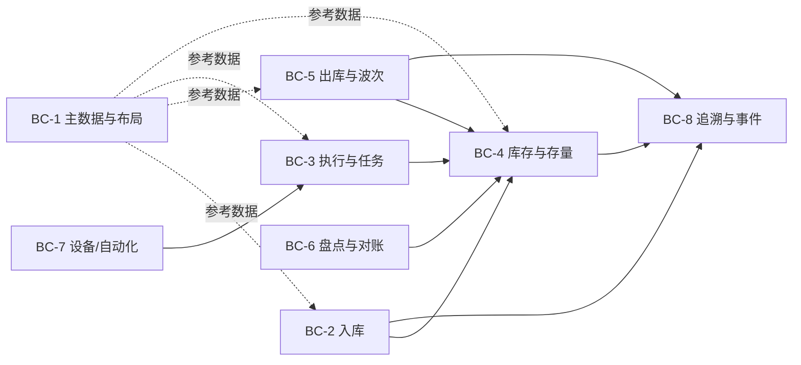

# 03-domain / 领域模型

限界上下文（DDD）、聚合、关键实体以及事件溯源核心。
ID 使用 `BC-*`；聚合名称以**粗体**标示。

## 1. 限界上下文



| BC | 职责 | 上游/下游 |
|---|---|---|
| **BC-1 主数据与布局** | 仓库、库区、货位、SKU/包装/UOM、货主、策略、危险品/温度属性 | 为所有 BC 提供 |
| **BC-2 入库** | ASN、预约、收货、HU/SSCC、QC 交接、上架请求 | → 库存、追溯；ERP |
| **BC-3 执行与任务** | 规范化仓库任务（上架/移动/拣选/补货/盘点）、任务分配/任务交错、执行方（人员/设备） | ↔ 库存、设备 |
| **BC-4 库存与存量** | 库存（分桶）、状态/冻结、调整、预留台账 | ← 所有会修改库存的 BC；→ ERP |
| **BC-5 出库与波次** | 订单、波次、分配/预留、拣货单、打包/发运、退货 | → 库存、追溯；OMS/TMS |
| **BC-6 盘点与对账** | 盘点计划/任务、差异、调整审批 | → 库存；ERP |
| **BC-7 设备/自动化** | WCS/WES 任务网关、设备状态、采集设备 | → 执行（仅事件） |
| **BC-8 追溯与事件** | 仅追加事件日志、与 EPCIS 对齐的投影、批次/序列号图谱 | 订阅全部 |

> 库存变更边界：**仅** BC-4 可以变更库存，且只能通过应用任务/单据完成时发出的已验证事件来实现。BC-7 绝不修改库存（ADR-0003、BR-14）。

## 2. 核心聚合与实体

- **仓库（Warehouse）/ 库区（Zone）/ 货位（Location，bin）** — 层级结构；`Location` 包含类型、容量（体积/重量/槽位数）、当前占用情况、访问权限、危险品/温控区域、阻断/盘点中标志。
- **产品（Product，SKU）** — 包装层级（单件/内包装/箱/托盘）、UOM 换算、控制标志（条码/批次/序列号/有效期/QC）、分配模式、盘点 ABC 分类、容差。
- **货主（Owner）** — 所有交易数据的隔离范围（3PL）。
- **批次（Lot）/ 序列实例（SerialInstance）** — 批次属性（收货日期、有效期、供应商批次、状态）；单元级追踪货物使用序列号；召回/冻结标志。
- **装卸/物流单元（HandlingUnit，托盘/容器标签/SSCC）** — 递归父子 HU 树；包含库存行；采用 GS1 SSCC 标识。
- **预先发货通知（ASN）/ ASN 行（ASNLine）** — 预期交付；已收/超收/短收/损坏数量；月台预约关联。
- **库存行（StockLine）/ 库存位置（StockPosition）** *（BC-4 的聚合根）* — 以（SKU、批次/序列号、货位、货主）为键；按 BR-01 分桶记录数量；通过版本控制支持乐观并发。
- **预留（Reservation）** — 订单行 ↔ 库存承诺；软/硬状态、到期时间；防止超卖的基本单元。
- **仓库任务（WarehouseTask）** *（BC-3 的聚合根）* — 类型、来源/目标货位、HU/SKU/数量/批次、优先级、指派人、执行方类型（人员/设备）、状态；任务确认具备幂等性。
- **出库订单（OutboundOrder）/ 订单行（OrderLine）** — 需求；货主；承运商/截单时间；异常。
- **波次（Wave）** — 订单分组；分配执行；拣货方式；释放状态。
- **拣货单（PickList）/ 拣货行（PickLine）** — 派生出的可执行拣选任务。
- **发运（Shipment）/ 装载（Load）/ 装车/发运清单（Manifest）** — 纸箱、SSCC、承运商/拖车、封签。
- **盘点计划（CountPlan）/ 盘点任务（CountTask）/ 盘点结果（CountResult）/ 调整（Adjustment）** — 盲盘、差异、审批、调整前/后值。
- **库存事件（StockEvent）** *（BC-8 的聚合）* — 仅追加事实（参见 §4）。

## 3. 关系（基数、键）

- 仓库（Warehouse） 1—* 库区（Zone） 1—* 货位（Location）。
- SKU 1—* 包装层级（PackLevel）；SKU 1—* 库存行（StockLine）。
- 货主（Owner） 1—* {库存行（StockLine）、订单（Order）、任务（Task）、盘点（Count）}。
- 批次（Lot） 1—* 库存行（StockLine）；序列实例（SerialInstance） 1..1 库存位置（StockPosition）（单元级追踪）。
- HU *—* HU（递归）；HU 1—* 库存行（StockLine，内容）；ASN 1—* ASN 行（ASNLine） 1—* HU。
- 订单（Order） 1—* 订单行（OrderLine） 1—* 预留（Reservation） *—1 库存行（StockLine）。
- 波次（Wave） 1—* 订单行（OrderLine，分组），1—* 拣货单（PickList） 1—* 拣货行（PickLine） 1..1 任务（Task）。
- 任务（Task） *—1 执行方（用户或设备通道）；任务完成 → 1 个库存事件（StockEvent，或在一个事务中批量处理）。
- 库存行（StockLine） 1—* 库存事件（StockEvent，完整历史）。

## 4. 事件溯源库存（核心模式）

库存真实状态通过对有序、仅追加的 **StockEvent** 流进行折叠推导得出（ADR-0002）。当前 `StockPosition` 是一个投影。

事件类型（不限于以下类型），每种事件都携带单据/任务/操作员/设备/时间戳（ts）和分桶增量：

`received`、`qc-status-changed`、`putaway-confirmed`、`moved`（`from/in-transit/to`）、`reserved-soft`、`reserved-hard`、`reservation-released`、`picked`、`packed`、`shipped`、`hold-set/released`、`adjusted`（`before/after`、原因、审批人）、`scrapped`、`owner-transferred`、`counted`。

```
StockPosition(t) = fold(StockEvent, key=(sku,lot,location,owner), up to t)
```

更正采用**补偿事件**，绝不采用更新/删除操作（NFR-009）。

EPCIS 映射（概念层面）：收货/拣选/发运 ≈ Object 事件；HU 组建/拆分 ≈ Aggregation 事件；订单关联 ≈ Transaction 事件。

## 5. 不变量（在聚合中执行的领域规则）

1. BR-01 分桶标识与 BR-02 非负性要求必须在每次折叠/事务中满足。
2. 硬预留必须引用已有的可用量；按单元唯一（不得重复预留）— FR-019。
3. 处于不可用状态的库存在分配时不可见（BR-03/CTL-03）。
4. 任务确认只能变更库存一次（幂等键 = 任务+步骤+HU）。
5. 调整的创建者不得审批该调整（CTL-04）。
6. 货位兼容性（容量/危险品/温度/混放）必须在入库移动时进行验证（BR-04）。

> ⚠️ ASSUMPTION: 预留与实物拣选被建模为独立事件，因此，在预留与拣选之间发生崩溃时，会留下一个已过期的软/硬预留，该预留可安全释放（BR-05），而不会造成幽灵库存损失。