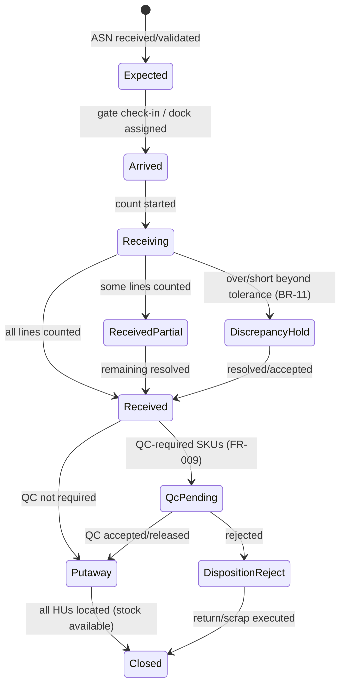
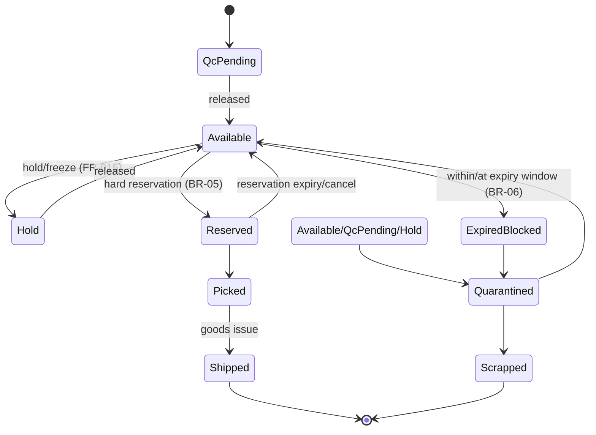
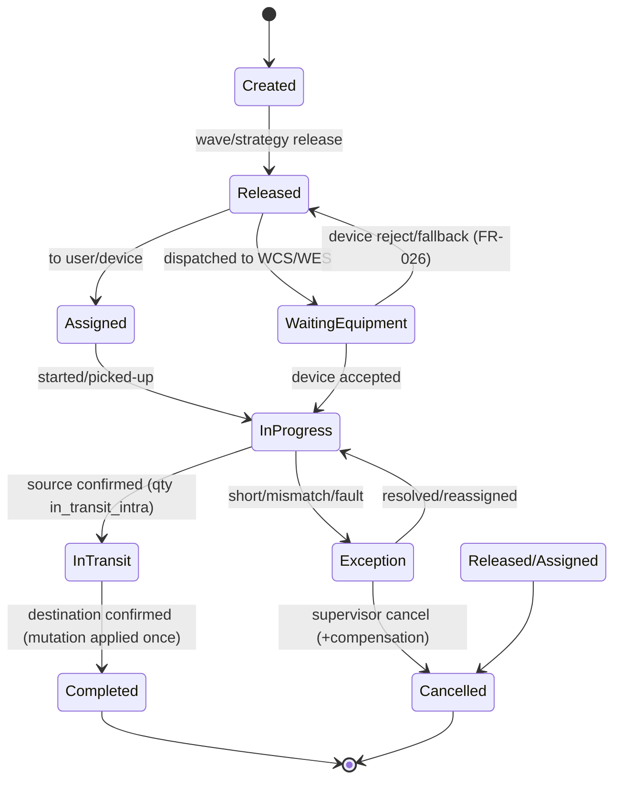
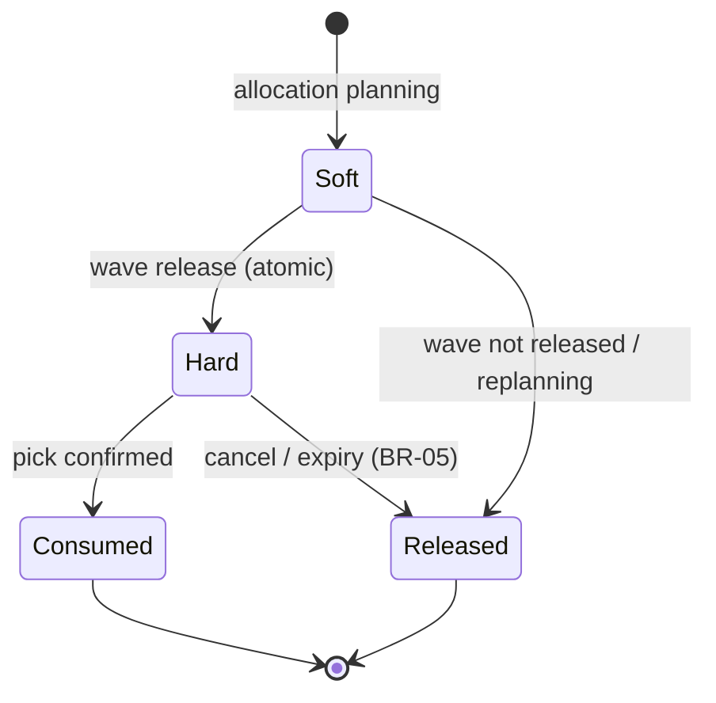
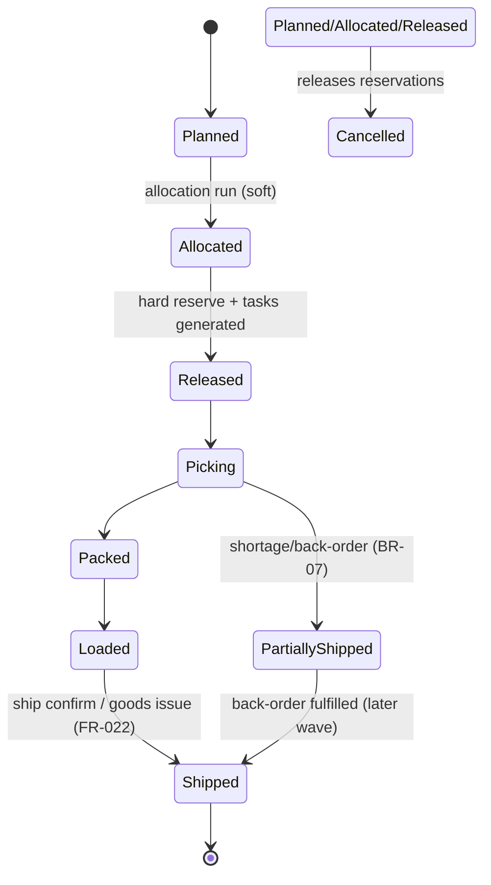
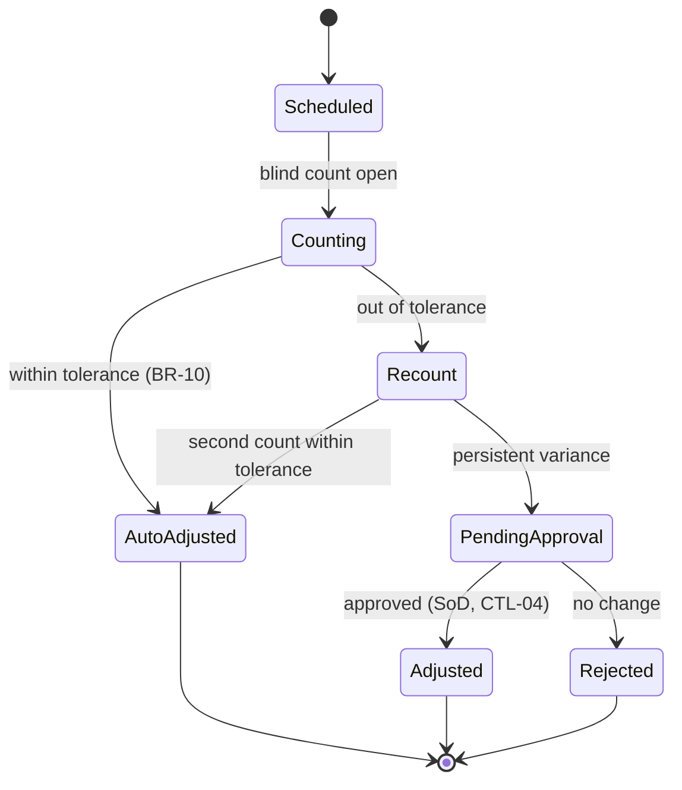

# 03-domain / State Machines

> ⚠️ ASSUMPTION — SM-1..SM-6 states and transitions are pack design, not
> derived from a standard (see [`../SOURCES.md` §4](../SOURCES.md)).

State machines are provided at L2 for the load-bearing lifecycle objects
(required at L3 for all key objects; these anchor the design early).

## SM-1 Inbound ASN / receipt

## SM-2 Stock lot / unit status

(Statuses map to the BR-01 quantity buckets; `Reserved`, `Hold`,
`QcPending` are non-allocatable.)

## SM-3 WarehouseTask (unified execution)

Key: completion is idempotent (task+step+HU key); device and human share
this state model (BR-14).

## SM-4 Reservation

## SM-5 Wave / outbound order

## SM-6 Count → adjustment

