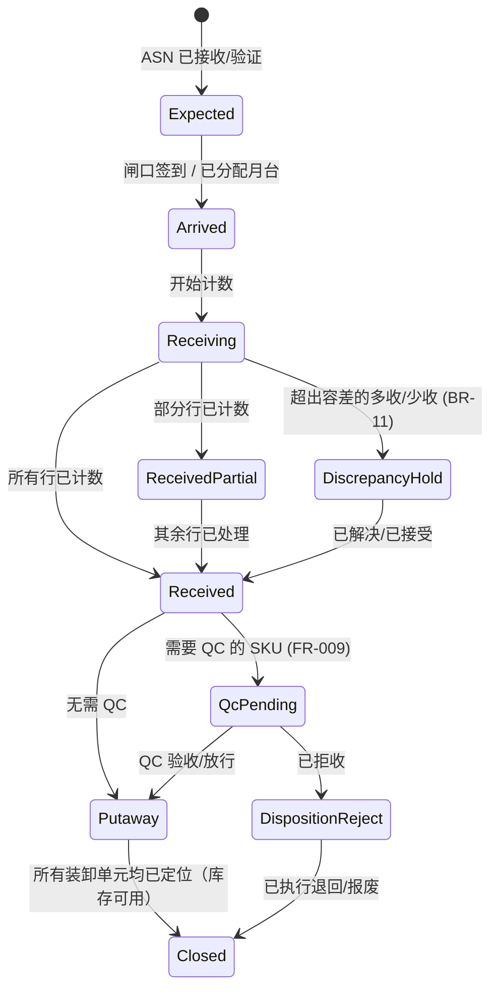
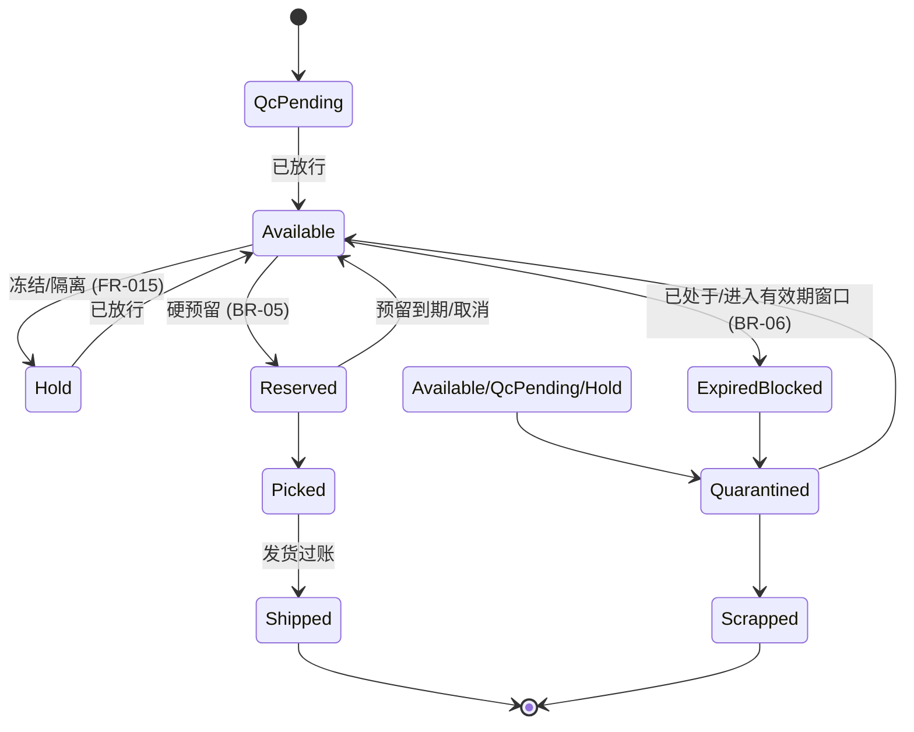
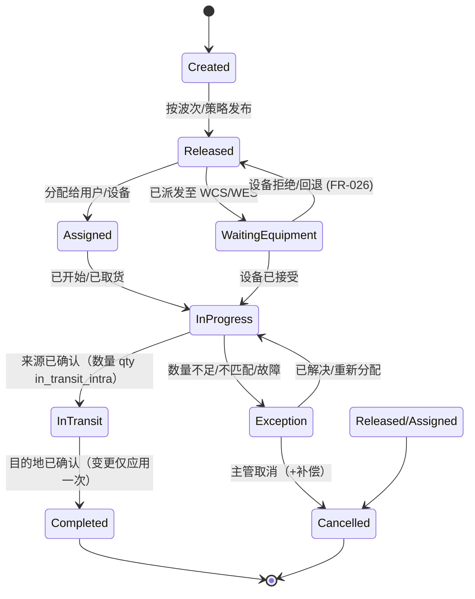
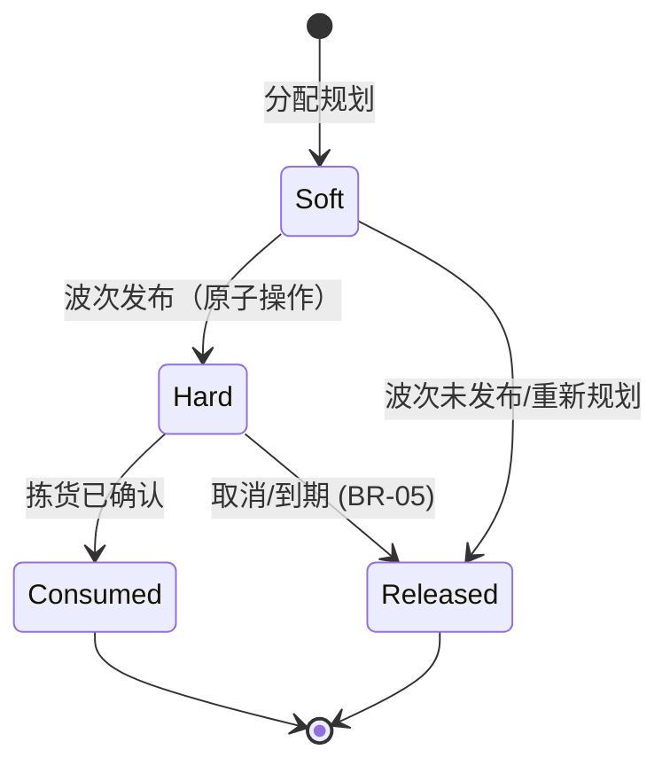
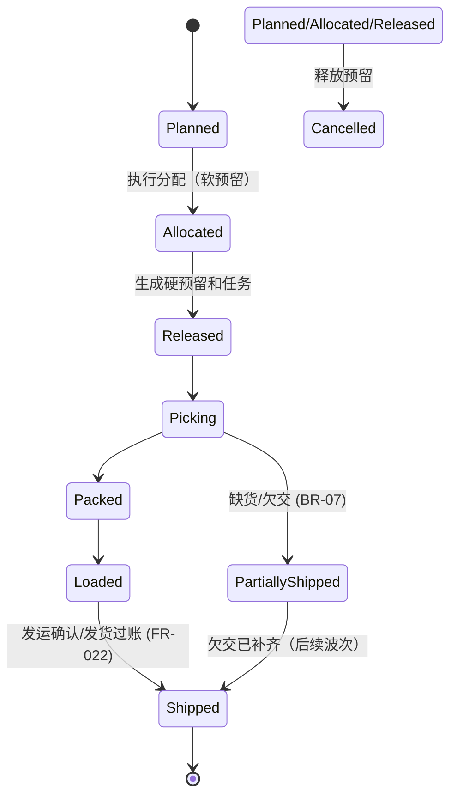
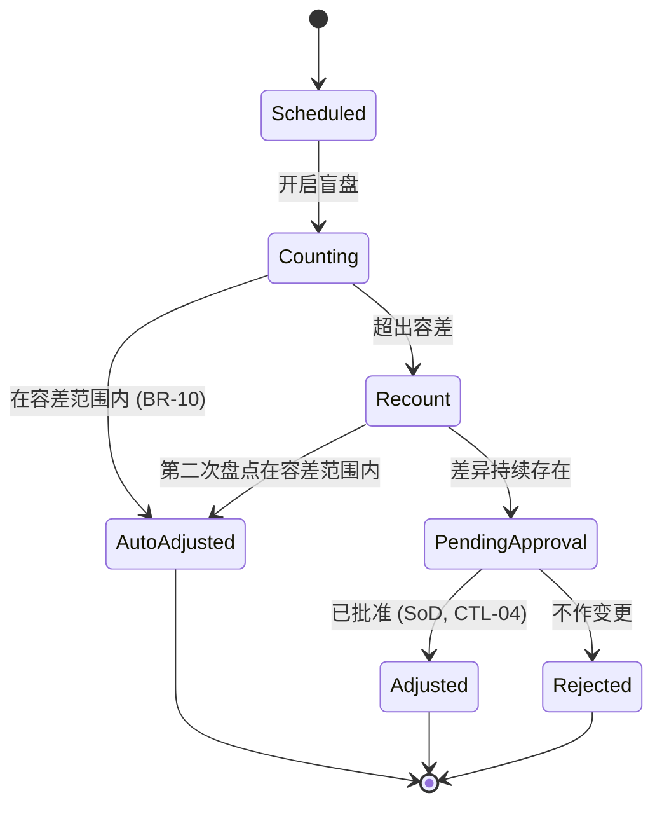

# 03-domain / 状态机

> ⚠️ ASSUMPTION — SM-1..SM-6 的状态和转换属于方案包设计，并非
> 依据标准推导得出（见 [`../SOURCES.md` §4](../SOURCES.md)）。

在 L2 层为核心生命周期对象提供状态机
（所有关键对象均须在 L3 层提供；这些状态机为早期设计提供锚点）。

## SM-1 入库 ASN / 收货

## SM-2 库存批次 / 单元状态

这些状态映射到 BR-01 的数量分类；`Reserved`、`Hold`、
`QcPending` 均为不可分配状态。

## SM-3 WarehouseTask (统一执行)

关键点：完成操作具有幂等性（task+step+HU 键）；设备和人员共用
此状态模型（BR-14）。

## SM-4 预留

## SM-5 波次 / 出库订单

## SM-6 盘点 → 调整

