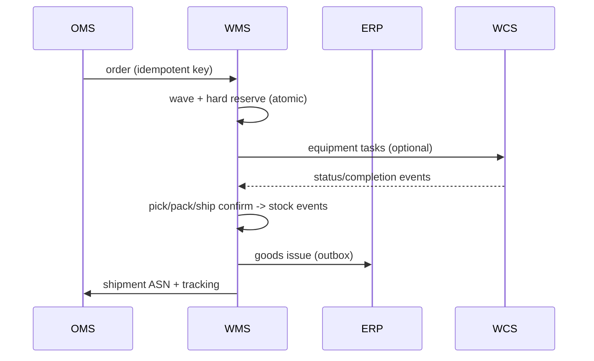

# 04-architecture / Integration

Upstream/downstream systems, protocols, data exchange and sequencing.
Concrete payload schemas are L3; this chapter fixes boundaries & semantics.

## 1. Integration inventory

| # | Counterparty | Direction | Content | Typical protocol (neutral options) |
|---|---|---|---|---|
| I-1 | ERP | in | PO, STO, material/owner master, orders | API/REST, IDoc/EDI, message bus |
| I-2 | ERP | out | goods receipt, goods issue, adjustments, stock snapshot | events via outbox → API/EDI/message |
| I-3 | OMS / e-commerce | in | sales orders, cancels, priorities, cutoffs | REST API / event stream |
| I-4 | OMS/ERP | out | order status, shipment, ASN, tracking | EDI 856 / API / webhook |
| I-5 | Supplier | in | ASN (856/DESADV) | EDI / supplier portal / API |
| I-6 | MES (manufacturing) | in/out | staging requests, material issue, FG receipt, line-side stock | API/events (align with `mes` pack) |
| I-7 | TMS / carrier | out/in | tender, manifest, parcel labels, track/trace, rates | carrier API / EDI (IFTMIN/204/214) |
| I-8 | WCS/WES | out/in | equipment tasks; status/completion/fault events | task API / message queue (site-local) |
| I-9 | Capture devices | in | scan/RFID/scale/PTL events | device gateway / MQTT-style / driver service |
| I-10 | Printers | out | GS1 labels/SSCC, carrier labels | print spooler / label service |
| I-11 | Yard/dock (if external) | in/out | appointments, check-in, door status | API |
| I-12 | Owner portal (3PL) | out | stock/order reports, activity events | API/feed (RLS-scoped) |

## 2. Boundary semantics (load-bearing)

### 2.1 ERP boundary — physical vs. financial truth (ADR-0001)

- WMS owns **physical** stock (bin/lot/quantity/status/owner). ERP owns
  **valuation, accounting and planning stock**.
- WMS posts GR / GI / adjustments as business events; it never derives
  inventory value and never accepts an ERP ledger number as a reason to
  silently overwrite physical stock. Reconciliation surfaces differences to
  the adjustment workflow (P-06/CTL-04).

### 2.2 MES boundary — staging area truth (shared open question)

- WMS executes the move into the **staging/line-side area** and owns it until
  a confirmed issue to the production order; MES owns consumption at the line.
- The handoff is an explicit transfer event (issue to line / FG receipt) so
  neither side double-holds the quantity. Resolution of "who owns staging
  stock truth" is tracked jointly with the `mes` pack open question #3.

### 2.3 Equipment boundary — task-based only (ADR-0003)

- WMS publishes business tasks (move LP A→B, retrieve tote to station) with
  source/destination/priority. It never emits PLC motion/IO commands.
- WCS/WES reports task lifecycle (accepted/arrived/picked/placed/faulted)
  and scans; WMS applies stock mutation only on validated completion
  (BR-14/FR-025).

## 3. Event exchange & reliability

- **Outbox pattern**: business transaction commits events and state together;
  a relay publishes to the bus, guaranteeing at-least-once ordered delivery
  per stock key.
- **Idempotency keys** on all inbound messages/device events (NFR-010):
  ASN/order business keys; task confirm key `task+step+HU+ts-window`.
- **Correlation**: each event carries document id, task id, owner, warehouse,
  and an EPCIS-aligned `bizStep/disposition` where applicable.
- Poison/dead-letter handling → exception workbench (FR-028), never silent drop.

## 4. Data flow (typical outbound)

## 5. Master data governance

- SKU/pack/owner master generally authored in ERP/MDM and consumed; WMS
  extends with warehouse-specific attributes (bin strategy, count class,
  control flags) locally.
- Effective-dated strategy/config so in-flight tasks keep the rules under
  which they were generated (FR-004).

> ⚠️ ASSUMPTION: a canonical message/canonical model layer (anti-corruption)
> normalizes EDI/IDoc/API variants; specific field mappings are L3/variant.
