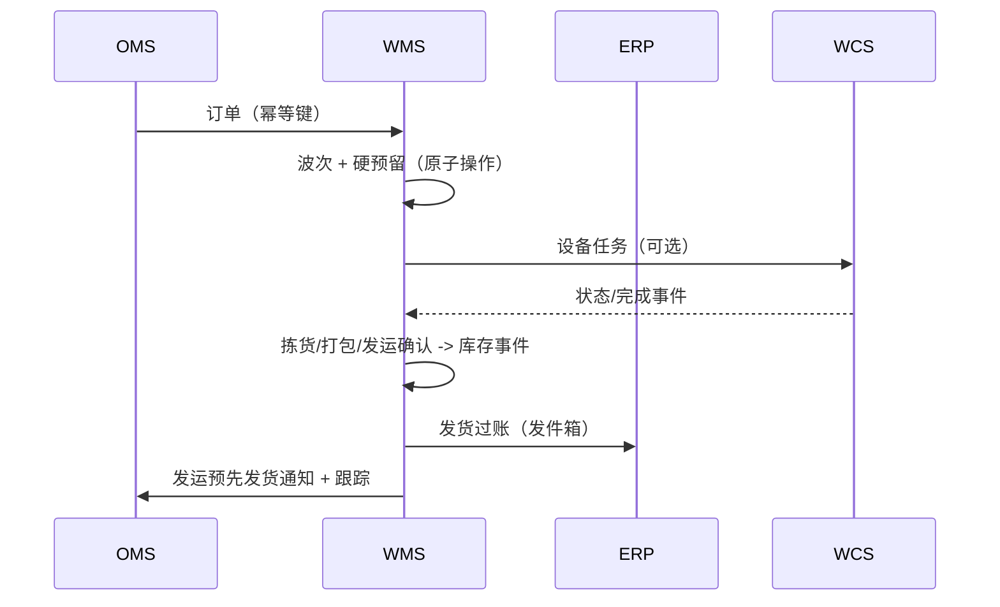

# 04-architecture / 集成

上游/下游系统、协议、数据交换与时序编排。
具体载荷模式属于 L3；本章确定边界与语义。

## 1. 集成清单

| # | 对接方 | 方向 | 内容 | 典型协议（中立选项） |
|---|---|---|---|---|
| I-1 | ERP | 入 | PO、STO、物料/货主主数据、订单 | API/REST、IDoc/EDI、消息总线 |
| I-2 | ERP | 出 | 收货、发货过账、调整、库存快照 | 通过发件箱发布事件 → API/EDI/消息 |
| I-3 | OMS / 电商 | 入 | 销售订单、取消、优先级、截止时间 | REST API / 事件流 |
| I-4 | OMS/ERP | 出 | 订单状态、发运、预先发货通知、跟踪 | EDI 856 / API / webhook |
| I-5 | 供应商 | 入 | 预先发货通知（856/DESADV） | EDI / 供应商门户 / API |
| I-6 | MES（制造） | 入/出 | 暂存请求、物料发料、成品收货、线边库存 | API/事件（与 `mes` 方案包对齐） |
| I-7 | TMS / 承运商 | 出/入 | 运输委托、装车/发运清单、包裹标签、跟踪/追溯、费率 | 承运商 API / EDI（IFTMIN/204/214） |
| I-8 | WCS/WES | 出/入 | 设备任务；状态/完成/故障事件 | 任务 API / 消息队列（站点本地） |
| I-9 | 采集设备 | 入 | 扫描/RFID/称重/电子标签拣货事件 | 设备网关 / MQTT 风格 / 驱动服务 |
| I-10 | 打印机 | 出 | GS1 标签/系列货运包装箱代码、承运商标签 | 打印后台处理服务 / 标签服务 |
| I-11 | 园区/月台（如为外部系统） | 入/出 | 预约、签到、门状态 | API |
| I-12 | 货主门户（第三方物流） | 出 | 库存/订单报表、活动事件 | API/数据流（受 RLS 范围限制） |

## 2. 边界语义（关键约束）

### 2.1 ERP 边界 — 实物事实与财务事实（ADR-0001）

- WMS 负责**实物**库存（库位/批次/数量/状态/货主）。ERP 负责
  **估值、会计和计划库存**。
- WMS 将 GR / GI / 调整作为业务事件过账；它绝不推导
  库存价值，也绝不接受 ERP 账簿编号作为静默覆盖实物库存的理由。对账会将差异提交至
  调整工作流（P-06/CTL-04）。

### 2.2 MES 边界 — 暂存区库存事实（共同开放问题）

- WMS 执行移入**暂存/线边区域**的操作，并拥有该区域库存，直至
  确认向生产订单发料；产线消耗由 MES 负责。
- 交接是明确的转移事件（线边发料 / 成品收货），因此
  双方均不会重复持有该数量。“暂存库存事实由谁负责”这一问题的解决，与 `mes`
  方案包的开放问题 #3 一并跟踪。

### 2.3 设备边界 — 仅基于任务（ADR-0003）

- WMS 发布业务任务（将 LP 从 A→B 移动、将周转箱取至工位），并包含
  来源/目的地/优先级。它绝不发出 PLC 运动/IO 命令。
- WCS/WES 报告任务生命周期（已接受/已到达/已拣取/已放置/故障）
  和扫描结果；WMS 仅在完成结果经验证后变更库存
  （BR-14/FR-025）。

## 3. 事件交换与可靠性

- **发件箱模式**：业务事务将事件与状态一并提交；
  中继器将事件发布到消息总线，保证按库存键进行至少一次的有序投递。
- **幂等键**应用于所有入站消息/设备事件（NFR-010）：
  预先发货通知/订单业务键；任务确认键 `task+step+HU+ts-window`。
- **关联**：每个事件都携带单据 ID、任务 ID、货主、仓库，
  以及适用时符合 EPCIS 的 `bizStep/disposition`。
- 毒消息/死信处理 → 异常工作台（FR-028），绝不静默丢弃。

## 4. 数据流（典型出站流程）

## 5. 主数据治理

- SKU/包装/货主主数据通常在 ERP/MDM 中创建并供 WMS 使用；WMS
  在本地扩展仓库专用属性（库位策略、盘点分类、控制标志）。
- 策略/配置按生效日期管理，使在途任务保留其生成时所依据的规则
  （FR-004）。

> ⚠️ ASSUMPTION: 规范消息/规范模型层（防腐层）将 EDI/IDoc/API 变体标准化；具体字段映射属于 L3/variant。