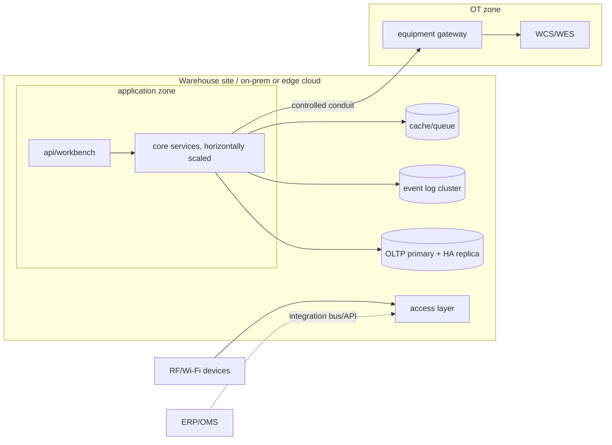

# 04-architecture / Overview

Vendor-neutral component, logical and deployment views.

## 1. Logical component view

```mermaid
flowchart TB
  subgraph Channels
    RF[RF/handheld & vehicle terminals]
    WS[Supervisor/web workbench]
    PORTAL[Owner portal 3PL]
    DEV[Scanners/RFID/scale/PTL capture]
  end

  subgraph WMS Core
    MD[Master & Layout svc]
    IB[Inbound svc]
    OB[Outbound & Wave svc]
    EX[Execution/Task svc]
    INV[Inventory svc - sole stock writer]
    CNT[Count/Recon svc]
    STRAT[Strategy/rule engine]
    EQ[Equipment gateway]
    TRACE[Trace/event projection]
    AUTH[IAM / audit / RLS]
  end

  subgraph Data
    EVT[(Append-only event log)]
    OLTP[(Operational store)]
    PROJ[(Read projections / search)]
  end

  subgraph Outside
    ERP[ERP/OMS/MES]
    TMS[TMS/carrier]
    WCS[WCS/WES/AS-RS/AGV]
  end

  RF & WS & PORTAL --> WMS Core
  DEV --> EQ
  IB & OB & EX & CNT --> INV
  STRAT --> IB & OB & EX & CNT
  INV --> EVT
  EVT --> PROJ
  TRACE --> PROJ
  WMS Core --> OLTP
  IB & OB & INV <--> ERP
  OB <--> TMS
  EQ <--> WCS
  AUTH -. enforces .- INV
```

## 2. Key structural decisions

- **Single stock writer**: only the Inventory service mutates stock, and
  only by applying validated events. All other services request movements;
  they never write quantities (ADR-0002).
- **Event log + projections**: append-only StockEvent log is the source of
  truth; operational tables and search indexes are rebuildable projections.
- **Strategy engine outside transactions**: putaway/allocation/replenishment
  rules are evaluated by a data-driven rule engine (BR-03..BR-11) that emits
  *proposed* assignments; the Inventory service validates invariants before
  commit.
- **Equipment gateway isolates OT**: WCS/WES behind one task-based gateway;
  core sees a generic executor (ADR-0003).
- **Identity & RLS cross-cutting**: owner isolation enforced at data access
  (RLS) and API, not by each caller (BR-13/CTL-06).

## 3. Deployment view (logical, vendor-neutral)



- RF traffic and automation require **site-local resilience**: the
  transactional/event stack should survive WAN loss to any central cloud
  (edge/local HA), supporting NFR-005/NFR-007.
- IT application zone and OT zone separated per IEC 62443 zone & conduit
  (CTL-07/NFR-012).
- Stateless services scale horizontally; the event log and OLTP are the
  consistency/state anchors. Specific products belong in `variants/`.

## 4. Transaction & consistency model

- **Strong consistency** inside one stock-mutation transaction (reservation
  or movement) using atomic conditional updates / optimistic concurrency on
  StockLine version (NFR-008, FR-019).
- **Eventual consistency** for projections, dashboards, ERP postings
  (outbox pattern → guaranteed, ordered, idempotent publication).
- Cross-system (ERP/WCS) results via events/idempotent consumers, never
  distributed locks across the boundary.

## 5. Scalability & multi-site

- Warehouse-scoped sharding key where feasible (all hot data is per DC).
- Multi-DC deployments replicate reference/owner config and federate trace;
  they do not co-mutate one another's stock.
- Event archival/partitioning supports NFR-003 retention/scale.
