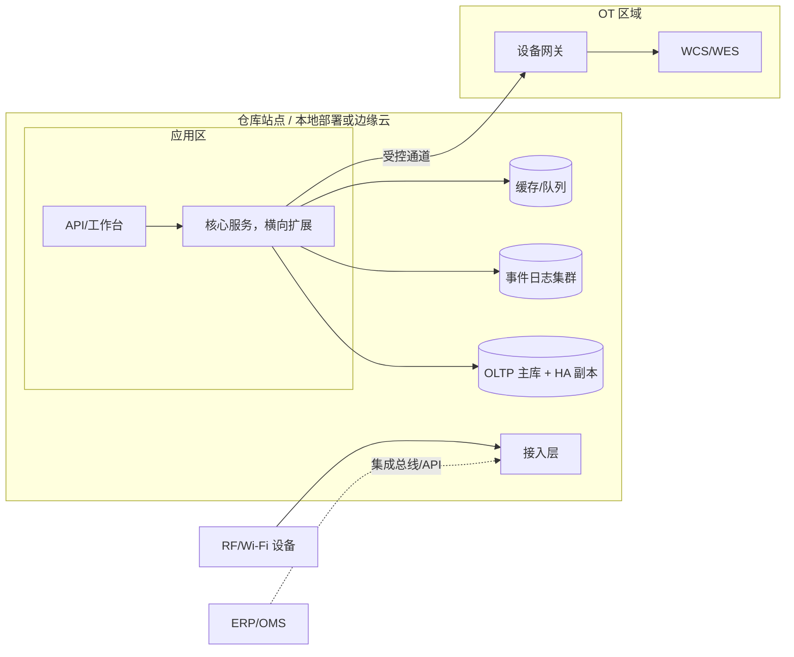

# 04-architecture / 概览

厂商中立的组件、逻辑和部署视图。

## 1. 逻辑组件视图

```mermaid
flowchart TB
  subgraph Channels
    RF[RF/手持终端及车载终端]
    WS[主管/网页工作台]
    PORTAL[货主门户（第三方物流）]
    DEV[扫描器/RFID/秤/电子标签拣货（PTL）采集]
  end

  subgraph WMS Core
    MD[主数据与库位布局服务]
    IB[入库服务]
    OB[出库与波次服务]
    EX[执行/任务服务]
    INV[库存服务 - 唯一库存写入方]
    CNT[盘点/对账服务]
    STRAT[策略/规则引擎]
    EQ[设备网关]
    TRACE[追溯/事件投影]
    AUTH[IAM / 审计 / 行级安全]
  end

  subgraph Data
    EVT[(仅追加事件日志)]
    OLTP[(操作型存储)]
    PROJ[(只读投影 / 搜索)]
  end

  subgraph Outside
    ERP[ERP/OMS/MES]
    TMS[TMS/承运商]
    WCS[WCS/WES/自动化立体库（AS-RS）/自动导引车（AGV）]
  end

  RF & WS & PORTAL --> WMS Core
  DEV --> EQ
  IB & OB & EX & CNT --> INV
  STRAT --> IB & OB & EX & CNT
  INV --> EVT
  EVT --> PROJ
  TRACE --> PROJ
  WMS Core --> OLTP
  IB & OB & INV <--> ERP
  OB <--> TMS
  EQ <--> WCS
  AUTH -. 强制执行 .- INV
```

## 2. 关键结构决策

- **单一库存写入方**：只有库存服务可以变更库存，且仅通过应用已验证的事件进行变更。其他所有服务只能请求库存移动，绝不写入数量（ADR-0002）。
- **事件日志与投影**：仅追加的 StockEvent 日志是事实来源；业务表和搜索索引均可重建为投影。
- **策略引擎置于事务之外**：上架/分配/补货规则由数据驱动的规则引擎（BR-03..BR-11）评估，并生成*建议的*分配；库存服务在提交前验证不变量。
- **设备网关隔离 OT**：WCS/WES 置于单一任务型网关之后；核心层仅看到通用执行器（ADR-0003）。
- **身份与行级安全横切**：货主隔离在数据访问（行级安全，RLS）与 API 层强制实施，而非由各调用方自行实施（BR-13/CTL-06）。

## 3. 部署视图（逻辑层面、厂商中立）



- RF 流量和自动化作业需要**站点本地韧性**：事务/事件技术栈应能在与任一中央云之间的 WAN 连接中断后继续运行（边缘/本地 HA），并支持 NFR-005/NFR-007。
- IT 应用区与 OT 区依据 IEC 62443 的区域（zone）与通道（conduit）模型进行隔离（CTL-07/NFR-012）。
- 无状态服务可横向扩展；事件日志和 OLTP 是一致性/状态锚点。具体产品归入 `variants/`。

## 4. 事务与一致性模型

- 在单个库存变更事务（预留或移动）内，通过对 StockLine 版本执行原子条件更新/乐观并发控制实现**强一致性**（NFR-008、FR-019）。
- 投影、仪表板和 ERP 过账采用**最终一致性**（发件箱模式 → 保证按序且幂等地发布）。
- 跨系统（ERP/WCS）的结果通过事件/幂等消费者传递；绝不跨边界使用分布式锁。

## 5. 可扩展性与多站点

- 在可行的情况下采用仓库范围的分片键（所有热点数据均按配送中心划分）。
- 多配送中心部署复制参考数据/货主配置并实现联邦追溯；不会共同修改彼此的库存。
- 事件归档/分区支持 NFR-003 的保留期/扩展规模要求。