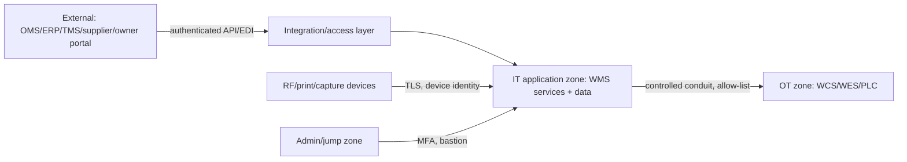

# 04-architecture / Security

Trust boundaries, authentication/authorization and key controls. Traces to
NFR-011/012 and CTL-04/06/07.

## 1. Trust boundaries

- External parties never reach the data tier; integration via the access
  layer with per-system credentials and message validation.
- **IT↔OT is a hard boundary**: authenticated service account(s),
  allow-listed host/port, one-way task/event contract; no remote control,
  no shared DB (IEC 62443 zones & conduits — CTL-07).

## 2. Authentication

- Human users: enterprise SSO (OIDC/SAML) where available; local fallback
  account policy for break-glass; MFA for admins and for approving roles in
  regulated variants.
- Devices: device identity + enrollment; RF sessions bound to user *and*
  device so scans are attributable to both (CTL-01).
- Service-to-service: mTLS or signed tokens with rotating credentials.

## 3. Authorization model

- **RBAC** on the roles in stakeholders.md (receiver, picker, packer,
  supervisor, inventory controller, manager, owner-portal, admin).
- **Owner-scoped RLS**: every transactional row carries owner; the data
  layer enforces that a session for owner X cannot read/mutate owner Y
  (3PL — BR-13/CTL-06). Internal roles span owners but are audited.
- **Segregation of duties**: the creator of an out-of-tolerance count cannot
  approve it (CTL-04/BR-10); override actions (force putaway, allow-negative,
  cancel wave) need an elevated role and a captured reason.
- Function + facility scoping: a user authorized in warehouse A has no
  implied rights in warehouse B.

## 4. Data protection

- TLS in transit for all channels incl. RF and IT↔OT; encryption at rest for
  the operational store and event log.
- PII minimization: only operational addresses/contacts needed for shipping;
  owner data isolation and retention/deletion per owner contract/GDPR-style
  obligations where applicable.
- Secret management via platform secret store; no credentials in config in
  the repository.

## 5. Audit & accountability

- Every privileged/override/quantity-changing action records who/what/when/
  device/before→after, sourced from the tamper-evident event log (CTL-05).
- Audit log is queryable for inspectors but not editable by operational roles.
- Periodic access review and dormant-account disable process (control
  operating procedure, described in compliance).

## 6. Application & interface security

- Input validation on all scanned/EDI/API data; malformed GS1/SSCC rejected
  (CTL-02); message size/rate limits on integration endpoints.
- Idempotency prevents replay-driven duplicate stock changes (NFR-010).
- Printer/label endpoints restricted to prevent label/SSCC forgery; reprint
  is itself logged and optionally approval-gated in regulated variants.

## 7. Resilience/security overlap

- Break-glass local account and offline RF mode (NFR-007) must not bypass
  scan controls or audit; queued confirmations are validated on reconnect.
- Security patching of OT-facing gateway follows OT change windows; the
  gateway is the only exposed IT component to OT.
