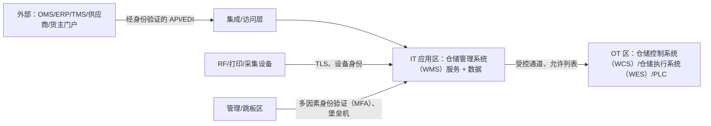

# 04-architecture / 安全

信任边界、身份验证/授权和关键控制。追溯至 NFR-011/012 和 CTL-04/06/07。

## 1. 信任边界

- 外部各方绝不能直接访问数据层；通过访问层进行集成，并使用按系统划分的凭据和消息验证。
- **IT↔OT 是硬边界**：使用经身份验证的服务账户、允许列表中的主机/端口和单向任务/事件契约；不允许远程控制，也不使用共享数据库（IEC 62443 区域与通道 — CTL-07）。

## 2. 身份验证

- 人类用户：在可用的情况下采用企业单点登录（OIDC/SAML）；采用本地备用账户策略作为应急访问（break-glass）机制；在受监管变体中，管理员和审批角色必须使用多因素身份验证（MFA）。
- 设备：采用设备身份和注册机制；RF 会话同时绑定用户和设备，确保扫描可归责于用户和设备二者（CTL-01）。
- 服务到服务：使用 mTLS 或签名令牌，并轮换凭据。

## 3. 授权模型

- **RBAC**：对 stakeholders.md 中的角色（收货员、拣货员、打包员、主管、库存控制员、经理、货主门户用户、管理员）进行授权。
- **货主范围的行级安全（RLS）**：每个事务性记录行都携带货主标识；数据层强制执行以下约束：货主 X 的会话不能读取或修改货主 Y 的数据（第三方物流（3PL） — BR-13/CTL-06）。内部角色可跨货主，但须接受审计。
- **职责分离**：创建超出容差盘点结果的人员不能批准该结果（CTL-04/BR-10）；覆盖操作（强制上架、允许负库存、取消波次）需要更高权限角色，并记录原因。
- **功能 + 设施范围控制**：获准在仓库 A 中操作的用户，不在仓库 B 中拥有隐含权限。

## 4. 数据保护

- 所有通信通道均使用 TLS 进行传输保护，包括 RF 和 IT↔OT；对运营数据存储和事件日志进行静态加密。
- PII 最小化：仅保留发运所需的操作地址/联系人信息；在适用情况下，依据货主合同和 GDPR 风格义务实施货主数据隔离、保留期管理和删除。
- 通过平台密钥存储服务管理机密；代码仓库中的配置不得包含凭据。

## 5. 审计与问责

- 每项特权/覆盖/数量变更操作均记录操作者/操作内容/时间/设备/变更前→变更后，并以来自防篡改事件日志的数据为依据（CTL-05）。
- 审计日志可供检查人员查询，但运营角色不可编辑。
- 定期执行访问权限审查及休眠账户停用流程（控制操作规程，在 compliance 中说明）。

## 6. 应用与接口安全

- 对所有扫描/EDI/API 数据进行输入验证；拒绝格式错误的 GS1/SSCC（CTL-02）；对集成端点设置消息大小/速率限制。
- 幂等性防止由重放引起的重复库存变更（NFR-010）。
- 收紧打印机/标签端点的访问权限，防止标签/SSCC 伪造；重打印操作本身也须记入日志，并可在受监管变体中设置审批闸门。

## 7. 韧性与安全重叠

- 应急访问（break-glass）本地账户和离线 RF 模式（NFR-007）不得绕过扫描控制或审计；排队的确认信息在重新连接后须经验证。
- 面向 OT 的网关进行安全修补时，应遵循 OT 变更窗口；该网关是唯一向 OT 暴露的 IT 组件。