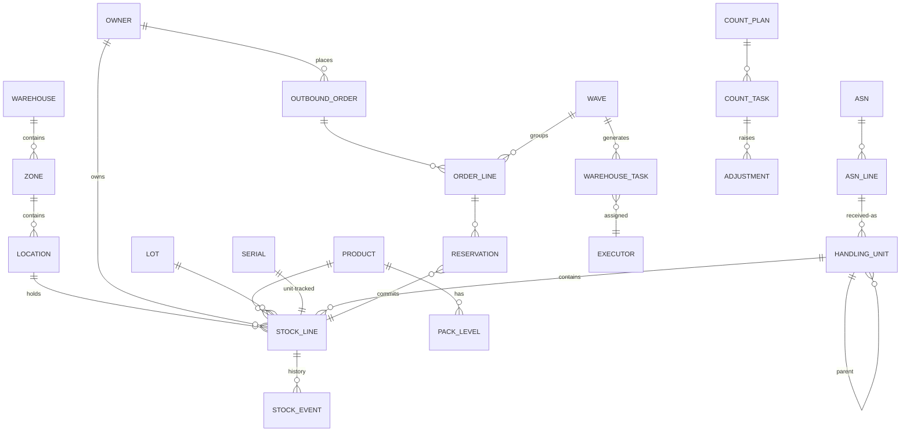

# 05-data / Logical Data Model

Logical entities, key attributes, relationships and cardinalities. Physical
DDL/partitioning is L3/variant. The append-only event log (ADR-0002) is the
source of truth; tables below are aggregates/projections.

## 1. Entity relationship overview

## 2. Core entities (logical fields)

### WAREHOUSE / ZONE / LOCATION
- WAREHOUSE(warehouse_id, code, name, gln, site_addr, tz, status)
- ZONE(zone_id, warehouse_id, zone_type [receive/reserve/pick/pack/ship/
  quarantine/overflow], temp_class, hazard_policy)
- LOCATION(location_id, warehouse_id, zone_id, barcode, path/coord,
  loc_type [bin/dock/staging], capacity_volume, capacity_weight,
  capacity_slots, used_volume/weight/slots, access_attr,
  mixed_lot_allowed, mixed_owner_allowed, status [active/blocked/counting],
  version)

### PRODUCT / PACK_LEVEL / OWNER
- PRODUCT(product_id, owner_scope?, gtin, sku, desc, barcode_required,
  lot_tracked, serial_tracked, expiry_tracked, qc_required,
  allocation_mode [FIFO/FEFO/LIFO/lot-directed], expiry_block_days,
  abc_class, over_short_tol_pct, hazard_class, temp_requirement, status)
- PACK_LEVEL(pack_id, product_id, level [EA/INNER/CASE/PALLET], uom,
  qty_per_parent, weight, dims, barcode)
- OWNER(owner_id, code, name, isolation_policy, bill_profile_ref, status)

### LOT / SERIAL / HANDLING_UNIT
- LOT(lot_id, product_id, lot_code, supplier_lot, receipt_date, expiry_date,
  status, recall_flag)
- SERIAL(serial_id, product_id, serial_no, lot_id, current_status)
- HANDLING_UNIT(hu_id, sscc, parent_hu_id, hu_type, tare_weight, status,
  built_from_asn_line_id)

### STOCK_LINE (BC-4 aggregate projection)
- STOCK_LINE(stock_id, warehouse_id, location_id, product_id, lot_id,
  serial_id?, owner_id, hu_id,
  qty_on_hand, qty_available, qty_reserved, qty_hold, qty_qc_pending,
  qty_in_transit, uom, status, last_event_id, version)
- Constraint: qty_on_hand = available+reserved+hold+qc_pending+in_transit
  (BR-01); all buckets ≥ 0 except explicit exception (BR-02).
- Unique logical key: (warehouse, location, product, lot, serial, owner, hu)
  per chosen granularity.

### STOCK_EVENT (append-only truth)
- STOCK_EVENT(event_id [ordered/immutable], event_type, warehouse_id,
  stock_key fields, owner_id, document_type, document_id, task_id,
  delta buckets (d_available/d_reserved/d_hold/d_qc/d_in_transit/on_hand),
  from_location_id, to_location_id, operator_id, device_id, idempotency_key,
  correlation_id, epcis_biz_step, epcis_disposition, occurred_at,
  recorded_at, prev_hash)
- No update/delete; compensating event for correction; hash-chain
  (NFR-009/CTL-05).

### Inbound
- ASN(asn_id, owner_id, supplier_id, po_ref, expected_at, dock_appt_id,
  status, idempotency_key)
- ASN_LINE(asn_line_id, asn_id, product_id, lot/serial/expiry captured,
  expected_qty, received_qty, over_qty, short_qty, damage_qty, status)
- DOCK_APPOINTMENT(appt_id, warehouse_id, dock_door_id, carrier_ref,
  planned_arrival/departure, status)

### Outbound
- OUTBOUND_ORDER(order_id, owner_id, order_type [sales/STO/pick],
  consignee, carrier_ref, cutoff_at, priority, status, source_system,
  idempotency_key)
- ORDER_LINE(line_id, order_id, product_id, lot_directive?, req_qty,
  alloc_qty, ship_qty, status)
- RESERVATION(reservation_id, order_line_id, stock_id, owner_id,
  reservation_type [soft/hard], qty, status, expires_at, created_by_event)
- WAVE(wave_id, warehouse_id, selection criteria, pick_method, status,
  strategy_version, planned/released_at)
- PICK_LIST / PICK_LINE derived from wave+tasks.
- SHIPMENT(shipment_id, order_id(s), carrier, tracking_no, sscc_list,
  load_id, seal_no, gross_weight, status, shipped_at)
- LOAD / MANIFEST(load_id, dock_door, trailer, shipment_ids, sealed_at)

### Execution
- WAREHOUSE_TASK(task_id, warehouse_id, task_type
  [putaway/move/replenish/pick/pack/count/equipment], source_loc, dest_loc,
  hu_id, product/lot, qty, uom, priority, executor_type [human/device],
  assigned_to, status (SM-3), strategy_version, idempotency_key,
  created/completed_at)

### Count / adjustment
- COUNT_PLAN(plan_id, warehouse_id, abc_policy_ref, period, status)
- COUNT_TASK(count_id, plan_id?, location_id, product/lot, trigger_reason,
  book_qty_hidden, counted_qty, recount_qty, status (SM-6), counter_id)
- ADJUSTMENT(adjustment_id, count_id or doc ref, stock_id, qty_before,
  qty_after, reason_code, requested_by, approved_by, approved_at,
  status, posted_to_erp_at)

## 3. Relationships & integrity notes

- Every STOCK_LINE row is reconstructable by folding STOCK_EVENT on its key
  (reconciliation job verifies equality — observability §6).
- RESERVATION is the join enabling "which order consumes which lot/bin" and
  recall trace; combined with events it provides forward/backward genealogy.
- HANDLING_UNIT recursion models pallet→carton→each; aggregation events
  mirror build/break (EPCIS Aggregation).
- Strategy/rule tables are effective-dated and referenced by
  `strategy_version` on tasks/orders so historical decisions are reproducible.

## 4. Retention & partitioning (logical)

- STOCK_EVENT partitioned by warehouse + time; hot window ~13 months online,
  older to cold store; never deleted within regulated retention (variant).
- Completed documents/shipments retained per policy; PII fields purged/
  anonymized per owner contract while stock/trace facts remain.

## 5. Integrity constraints (normative)

Constraints the model must enforce. They are numbered and stable, and each
names the `BR-`/`FR-` identifier it enforces. The closing sentence records
which are enforced **in the store** rather than in application code — a claim
the pack makes about itself, not a verified property, since application
discipline is exactly what a later change bypasses.

| # | Constraint | Enforces |
|---|---|---|
| 1 | A stock line's quantity buckets sum **exactly** to its on-hand quantity; a bucket set that does not reconcile is illegal | BR-01 |
| 2 | No quantity bucket goes negative; a deduction beyond available is rejected, never clamped | BR-02 |
| 3 | Putaway records the `strategy_version` in force; a putaway with no strategy version is illegal | BR-03, ADR-0004 |
| 4 | A location is compatible with the product, lot status and handling unit before putaway; an incompatible putaway is rejected | BR-04 |
| 5 | A reservation carries a lifetime and expires automatically; an expired reservation releases its stock rather than waiting for a sweep | BR-05 |
| 6 | Allocation honours the declared lot direction (FIFO / FEFO / manual-override) and records a manual override with a reason | BR-06 |
| 7 | An allocation may split across lots and locations, but the allocated parts sum to the requested quantity **exactly** | BR-07 |
| 8 | A mandatory scan control point is enforced at the task gateway; a task completes only with its scans | BR-08, ADR-0003 |
| 9 | A count variance beyond tolerance requires an approval before posting; a within-tolerance variance posts and is still recorded | BR-10 |
| 10 | A delivery outside tolerance is flagged at receipt and cannot be silently accepted | BR-11 |
| 11 | A shipment passes the completeness gate — every pick packed, every pack labelled — before it may ship | BR-12 |
| 12 | Every query resolves exactly one `OWNER`; a cross-owner read is impossible rather than filtered after the fact | BR-13 |
| 13 | There is exactly **one** mutation path: a stock change exists only as an event in `STOCK_EVENT` | BR-14, ADR-0002 |
| 14 | The stock projection equals the fold of `STOCK_EVENT`; a divergence is a defect, not a tolerated drift | ADR-0002, BR-15 |
| 15 | WMS never writes financial valuation, cost or GL fields — ERP owns them | ADR-0001 |
| 16 | The ABC count frequency is enforced per cycle; an un-counted class-A location past its window is flagged | BR-09 |

> Constraints 1, 2, 12, 13, 14 and 15 are **enforced in the store**, not in
> application code. A non-reconciling bucket set, a negative balance, a
> cross-owner read, a second mutation path, a projection that has drifted from
> its event log, or a WMS row holding a cost is a defect regardless of what
> application discipline promises — and in this domain the first two are
> stock-outs and phantom inventory, which is what the whole model exists to
> prevent.
