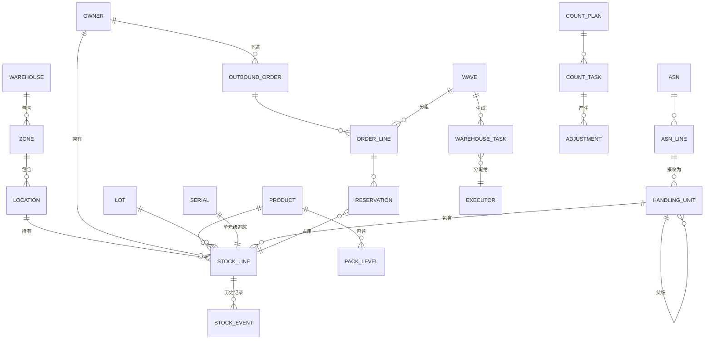

# 05-data / 逻辑数据模型

逻辑实体、关键属性、关系及基数。物理
DDL/分区机制属于 L3/变体。仅追加事件日志（ADR-0002）是
事实来源；以下表均为聚合/投影。

## 1. 实体关系概述

## 2. 核心实体（逻辑字段）

### WAREHOUSE / ZONE / LOCATION
- WAREHOUSE(warehouse_id, code, name, gln, site_addr, tz, status)
- ZONE(zone_id, warehouse_id, zone_type [receive/reserve/pick/pack/ship/
  quarantine/overflow], temp_class, hazard_policy)
- LOCATION(location_id, warehouse_id, zone_id, barcode, path/coord,
  loc_type [bin/dock/staging], capacity_volume, capacity_weight,
  capacity_slots, used_volume/weight/slots, access_attr,
  mixed_lot_allowed, mixed_owner_allowed, status [active/blocked/counting],
  version)

### PRODUCT / PACK_LEVEL / OWNER
- PRODUCT(product_id, owner_scope?, gtin, sku, desc, barcode_required,
  lot_tracked, serial_tracked, expiry_tracked, qc_required,
  allocation_mode [FIFO/FEFO/LIFO/lot-directed], expiry_block_days,
  abc_class, over_short_tol_pct, hazard_class, temp_requirement, status)
- PACK_LEVEL(pack_id, product_id, level [EA/INNER/CASE/PALLET], uom,
  qty_per_parent, weight, dims, barcode)
- OWNER(owner_id, code, name, isolation_policy, bill_profile_ref, status)

### LOT / SERIAL / HANDLING_UNIT
- LOT(lot_id, product_id, lot_code, supplier_lot, receipt_date, expiry_date,
  status, recall_flag)
- SERIAL(serial_id, product_id, serial_no, lot_id, current_status)
- HANDLING_UNIT(hu_id, sscc, parent_hu_id, hu_type, tare_weight, status,
  built_from_asn_line_id（构建自 ASN 明细行）)

### STOCK_LINE（BC-4 聚合投影）
- STOCK_LINE(stock_id, warehouse_id, location_id, product_id, lot_id,
  serial_id?, owner_id, hu_id,
  qty_on_hand, qty_available, qty_reserved, qty_hold, qty_qc_pending,
  qty_in_transit, uom, status, last_event_id, version)
- 约束：qty_on_hand = available+reserved+hold+qc_pending+in_transit
  (BR-01)；除明确例外外，所有分桶均 ≥ 0（BR-02）。
- 唯一逻辑键：按选定粒度为
  (warehouse, location, product, lot, serial, owner, hu)。

### STOCK_EVENT（仅追加事实源）
- STOCK_EVENT(event_id [ordered/immutable], event_type, warehouse_id,
  stock_key 字段, owner_id, document_type, document_id, task_id,
  增量分桶 (d_available/d_reserved/d_hold/d_qc/d_in_transit/on_hand),
  from_location_id, to_location_id, operator_id, device_id, idempotency_key,
  correlation_id, epcis_biz_step, epcis_disposition, occurred_at,
  recorded_at, prev_hash)
- 不得更新/删除；更正时使用补偿事件；哈希链
  (NFR-009/CTL-05)。

### 入库
- ASN(asn_id, owner_id, supplier_id, po_ref, expected_at, dock_appt_id,
  status, idempotency_key)
- ASN_LINE(asn_line_id, asn_id, product_id, lot/serial/expiry 已采集,
  expected_qty, received_qty, over_qty, short_qty, damage_qty, status)
- DOCK_APPOINTMENT(appt_id, warehouse_id, dock_door_id, carrier_ref,
  planned_arrival/departure, status)

### 出库
- OUTBOUND_ORDER(order_id, owner_id, order_type [sales/STO/pick],
  consignee, carrier_ref, cutoff_at, priority, status, source_system,
  idempotency_key)
- ORDER_LINE(line_id, order_id, product_id, lot_directive?, req_qty,
  alloc_qty, ship_qty, status)
- RESERVATION(reservation_id, order_line_id, stock_id, owner_id,
  reservation_type [soft/hard], qty, status, expires_at, created_by_event)
- WAVE(wave_id, warehouse_id, selection criteria（选择条件）, pick_method, status,
  strategy_version, planned/released_at)
- PICK_LIST / PICK_LINE 由波次+任务派生。
- SHIPMENT(shipment_id, order_id(s), carrier, tracking_no, sscc_list,
  load_id, seal_no, gross_weight, status, shipped_at)
- LOAD / MANIFEST(load_id, dock_door, trailer, shipment_ids, sealed_at)

### 执行
- WAREHOUSE_TASK(task_id, warehouse_id, task_type
  [putaway/move/replenish/pick/pack/count/equipment], source_loc, dest_loc,
  hu_id, product/lot, qty, uom, priority, executor_type [human/device],
  assigned_to, status (SM-3), strategy_version, idempotency_key,
  created/completed_at)

### 盘点 / 调整
- COUNT_PLAN(plan_id, warehouse_id, abc_policy_ref, period, status)
- COUNT_TASK(count_id, plan_id?, location_id, product/lot, trigger_reason,
  book_qty_hidden, counted_qty, recount_qty, status (SM-6), counter_id)
- ADJUSTMENT(adjustment_id, count_id 或 doc ref, stock_id, qty_before,
  qty_after, reason_code, requested_by, approved_by, approved_at,
  status, posted_to_erp_at)

## 3. 关系与完整性说明

- 每一行 STOCK_LINE 均可通过按其键折叠 STOCK_EVENT 来重建
  （对账作业验证二者相等——可观测性 §6）。
- RESERVATION 是实现“哪个订单消耗哪个批次/库位”的关联，并
  支持召回追溯；与事件结合后，可提供正向/反向血缘。
- HANDLING_UNIT 递归建模托盘→纸箱→每个单元；聚合事件
  镜像构建/拆解（EPCIS Aggregation）。
- 策略/规则表按生效日期管理，并通过任务/订单上的
  `strategy_version` 引用，以便复现历史决策。

## 4. 保留期与分区（逻辑）

- STOCK_EVENT 按仓库+时间分区；热数据窗口约 13 个月在线，
  更旧数据转入冷存储；在法规规定的保留期内绝不删除（变体）。
- 已完成单据/发运按政策保留；PII 字段按货主合同清除/
  匿名化，同时保留库存/追溯事实。

## 5. 完整性约束（规范性）

模型必须强制执行以下约束。这些约束具有稳定编号，且每条约束都注明
其所强制执行的 `BR-`/`FR-` 标识符。最后一句记录了哪些约束是由
**存储层**而非应用程序代码强制执行——这是本方案包对自身的声明，
而非经验证的属性，因为应用程序侧的约束执行恰恰可能被后续变更绕过。

| # | 约束 | 强制执行的要求 |
|---|---|---|
| 1 | 库存行的数量分桶之和必须**恰好**等于其现有量；无法对账的分桶集合属于非法状态 | BR-01 |
| 2 | 任何数量分桶都不得为负；超出可用量的扣减应被拒绝，绝不作截断处理 | BR-02 |
| 3 | 上架作业必须记录当时生效的 `strategy_version`；未记录策略版本的上架作业属于非法操作 | BR-03, ADR-0004 |
| 4 | 上架前，库位必须与产品、批次状态及装卸/物流单元兼容；不兼容的上架应被拒绝 | BR-04 |
| 5 | 预留具有有效期并自动到期；预留到期后立即释放库存，而不是等待清理任务 | BR-05 |
| 6 | 分配必须遵循指定的批次流向（FIFO / FEFO / 人工覆盖），并记录人工覆盖及其原因 | BR-06 |
| 7 | 一次分配可跨批次和库位拆分，但已分配部分之和必须**恰好**等于请求数量 | BR-07 |
| 8 | 任务网关必须强制执行必需的扫描控制点；任务只有在完成相应扫描后才能完成 | BR-08, ADR-0003 |
| 9 | 盘点差异超出容差时，过账前必须经审批；容差范围内的差异可直接过账，但仍须记录 | BR-10 |
| 10 | 收货时，超出容差的到货必须被标记，且不得被静默接受 | BR-11 |
| 11 | 发运前，发货必须通过完整性闸门——每项拣货均已打包、每个包装均已贴标 | BR-12 |
| 12 | 每次查询必须且只能解析到一个 `OWNER`；跨货主读取不可发生，而不是在读取后进行过滤 | BR-13 |
| 13 | 有且只有一条变更路径：库存变更仅以 `STOCK_EVENT` 中的事件形式存在 | BR-14, ADR-0002 |
| 14 | 库存投影必须等于 `STOCK_EVENT` 的折叠结果；任何偏离都是缺陷，而非可容忍的漂移 | ADR-0002, BR-15 |
| 15 | WMS 绝不写入财务估值、成本或 GL 字段——这些字段归 ERP 所有 | ADR-0001 |
| 16 | ABC 盘点频率按周期强制执行；超过规定窗口仍未盘点的 A 类库位必须被标记 | BR-09 |

> 约束 1、2、12、13、14 和 15 由**存储层**强制执行，而非
> 应用程序代码。无法对账的分桶集合、负余额、
> 跨货主读取、第二条变更路径、已偏离其事件日志的投影，
> 或含有成本的 WMS 行均属于缺陷，无论应用程序侧的约束作出何种承诺——
> 而且在此领域中，前两者分别是缺货和幽灵库存，而这正是整个模型
> 存在所要防止的情况。