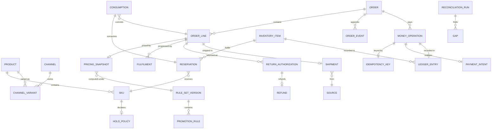

# 03 · Domain Model

> ⚠️ ASSUMPTION — bounded contexts, aggregates and invariants are pack design.
> No external standard is cited for this decomposition.

## Bounded contexts

| Context | Responsibility | Owns |
|---|---|---|
| **Catalog** | The shared product master and its channel variants | Product, Sku, PriceList, Channel, ChannelVariant |
| **Pricing** | Rule-set evaluation into priced results and snapshots | PromotionRule, RuleSetVersion, PricingSnapshot |
| **Cart** | Priced intentions with hold policies | Cart, CartLine, HoldPolicy |
| **Payment** | PSP-hosted capture, tokens, idempotency | PaymentIntent, MoneyOperation, IdempotencyKey |
| **Inventory** | The scarce resource: availability, reserves, consumes | InventoryItem, Reservation, Consumption, Count |
| **Ordering** | The commitment object and its lifecycle | Order, OrderLine, OrderEvent |
| **Fulfilment** | Source selection, shipment, routing | Shipment, ShipmentLine, Source |
| **Post-sale** | Returns, refunds, cancellations | ReturnAuthorization, Refund, Cancellation |
| **Ledger** | The immutable movement record | LedgerEntry, ReconciliationRun, Gap |
| **Care** | Service-side access to the order state | ServiceCase |

Ledger is the **evidence** context: every money and inventory movement in every
other context appends to it, and reconciliation reads only from it plus external
actuals. It never mutates another context's records.

## Core aggregates & invariants

### Product / Sku (aggregate root, in Catalog)
```
Product: id, status, taxonomy, media[], attributes
Sku: id, productId, code, attributes, holdPolicy, taxable
HoldPolicy: {
  reserveAt: (add-to-cart | confirmation | capture | fulfilment),
  consumeAt:  (confirmation | capture | fulfilment),
  reserveTtl: duration,      // mandatory when reserveAt is used (BR-02)
  sourceScope: [warehouse | store | dropship]
}
└── invariants
    • holdPolicy is per product; a global default is a defect (BR-01)
    • reserveTtl is mandatory whenever reserveAt is set (BR-02)
    • consumeAt != reserveAt implies both exist and are distinct operations (BR-01)
```

### PricingSnapshot (value object, in Pricing)
```
PricingSnapshot: id, orderLineRef, rulesetVersion, currency,
  unitPrice, discountContributions: [{ruleId, ruleVersion, amount}],
  taxLines[], total, computedAt
└── invariants
    • immutable once created (BR-06, NFR-004)
    • records the rulesetVersion — reproducibility is the point (BR-06)
    • a re-pricing creates a new snapshot; no path edits an existing one (BR-06)
```

### Order (aggregate root, in Ordering)
```
Order: id, channel, customerRef, currency, state,
  lines: [OrderLine], pricingSnapshotRefs[], paymentRefs[], shipments[],
  createdTs, updatedTs
OrderLine: id, skuRef, quantity, snapshotRef, fulfilmentState,
  disposition?, cancellationCause?
OrderEvent: id, kind, ts, actor, channel, payloadRef   // append-only
└── invariants
    • order-derived state = fold over per-line fulfilment states (BR-11)
    • state vocabulary is identical across channels (BR-14)
    • every transition appends an OrderEvent; nothing is rewritten
    • cancellation is by defined point; only unconsumed reservations release
      (BR-03, BR-04)
    • prices read from the snapshot, never recomputed (BR-06)
```

### InventoryItem / Reservation (in Inventory)
```
InventoryItem: skuRef, sourceRef, physical, timestamp
Reservation: id, skuRef, sourceRef, qty, expiresTs, state (active|released|consumed)
Consumption:  id, reservationId?, orderLineRef, qty, ts
└── invariants
    • availability = physical - active reserves - in-flight commitments (NFR-002)
    • a reservation without expiry is illegal (BR-02)
    • only unconsumed reservations release on cancellation (BR-04)
    • a cross-channel order deducts once, at one resolving source (FR-014)
    • consume is refused when availability is insufficient (FR-015) → oversell guard
    • consume is irreversible; there is no "un-consume"
```

### MoneyOperation / IdempotencyKey (in Payment)
```
MoneyOperation: id, kind (authorise|capture|refund|adjust), amount, currency,
  orderRef?, captureRef?, keyId, pspRef, state, createdTs
IdempotencyKey: id, issuedBy=platform, payloadHash, scope, firstOperationRef
└── invariants
    • a key is issued by the platform, not the PSP (BR-07)
    • identical key + identical payload ⇒ identical outcome; no duplicate effect
      (BR-07, NFR-005)
    • a refund is a new operation with a new key, never a negative charge (BR-08)
    • no primary account number is stored anywhere in this context (BR-10)
```

### ReturnAuthorization / Refund (in Post-sale)
```
ReturnAuthorization: id, orderLineRef, disposition (restock|scrap), authorisedBy,
  receivedTs?, state
Refund: id, moneyOperationId, returnAuthId?, cancellationId?, amount, reason
└── invariants
    • disposition is decided at authorisation (BR-12)
    • restock returns to availability; scrap does not — decided by disposition,
      never by receipt (BR-12)
    • refunds link to the originating line and capture (FR-021)
    • the reversal path has its own states (BR-09)
```

### LedgerEntry (in Ledger)
```
LedgerEntry: id, kind (money | inventory), operation, keyId?, actor, channel,
  ts, snapshotOrReadingRef, amountOrQty
└── invariants
    • append-only; a correction is a new entry (BR-13)
    • every entry is attributable and timestamped (CTL-07)
```

## Relationships (logical)



## The four aggregates that carry the pack's weight

| Aggregate | The invariant that matters most | What it prevents |
|---|---|---|
| **HoldPolicy** | reserve and consume are distinct, and expiry is mandatory | stock locked forever by abandoned carts; oversell by silent resale |
| **PricingSnapshot** | immutable, and records its ruleset version | a customer losing a discount while paying; an unfalsifiable price |
| **IdempotencyKey** | platform-issued, path-independent | double charges on POS and marketplace paths the PSP does not cover |
| **ReturnAuthorization** | disposition decided at authorisation | inventory moving on a receipt-time decision that availability has already changed |

> The first and the fourth are the ones most often implemented as configuration
> rather than as invariants — and both are exactly where the pack's cardinal sin
> and its money failures live.