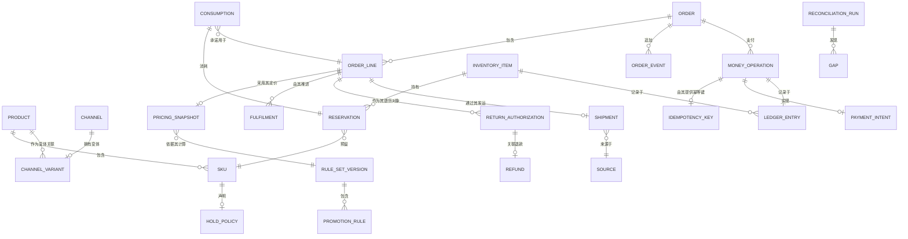

# 03 · 领域模型

> ⚠️ ASSUMPTION — 有界上下文、聚合和不变量属于方案包设计。
> 未引用外部标准来论证这种拆分。

## 有界上下文

| 上下文 | 职责 | 所拥有 |
|---|---|---|
| **Catalog** | 共享的商品主数据及其渠道变体 | Product, Sku, PriceList, Channel, ChannelVariant |
| **Pricing** | 对规则集进行评估，生成定价结果和快照 | PromotionRule, RuleSetVersion, PricingSnapshot |
| **Cart** | 带库存占用策略的已定价购买意向 | Cart, CartLine, HoldPolicy |
| **Payment** | PSP 托管的请款、令牌化和幂等处理 | PaymentIntent, MoneyOperation, IdempotencyKey |
| **Inventory** | 稀缺资源：可用库存、预留、消耗 | InventoryItem, Reservation, Consumption, Count |
| **Ordering** | 承诺对象及其生命周期 | Order, OrderLine, OrderEvent |
| **Fulfilment** | 来源选择、发运、路由 | Shipment, ShipmentLine, Source |
| **Post-sale** | 退货、退款、取消 | ReturnAuthorization, Refund, Cancellation |
| **Ledger** | 不可变的变动记录 | LedgerEntry, ReconciliationRun, Gap |
| **Care** | 服务端对订单状态的访问 | ServiceCase |

账本是**证据**上下文：其他每个上下文中发生的每笔资金和库存变动都会追加至账本，
对账仅从账本及外部实际数据中读取。它绝不修改其他上下文的记录。

## 核心聚合与不变量

### Product / Sku（聚合根，位于 Catalog）
```
Product: id, status, taxonomy, media[], attributes
Sku: id, productId, code, attributes, holdPolicy, taxable
HoldPolicy: {
  reserveAt: (add-to-cart | confirmation | capture | fulfilment),
  consumeAt:  (confirmation | capture | fulfilment),
  reserveTtl: duration,      // 使用 reserveAt 时为必填项 (BR-02)
  sourceScope: [warehouse | store | dropship]
}
└── 不变量
    • holdPolicy 按商品设置；使用全局默认值属于缺陷 (BR-01)
    • 设置 reserveAt 时，reserveTtl 为必填项 (BR-02)
    • consumeAt != reserveAt 表示两者均存在且执行不同的操作 (BR-01)
```

### PricingSnapshot（值对象，位于 Pricing）
```
PricingSnapshot: id, orderLineRef, rulesetVersion, currency,
  unitPrice, discountContributions: [{ruleId, ruleVersion, amount}],
  taxLines[], total, computedAt
└── 不变量
    • 创建后不可变 (BR-06, NFR-004)
    • 记录 rulesetVersion——可复现性正是其目的 (BR-06)
    • 重新定价会创建新快照；任何处理路径都不会编辑现有快照 (BR-06)
```

### Order（聚合根，位于 Ordering）
```
Order: id, channel, customerRef, currency, state,
  lines: [OrderLine], pricingSnapshotRefs[], paymentRefs[], shipments[],
  createdTs, updatedTs
OrderLine: id, skuRef, quantity, snapshotRef, fulfilmentState,
  disposition?, cancellationCause?
OrderEvent: id, kind, ts, actor, channel, payloadRef   // 仅追加
└── 不变量
    • 订单派生状态 = 各行项目履约状态的折叠结果 (BR-11)
    • 各渠道的状态词汇完全相同 (BR-14)
    • 每次状态转换都追加一个 OrderEvent；不得重写任何记录
    • 取消按已定义的节点执行；只有未消耗的预留才会释放
      (BR-03, BR-04)
    • 价格从快照读取，绝不重新计算 (BR-06)
```

### InventoryItem / Reservation（位于 Inventory）
```
InventoryItem: skuRef, sourceRef, physical, timestamp
Reservation: id, skuRef, sourceRef, qty, expiresTs, state (active|released|consumed)
Consumption:  id, reservationId?, orderLineRef, qty, ts
└── 不变量
    • availability = physical - active reserves - in-flight commitments (NFR-002)
    • 没有过期时间的预留是非法的 (BR-02)
    • 取消时仅释放未消耗的预留 (BR-04)
    • 跨渠道订单在一个确定的来源处仅扣减一次 (FR-014)
    • 可用库存不足时拒绝执行消耗 (FR-015) → 超卖防护
    • 消耗不可逆；不存在“撤销消耗”操作
```

### MoneyOperation / IdempotencyKey（位于 Payment）
```
MoneyOperation: id, kind (authorise|capture|refund|adjust), amount, currency,
  orderRef?, captureRef?, keyId, pspRef, state, createdTs
IdempotencyKey: id, issuedBy=platform, payloadHash, scope, firstOperationRef
└── 不变量
    • 键由平台签发，而非 PSP (BR-07)
    • 相同的键 + 相同的载荷 ⇒ 相同的结果；不会产生重复效果
      (BR-07, NFR-005)
    • 退款是一项使用新键的新操作，绝不是负向扣款 (BR-08)
    • 此上下文中的任何位置都不存储主账号号码 (BR-10)
```

### ReturnAuthorization / Refund（位于 Post-sale）
```
ReturnAuthorization: id, orderLineRef, disposition (restock|scrap), authorisedBy,
  receivedTs?, state
Refund: id, moneyOperationId, returnAuthId?, cancellationId?, amount, reason
└── 不变量
    • 处置方式在授权时确定 (BR-12)
    • 重新入库会恢复可用库存；报废不会——由处置方式决定，绝非由收货决定
      (BR-12)
    • 退款关联原始行项目和请款 (FR-021)
    • 冲正路径拥有自身状态 (BR-09)
```

### LedgerEntry（位于 Ledger）
```
LedgerEntry: id, kind (money | inventory), operation, keyId?, actor, channel,
  ts, snapshotOrReadingRef, amountOrQty
└── 不变量
    • 仅追加；更正应创建新条目 (BR-13)
    • 每个条目均可归属到责任主体且带有时间戳 (CTL-07)
```

## 关系（逻辑）



## 支撑本方案包的四个核心聚合

| 聚合 | 最重要的不变量 | 可防止的问题 |
|---|---|---|
| **HoldPolicy** | 预留与消耗彼此不同，且必须设置过期时间 | 被遗弃的购物车永久锁定库存；通过静默转售造成超卖 |
| **PricingSnapshot** | 不可变，并记录其规则集版本 | 客户在付款过程中失去折扣；无法核实真伪的价格 |
| **IdempotencyKey** | 由平台签发，与路径无关 | PSP 未覆盖的 POS 和第三方平台路径发生重复扣款 |
| **ReturnAuthorization** | 处置方式在授权时确定 | 在可用库存已经变化后，仍依据收货时的决定移动库存 |

> 第一个和第四个聚合最常被实现为配置，而不是不变量——而这两处恰恰是
> 本方案包的头号大忌和资金故障所在。