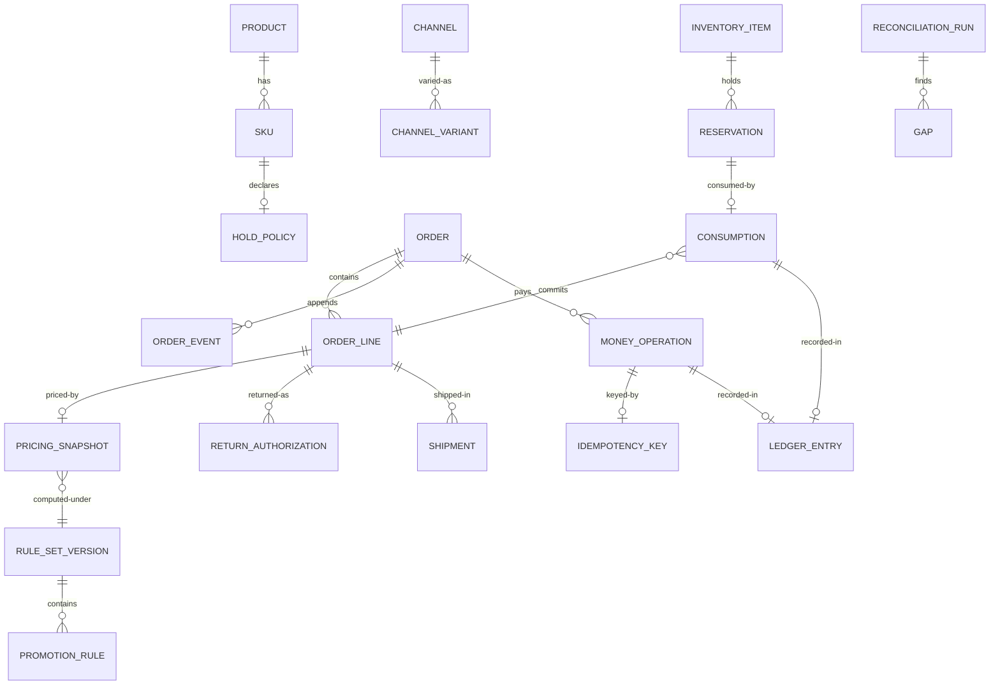

# 05 · Logical Data Model

> Logical model for the core entities. Physical modelling is a deployment
> concern; this file fixes the shape and the invariants.
>
> ⚠️ ASSUMPTION — the model is pack design. Mermaid is illustrative.

## Entities

```
PRODUCT (catalog)
  product_id        PK
  status            draft | published | retired
  taxonomy_ref
  created_ts, updated_ts

SKU (catalog)
  sku_id            PK
  product_id        FK → PRODUCT
  code              unique
  attributes        jsonb

HOLD_POLICY (catalog)                      -- BR-01, BR-02
  policy_id         PK
  sku_id            FK → SKU
  reserve_at        add-to-cart | confirmation | capture | fulfilment | none
  consume_at        confirmation | capture | fulfilment
  reserve_ttl       not null when reserve_at != none   -- BR-02
  source_scope      [warehouse | store | dropship]

CHANNEL (catalog)
  channel_id        PK
  input_path, payment_path, identity_model, fulfilment_sources   -- BR-14 contract

PRICE_LIST (pricing)
  price_list_id     PK
  channel_id, currency, audience_ref, effective_range

RULE_SET_VERSION (pricing)                 -- BR-05, BR-06
  ruleset_version   PK
  published_ts, published_by
  status            active | superseded

PROMOTION_RULE (pricing)
  rule_id           PK, rule_version
  ruleset_version   FK → RULE_SET_VERSION
  kind, condition, contribution, stacking_group, exclusivity

PRICING_SNAPSHOT (pricing)                 -- BR-06, NFR-004
  snapshot_id       PK
  order_line_id     FK → ORDER_LINE (nullable before order capture)
  ruleset_version   FK → RULE_SET_VERSION
  currency
  unit_price
  contributions     jsonb   [{rule_id, rule_version, amount}]
  tax_lines         jsonb
  total
  computed_ts
  -- IMMUTABLE: no update path exists (BR-06)

CART / CART_LINE (cart)
  cart_id           PK, channel_id, customer_ref?
  cart_line_id      PK
  cart_id, sku_id, quantity, snapshot_id (advisory),

INVENTORY_ITEM (inventory)                 -- NFR-002
  sku_id + source_ref     (composite key)
  physical_qty
  last_counted_ts

RESERVATION (inventory)                    -- BR-01, BR-02
  reservation_id    PK
  sku_id + source_ref
  quantity
  state             active | released | consumed
  created_ts, expires_ts      -- expires_ts NOT NULL (BR-02)
  order_line_ref?
  released_ts, consumed_ts

CONSUMPTION (inventory)
  consumption_id    PK
  reservation_id    FK → RESERVATION (nullable: a consume without a prior reserve)
  order_line_id     FK → ORDER_LINE
  sku_id + source_ref, quantity
  ts                                -- irreversible

ORDER (ordering)                           -- BR-11, BR-14
  order_id          PK
  channel_id        FK → CHANNEL
  customer_ref
  currency
  state
  created_ts, updated_ts
  cancellation_cause?

ORDER_LINE (ordering)                       -- BR-11
  order_line_id     PK
  order_id          FK → ORDER
  sku_id, quantity
  snapshot_id       FK → PRICING_SNAPSHOT      -- never recomputed (BR-06)
  fulfilment_state  pending | allocated | shipped | delivered | returned | cancelled
  disposition       restock | scrap            -- set at authorisation (BR-12)

ORDER_EVENT (ordering)                      -- append-only
  order_event_id    PK
  order_id, kind, ts, actor, channel, payload_ref

IDEMPOTENCY_KEY (payment)                   -- BR-07, ADR-0003
  key_id            PK
  issued_by         = platform                -- never the PSP
  payload_hash
  scope             channel, operation kind
  first_operation_id FK → MONEY_OPERATION
  created_ts

MONEY_OPERATION (payment)                    -- BR-07, BR-08, NFR-005
  money_operation_id  PK
  kind               authorise | capture | refund | adjust
  amount, currency
  key_id             FK → IDEMPOTENCY_KEY
  order_id?, capture_ref?
  psp_token_ref      -- a token; never a PAN (BR-10)
  state
  created_ts

SHIPMENT (fulfilment)                        -- BR-11, BR-15
  shipment_id       PK
  order_line_id, source_ref, carrier_ref, state
  -- partial shipments are first-class (BR-11)

RETURN_AUTHORIZATION (post-sale)             -- BR-12
  rma_id            PK
  order_line_id, disposition (restock|scrap), authorised_by, state, received_ts?

LEDGER_ENTRY (ledger)                        -- BR-13, CTL-07
  ledger_entry_id   PK
  kind              money | inventory
  operation, key_id?, actor, channel, ts
  snapshot_or_reading_ref
  amount_or_qty
  -- append-only; corrections are new entries

RECONCILIATION_RUN / GAP (ledger)            -- BR-13, NFR-009
  run_id            PK
  gap_id            PK, run_id, kind, expected, actual, opened_ts, closed_ts?, owner?
```

## Keys and cardinalities



## Integrity constraints the model must enforce

| # | Constraint | Enforces |
|---|---|---|
| 1 | `HOLD_POLICY.reserve_ttl` is NOT NULL whenever `reserve_at != none` | BR-02 |
| 2 | `PRICING_SNAPSHOT` has no UPDATE grant — insert-only | BR-06, NFR-004 |
| 3 | `MONEY_OPERATION.key_id` resolves, and `IDEMPOTENCY_KEY.issued_by = 'platform'` | BR-07 |
| 4 | No column in any entity may store a PAN | BR-10, CTL-01 |
| 5 | `RESERVATION.expires_ts` NOT NULL | BR-02 |
| 6 | `ORDER_LINE.snapshot_id` NOT NULL for lines in states past `captured` | BR-06 |
| 7 | `RETURN_AUTHORIZATION.disposition` is set at INSERT, never at receipt | BR-12 |
| 8 | `LEDGER_ENTRY` has no UPDATE or DELETE grant | BR-13 |
| 9 | `ORDER_EVENT` has no UPDATE or DELETE grant | append-only history |
| 10 | `ORDER.state` is derivable from `ORDER_LINE.fulfilment_state` — no independent write path | BR-11 |

> Constraints 2, 4, 8, 9 and 10 are **enforced in the store**, not in
> application code. A mutable snapshot or an editable ledger is a defect
> regardless of what application discipline promises.