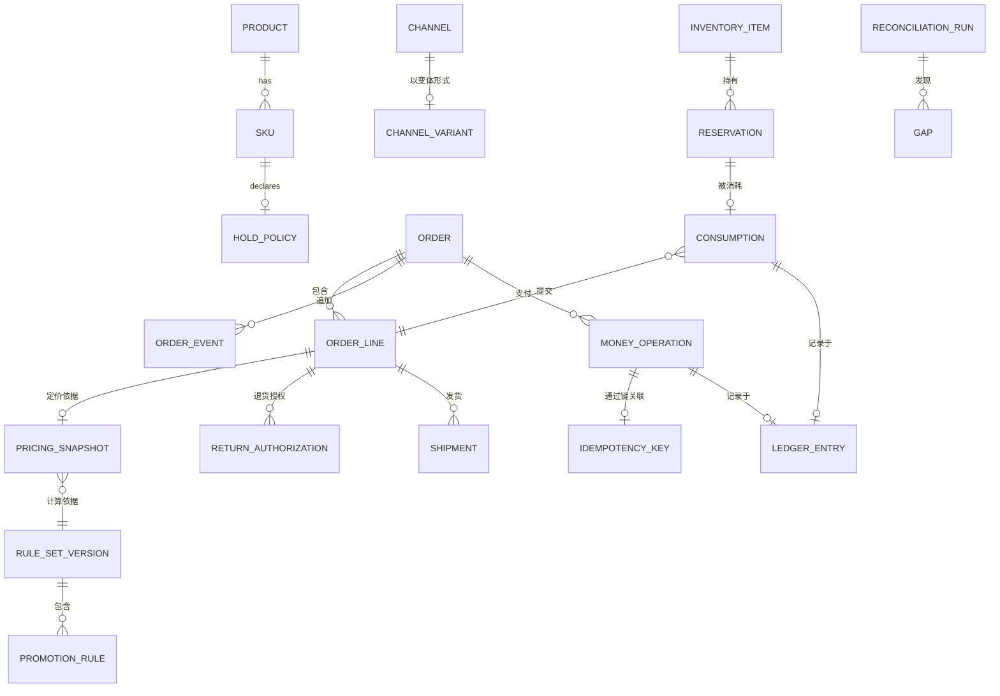

# 05 · 逻辑数据模型

> 核心实体的逻辑模型。物理建模属于部署层面的关注事项；本文件确定模型形态及其不变量。
>
> ⚠️ ASSUMPTION — 该模型属于方案包设计。Mermaid 仅作示意。

## 实体

```
PRODUCT (目录)
  product_id        PK
  status            draft | published | retired
  taxonomy_ref
  created_ts, updated_ts

SKU (目录)
  sku_id            PK
  product_id        FK → PRODUCT
  code              unique
  attributes        jsonb

HOLD_POLICY (目录)                      -- BR-01, BR-02
  policy_id         PK
  sku_id            FK → SKU
  reserve_at        add-to-cart | confirmation | capture | fulfilment | none
  consume_at        confirmation | capture | fulfilment
  reserve_ttl       not null when reserve_at != none   -- BR-02
  source_scope      [warehouse | store | dropship]

CHANNEL (目录)
  channel_id        PK
  input_path, payment_path, identity_model, fulfilment_sources   -- BR-14 contract

PRICE_LIST (定价)
  price_list_id     PK
  channel_id, currency, audience_ref, effective_range

RULE_SET_VERSION (定价)                 -- BR-05, BR-06
  ruleset_version   PK
  published_ts, published_by
  status            active | superseded

PROMOTION_RULE (定价)
  rule_id           PK, rule_version
  ruleset_version   FK → RULE_SET_VERSION
  kind, condition, contribution, stacking_group, exclusivity

PRICING_SNAPSHOT (定价)                 -- BR-06, NFR-004
  snapshot_id       PK
  order_line_id     FK → ORDER_LINE (订单请款前可为空)
  ruleset_version   FK → RULE_SET_VERSION
  currency
  unit_price
  contributions     jsonb   [{rule_id, rule_version, amount}]
  tax_lines         jsonb
  total
  computed_ts
  -- IMMUTABLE：不存在更新路径 (BR-06)

CART / CART_LINE (购物车)
  cart_id           PK, channel_id, customer_ref?
  cart_line_id      PK
  cart_id, sku_id, quantity, snapshot_id (仅供参考),

INVENTORY_ITEM (库存)                 -- NFR-002
  sku_id + source_ref     (复合键)
  physical_qty
  last_counted_ts

RESERVATION (库存)                    -- BR-01, BR-02
  reservation_id    PK
  sku_id + source_ref
  quantity
  state             active | released | consumed
  created_ts, expires_ts      -- expires_ts NOT NULL (BR-02)
  order_line_ref?
  released_ts, consumed_ts

CONSUMPTION (库存)
  consumption_id    PK
  reservation_id    FK → RESERVATION (可为空：无需先前预留即可消耗)
  order_line_id     FK → ORDER_LINE
  sku_id + source_ref, quantity
  ts                                -- 不可逆

ORDER (订单)                           -- BR-11, BR-14
  order_id          PK
  channel_id        FK → CHANNEL
  customer_ref
  currency
  state
  created_ts, updated_ts
  cancellation_cause?

ORDER_LINE (订单)                       -- BR-11
  order_line_id     PK
  order_id          FK → ORDER
  sku_id, quantity
  snapshot_id       FK → PRICING_SNAPSHOT      -- 绝不重算 (BR-06)
  fulfilment_state  pending | allocated | shipped | delivered | returned | cancelled
  disposition       restock | scrap            -- 在授权时设置 (BR-12)

ORDER_EVENT (订单)                      -- 仅追加
  order_event_id    PK
  order_id, kind, ts, actor, channel, payload_ref

IDEMPOTENCY_KEY (支付)                   -- BR-07, ADR-0003
  key_id            PK
  issued_by         = platform                -- 绝不由 PSP 签发
  payload_hash
  scope             channel, operation kind
  first_operation_id FK → MONEY_OPERATION
  created_ts

MONEY_OPERATION (支付)                    -- BR-07, BR-08, NFR-005
  money_operation_id  PK
  kind               authorise | capture | refund | adjust
  amount, currency
  key_id             FK → IDEMPOTENCY_KEY
  order_id?, capture_ref?
  psp_token_ref      -- 令牌；绝不使用 PAN (BR-10)
  state
  created_ts

SHIPMENT (履约)                        -- BR-11, BR-15
  shipment_id       PK
  order_line_id, source_ref, carrier_ref, state
  -- 部分发货是一等实体 (BR-11)

RETURN_AUTHORIZATION (售后)             -- BR-12
  rma_id            PK
  order_line_id, disposition (restock|scrap), authorised_by, state, received_ts?

LEDGER_ENTRY (账本)                        -- BR-13, CTL-07
  ledger_entry_id   PK
  kind              money | inventory
  operation, key_id?, actor, channel, ts
  snapshot_or_reading_ref
  amount_or_qty
  -- 仅追加；更正须创建新条目

RECONCILIATION_RUN / GAP (账本)            -- BR-13, NFR-009
  run_id            PK
  gap_id            PK, run_id, kind, expected, actual, opened_ts, closed_ts?, owner?
```

## 键与基数



## 模型必须强制执行的完整性约束

| # | 约束 | 强制落实 |
|---|---|---|
| 1 | 只要 `reserve_at != none`，`HOLD_POLICY.reserve_ttl` 就必须为 NOT NULL | BR-02 |
| 2 | 对 `PRICING_SNAPSHOT` 不授予 UPDATE 权限——仅可插入 | BR-06, NFR-004 |
| 3 | `MONEY_OPERATION.key_id` 必须可解析，且 `IDEMPOTENCY_KEY.issued_by = 'platform'` | BR-07 |
| 4 | 任何实体中的任何列都不得存储 PAN | BR-10, CTL-01 |
| 5 | `RESERVATION.expires_ts` 必须为 NOT NULL | BR-02 |
| 6 | 对于状态已越过 `captured` 的行，`ORDER_LINE.snapshot_id` 必须为 NOT NULL | BR-06 |
| 7 | `RETURN_AUTHORIZATION.disposition` 必须在 INSERT 时设置，绝不在收货时设置 | BR-12 |
| 8 | 不对 `LEDGER_ENTRY` 授予 UPDATE 或 DELETE 权限 | BR-13 |
| 9 | 不对 `ORDER_EVENT` 授予 UPDATE 或 DELETE 权限 | 仅追加的历史记录 |
| 10 | `ORDER.state` 必须可由 `ORDER_LINE.fulfilment_state` 推导得出——不存在独立写入路径 | BR-11 |

> 约束 2、4、8、9 和 10 是在**存储层**强制执行的，而非在应用代码中强制执行。无论应用规范作出何种承诺，可变快照或可编辑账本都属于缺陷。