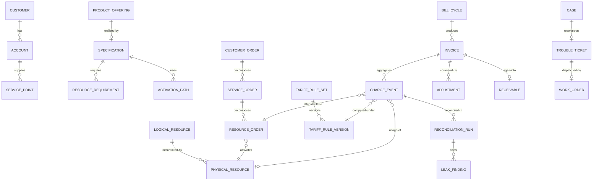

# 03 · Domain Model

> ⚠️ ASSUMPTION — bounded contexts, aggregates and invariants are pack design.
> No external standard is cited for this decomposition.

## Bounded contexts

| Context | Responsibility | Owns |
|---|---|---|
| **Party** | Who is the commercial counterparty | Customer, Party, Agreement, CustomerClass |
| **Commercial catalog** | The commercial truth: what is sold, at what price, to whom | ProductOffering, PricePlan, EligibilityRule |
| **Specification** | What an offering means **in resource terms** | Specification, ResourceRequirement, VerificationRule |
| **Technical catalog** | What must actually exist | LogicalResource, PhysicalResource, ActivationPath |
| **Numbering** | A finite, externally regulated resource | NumberRange, NumberAllocation, PortabilityCase |
| **Ordering** | The commitment chain CO → SO → RO | CustomerOrder, ServiceOrder, ResourceOrder, OrderEvent |
| **Rating** | Effective-dated governed arithmetic | TariffRuleSet, TariffRuleVersion, ChargeEvent |
| **Billing** | Invoices, adjustments, receivables | Invoice, BillCycle, Adjustment, Receivable |
| **Care** | 95598 cases tied to the service instance | Case, TroubleTicket, WorkOrder |
| **Reconciliation** | Two-way revenue integrity | ReconciliationRun, LeakFinding |

Rating is the context where the regulated-arithmetic property lives. It is
separate from Billing because a tariff change inside billing code is
indistinguishable from a bug fix in a release (BR-08).

## Core aggregates & invariants

### Specification (aggregate root)
```
Specification: id, productOfferingRef, resourceRequirements[], verificationRules
└── invariants
    • an offering cannot publish without an attached specification (FR-002)
    • it is a first-class object, not a mapping table in code (BR-03)
    • resolving it yields one or more resource realisations (FR-004)
    • it is the ONLY permitted join between the two catalogs (BR-03)
      — no other component may infer the relationship
```

### ProductOffering (aggregate root, commercial catalog)
```
ProductOffering: id, status, pricePlanRefs[], eligibilityRules[],
  specificationRef, customerClasses[]
└── invariants
    • prices and eligibility come from here, never from the technical side
      (BR-05)
    • changing them requires no change to the technical catalog (FR-003)
```

### LogicalResource / PhysicalResource (technical catalog)
```
LogicalResource: id, type, capacityModel
PhysicalResource: id, type, elementRef, state
ActivationPath: id, from, to, preconditions[], failureModes[]
└── invariants
    • never duplicated into the commercial catalog (BR-03)
    • a resource-only product (wholesale, interconnect, M2M SIM) has no
      commercial representation and does not acquire a fake one (BR-03)
```

### CustomerOrder / ServiceOrder / ResourceOrder (ordering)
```
CustomerOrder: id, partyRef, offeringRef, state
ServiceOrder:  id, customerOrderRef, serviceInstances[], state
ResourceOrder: id, serviceOrderRef, resources[], activationState
OrderEvent:    id, kind, ts, actor, payloadRef      # append-only
└── invariants
    • links exist in BOTH directions: RO→SO→CO and CO→SO→RO (BR-04, FR-005)
    • a partially completed RO set is a valid state; the remainder is
      cancelled explicitly, never by reversing completed steps (BR-07, FR-007)
    • every state change appends an OrderEvent; nothing is rewritten
    • commercial decisions never consult network state (BR-01)
```

### TariffRuleVersion (aggregate root, rating)
```
TariffRuleSet: id, purpose, versions[], activeVersion
TariffRuleVersion: id, effectiveFrom, effectiveTo?, effectiveDate,
  publishedBy, publishedTs, status (draft|published|superseded|retired)
ChargeEvent: id, kind, amount, currency, ts,
  tarRuleVersionRef, orderRef, inventoryRef   # IMMUTABLE
└── invariants
    • effective-dated: a cycle straddlingEffectiveFrom splits by evaluation,
      never by operator decision (BR-08, FR-009)
    • an emitted ChargeEvent cannot be updated or deleted (BR-09, FR-010)
      — corrections are new events (BR-10)
    • a rule change never restates an already-emitted event, and never makes
      an old one uninterpretable (BR-08)
    • the engine is governed separately from billing code (BR-08)
```

### Invoice (billing)
```
Invoice: id, accountRef, cycleRef, lines[], ruleVersionsUsed[], total
BillCycle: id, periodFrom, periodTo, closedTs
Adjustment: id, invoiceRef, amount, reason, approvedBy, approvedTs
Receivable: id, invoiceRef, dueTs, state
└── invariants
    • regenerable f(charge events, rule versions per event, adjustment
      events) — deterministic (BR-11, FR-014)
    • an adjustment is an approved act; the original invoice remains (BR-10)
```

### Case / TroubleTicket (care)
```
Case: id, partyRef, accountRef, meterRef, context{snapshot}, state
TroubleTicket: id, serviceInstanceRef, issue, workOrderRef
└── invariants
    • intake presents account, meter, reading history, payment and affecting
      outage in one view — no transfer required (BR-06, FR-018)
    • dispatch goes through the interface, never to a control surface (BR-02)
```

## Relationships (logical)



## The four aggregates that carry the pack's weight

| Aggregate | The invariant that matters most | What it prevents |
|---|---|---|
| **Specification** | the only permitted join between the two catalogs | the catalogs merging, which turns every pricing change into a network-engineering change |
| **CustomerOrder → ServiceOrder → ResourceOrder** | links in **both** directions | a chain that answers one question instead of three |
| **TariffRuleVersion** | effective-dated, and the charge stores the version | a rule change silently restating issued money |
| **ChargeEvent** | immutable, reconciled two-way | a suite that bills correctly and is blind to leakage |

> The first and the third are the ones most often implemented as configuration
> rather than invariants — and both are where this pack's regulated-arithmetic
> property either holds or quietly does not.