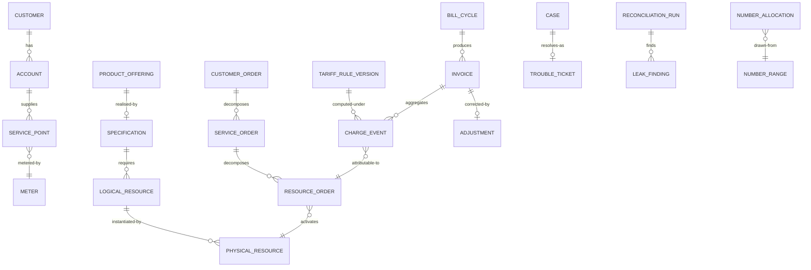

# 05 · Logical Data Model

> Logical model for the core entities. Physical modelling is a deployment
> concern; this file fixes the shape and the invariants.
>
> ⚠️ ASSUMPTION — the model is pack design.

## Entities

```
CUSTOMER (party)
  customer_id      PK
  party_type       natural | legal
  customer_class   residential | industrial | commercial | agricultural | large

ACCOUNT (party)                        -- BR-01/conventions: distinct lifecycle
  account_id       PK
  customer_id      FK → CUSTOMER
  billing_type, opened_ts, closed_ts?

SERVICE_POINT (party)
  service_point_id PK
  account_id       FK → ACCOUNT
  meter_id         FK → METER
  tariff_assignment_ref

PRODUCT_OFFERING (commercial catalog)     -- BR-05
  product_offering_id PK
  status             draft | published | retired
  specification_ref  FK → SPECIFICATION   -- NOT NULL once published (FR-002)
  price_plan_refs[]
  eligibility_rules[]

SPECIFICATION (the join)                 -- BR-03, ADR-0002
  specification_id  PK
  product_offering_id FK → PRODUCT_OFFERING
  resource_requirements[]
  verification_rules[]
  -- the ONLY permitted join between the catalogs

LOGICAL_RESOURCE (technical catalog)     -- BR-03
  logical_resource_id PK, type, capacity_model

PHYSICAL_RESOURCE (technical catalog)    -- BR-03
  physical_resource_id PK, type, element_ref, state

ACTIVATION_PATH (technical catalog)
  path_id PK, from_ref, to_ref, preconditions[], failure_modes[]

TARIFF_RULE_SET / TARIFF_RULE_VERSION (rating)   -- BR-08
  rule_set_id       PK
  rule_version_ref  PK
  effective_from    -- NOT NULL
  effective_to      -- nullable (open-ended current version)
  effective_date    -- the split boundary for cycles (FR-009)
  published_by, published_ts
  status            draft | published | superseded | retired

CHARGE_EVENT (rating)                    -- BR-09, ADR-0004
  charge_event_id  PK
  kind             usage | recurring | one-time | adjustment-source
  amount, currency, ts
  rule_version_ref FK → TARIFF_RULE_VERSION   -- NOT NULL (BR-08)
  order_ref        FK → RESOURCE_ORDER       -- NOT NULL (BR-12)
  inventory_ref    FK → PHYSICAL_RESOURCE  -- NOT NULL (BR-12, inventory side)
  -- APPEND-ONLY: no UPDATE or DELETE grant (BR-09)

CUSTOMER_ORDER / SERVICE_ORDER / RESOURCE_ORDER (ordering)   -- BR-04, ADR-0003
  customer_order_id PK
  service_order_id  PK, customer_order_id FK
  resource_order_id PK, service_order_id FK
  -- BOTH directions: RO→SO→CO links and CO→SO→RO links (FR-005)
  activation_state
  -- partial completion is a valid state; remainder cancelled explicitly (BR-07)

ORDER_EVENT (ordering)                    -- append-only
  order_event_id PK, any order ref, kind, ts, actor, payload_ref

INVOICE / BILL_CYCLE / ADJUSTMENT (billing)   -- BR-10, BR-11
  bill_cycle_id PK, period_from, period_to, closed_ts
  invoice_id    PK, account_ref, bill_cycle_ref, rule_versions_used[], total
  -- rule_versions_used[] NOT NULL: regeneration requires them (FR-014)
  adjustment_id PK, invoice_ref, amount, reason, approved_by, approved_ts

CASE / TROUBLE_TICKET / WORK_ORDER (care)  -- BR-06
  case_id PK, customer_ref, account_ref, meter_ref, context_snapshot_ref, state
  trouble_ticket_id PK, service_instance_ref, work_order_ref

NUMBER_RANGE / NUMBER_ALLOCATION (numbering)
  range_id PK, from, to, regulator_ref, purpose
  allocation_id PK, range_id, number, state (allocated|reserved|ported|released)
  -- single allocator; a release returns the number to the pool

RECONCILIATION_RUN / LEAK_FINDING (reconciliation)  -- BR-12
  run_id PK, direction (order-side | inventory-side), closed_ts
  finding_id PK, run_id, kind (usage-no-customer | activation-no-charge), opened_ts, owner?
```

## Keys and cardinalities



## Integrity constraints the model must enforce

| # | Constraint | Enforces |
|---|---|---|
| 1 | `PRODUCT_OFFERING.specification_ref` is NOT NULL once status is `published` | BR-03, FR-002 |
| 2 | `CHARGE_EVENT` has no UPDATE or DELETE grant | BR-09, NFR-001 |
| 3 | `CHARGE_EVENT.rule_version_ref` and `inventory_ref` are NOT NULL | BR-08, BR-12 |
| 4 | Order chain links exist in **both** directions for every RO | BR-04, NFR-002 |
| 5 | `INVOICE.rule_versions_used[]` is NOT NULL | BR-11, NFR-005 |
| 6 | A rule version's `effective_date` partitions every cycle: no charge event is emitted for a period under a version not effective in that period | BR-08, NFR-007 |
| 7 | `ADJUSTMENT.approved_by` is NOT NULL before it takes effect | BR-10 |
| 8 | `ORDER_EVENT` and charge events are append-only; corrections are new rows | BR-04, BR-09 |
| 9 | A disconnection cannot be recorded without a persisted guardrail evaluation record | BR-15, NFR-009 |
| 10 | An allocation is issued by the numbering allocator only, and `released` returns it to the pool | numbering integrity |

> Constraints 2, 3, 4, 5, 6 and 8 are **enforced in the store**, not in
> application code. A mutable charge event, a regenerable-less invoice or a
> mis-split cycle is a defect regardless of what application discipline
> promises — and each of those is a sev-1 signal in
> `04-architecture/observability.md`.