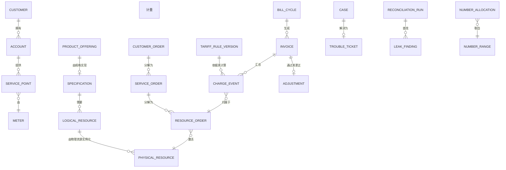

# 05 · 逻辑数据模型

> 核心实体的逻辑模型。物理建模属于部署层面的关注事项；本文件确定模型形态和不变量。
>
> ⚠️ ASSUMPTION — 该模型属于方案包设计。

## 实体

```
CUSTOMER (参与方)
  customer_id      PK
  party_type       natural | legal
  customer_class   residential | industrial | commercial | agricultural | large

ACCOUNT (参与方)                        -- BR-01/约定：生命周期彼此独立
  account_id       PK
  customer_id      FK → CUSTOMER
  billing_type, opened_ts, closed_ts?

SERVICE_POINT (参与方)
  service_point_id PK
  account_id       FK → ACCOUNT
  meter_id         FK → METER
  tariff_assignment_ref

PRODUCT_OFFERING (商业目录)     -- BR-05
  product_offering_id PK
  status             draft | published | retired
  specification_ref  FK → SPECIFICATION   -- 发布后为 NOT NULL (FR-002)
  price_plan_refs[]
  eligibility_rules[]

SPECIFICATION (连接对象)                 -- BR-03, ADR-0002
  specification_id  PK
  product_offering_id FK → PRODUCT_OFFERING
  resource_requirements[]
  verification_rules[]
  -- 两个目录之间唯一允许的连接

LOGICAL_RESOURCE (技术目录)     -- BR-03
  logical_resource_id PK, type, capacity_model

PHYSICAL_RESOURCE (技术目录)    -- BR-03
  physical_resource_id PK, type, element_ref, state

ACTIVATION_PATH (技术目录)
  path_id PK, from_ref, to_ref, preconditions[], failure_modes[]

TARIFF_RULE_SET / TARIFF_RULE_VERSION (计费)   -- BR-08
  rule_set_id       PK
  rule_version_ref  PK
  effective_from    -- NOT NULL
  effective_to      -- nullable (开放式当前版本)
  effective_date    -- 账期的划分边界 (FR-009)
  published_by, published_ts
  status            draft | published | superseded | retired

CHARGE_EVENT (计费)                    -- BR-09, ADR-0004
  charge_event_id  PK
  kind             usage | recurring | one-time | adjustment-source
  amount, currency, ts
  rule_version_ref FK → TARIFF_RULE_VERSION   -- NOT NULL (BR-08)
  order_ref        FK → RESOURCE_ORDER       -- NOT NULL (BR-12)
  inventory_ref    FK → PHYSICAL_RESOURCE  -- NOT NULL (BR-12, 库存侧)
  -- 仅追加：不授予 UPDATE 或 DELETE 权限 (BR-09)

CUSTOMER_ORDER / SERVICE_ORDER / RESOURCE_ORDER (订单)   -- BR-04, ADR-0003
  customer_order_id PK
  service_order_id  PK, customer_order_id FK
  resource_order_id PK, service_order_id FK
  -- 双向：RO→SO→CO 链接和 CO→SO→RO 链接 (FR-005)
  activation_state
  -- 部分完成是有效状态；其余部分须显式取消 (BR-07)

ORDER_EVENT (订单)                    -- 仅追加
  order_event_id PK, any order ref, kind, ts, actor, payload_ref

INVOICE / BILL_CYCLE / ADJUSTMENT (账单)   -- BR-10, BR-11
  bill_cycle_id PK, period_from, period_to, closed_ts
  invoice_id    PK, account_ref, bill_cycle_ref, rule_versions_used[], total
  -- rule_versions_used[] 为 NOT NULL：重算需要这些规则版本 (FR-014)
  adjustment_id PK, invoice_ref, amount, reason, approved_by, approved_ts

CASE / TROUBLE_TICKET / WORK_ORDER (客服)  -- BR-06
  case_id PK, customer_ref, account_ref, meter_ref, context_snapshot_ref, state
  trouble_ticket_id PK, service_instance_ref, work_order_ref

NUMBER_RANGE / NUMBER_ALLOCATION (号码管理)
  range_id PK, from, to, regulator_ref, purpose
  allocation_id PK, range_id, number, state (allocated|reserved|ported|released)
  -- 单一分配器；释放会将号码归还资源池

RECONCILIATION_RUN / LEAK_FINDING (对账)  -- BR-12
  run_id PK, direction (order-side | inventory-side), closed_ts
  finding_id PK, run_id, kind (usage-no-customer | activation-no-charge), opened_ts, owner?
```

## 键与基数



## 模型必须强制执行的完整性约束

| # | 约束 | 约束依据 |
|---|---|---|
| 1 | 一旦状态为 `published`，`PRODUCT_OFFERING.specification_ref` 必须为 NOT NULL | BR-03, FR-002 |
| 2 | `CHARGE_EVENT` 不授予 UPDATE 或 DELETE 权限 | BR-09, NFR-001 |
| 3 | `CHARGE_EVENT.rule_version_ref` 和 `inventory_ref` 必须为 NOT NULL | BR-08, BR-12 |
| 4 | 对每个 RO，订单链链接在**两个**方向均存在 | BR-04, NFR-002 |
| 5 | `INVOICE.rule_versions_used[]` 必须为 NOT NULL | BR-11, NFR-005 |
| 6 | 规则版本的 `effective_date` 划分每个账期：不得针对某一期间使用在该期间未生效的版本生成计费事件 | BR-08, NFR-007 |
| 7 | `ADJUSTMENT.approved_by` 在生效前必须为 NOT NULL | BR-10 |
| 8 | `ORDER_EVENT` 和计费事件均为仅追加；更正应创建新行 | BR-04, BR-09 |
| 9 | 未持久化防护措施评估记录，不得记录断开连接 | BR-15, NFR-009 |
| 10 | 号码分配只能由号码分配器签发，且 `released` 会将其归还资源池 | 号码完整性 |

> 约束 2、3、4、5、6 和 8 是**在存储层强制执行**的，而不是在应用程序代码中强制执行。可变的计费事件、缺少规则版本而无法重算的发票或划分错误的账期，无论应用规范作出何种承诺，均属于缺陷；上述每一种情况都是 `04-architecture/observability.md` 中的 sev-1 信号。