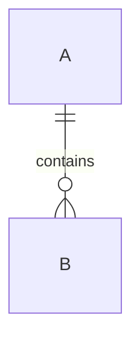

# 03 · Domain Model (template)

> TEMPLATE STUB — bounded contexts & invariants are pack design unless a
> cited standard supplies the vocabulary; say which (SOURCES §4).

## Bounded contexts

| Context | Responsibility | Owns |
|---|---|---|
| _Context A_ | _one-line responsibility_ | _entities…_ |

## Core aggregates & invariants

### _AggregateRoot_ (template)

```
Aggregate
├── identity: id, refs…
├── lifecycle: state (SM-xx)
└── invariants
    • invariant tied to BR-xx
```

## Relationships (logical)


