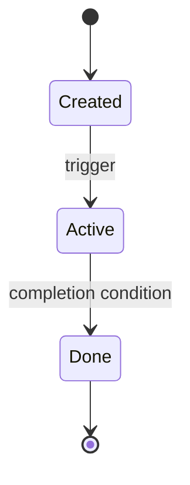

# 03 · State Machines (template)

> TEMPLATE STUB — SM-xx states/transitions are pack design unless derived
> from a cited source; say which (SOURCES §4).

## SM-1 _Lifecycle object_

_Guards: tie transitions to BR-xx / FR-xx IDs._
