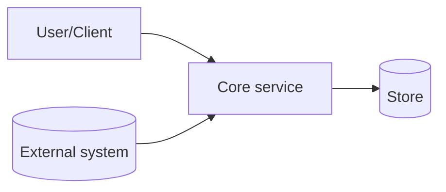

# 04 · Architecture Overview (template)

> TEMPLATE STUB — component & deployment views are pack design; ADRs carry
> the load-bearing decisions.

## Component view

## Key structural rules

- _One bullet per invariant that architecture must preserve, each linking
  its ADR / BR / FR ID._

## Deployment view (reference)

| Element | Notes |
|---|---|
| _service_ | _scaling / topology notes; `stack-agnostic` stance_ |
