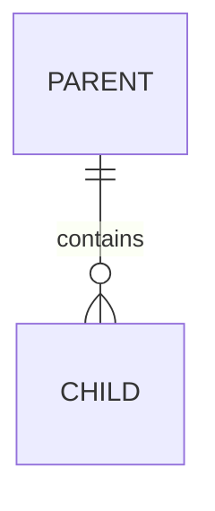

# 05 · Logical Data Model (template)

> TEMPLATE STUB — entities/keys/cardinalities are pack design; only borrowed
> standard vocabulary is normative (SOURCES §4).

## ER view (logical)

## Entity groups

| Entity | Key | Notable attributes |
|---|---|---|
| _entity_ | _pk_ | _notable fields, FKs, state refs_ |
